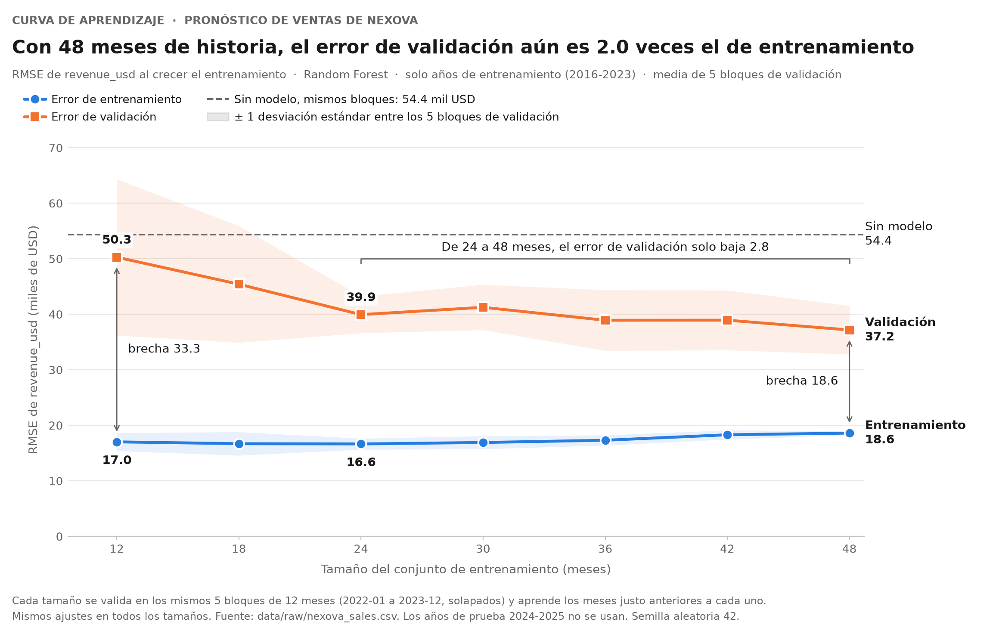

# Reporte técnico: evaluación del pronóstico de ventas de Nexova

_English version: [evaluation_report.md](./evaluation_report.md)._

Modelo evaluado: el Random Forest que pronostica `revenue_usd` de la línea de negocio `consolidated`, a un mes vista, antes de aprobar su paso a *staging*.
(Formato del programa: coma para miles y punto decimal.)

## Veredicto

**Clasificación: OVERFITTING (moderado).**

| Pregunta | Respuesta |
| --- | --- |
| ¿Underfitting, overfitting o bien ajustado? | **Overfitting moderado.** Falla en validación el doble que en entrenamiento (RMSE 39,141 frente a 19,055 USD). Aun así, de media es mejor que no usar modelo (52,353 USD). |
| ¿Es estable si cambia la porción de entrenamiento? | **Solo en parte.** La media aguanta, pero de un semestre a otro el error va de 26,210 a 49,851 USD, y en 2 de los 8 semestres el modelo pierde contra la regla sin modelo. |
| ¿Qué acción correctiva concreta? | **Reducir la profundidad de los árboles de 3 a 2.** Mejora poco (-1,868 USD en validación) y no resuelve el resto del error. |

## 1. Qué se ha medido

- **Datos:** [`data/raw/nexova_sales.csv`](../raw/nexova_sales.csv), **solo los años de entrenamiento (2016-2023)**. 2024-2025 no intervienen en el diagnóstico ni en la elección de la corrección.
- **Validación cruzada temporal anidada:** `TimeSeriesSplit` con 8 bloques de 6 meses (2020-2023), sin mezclar el orden. Los ajustes del bosque se vuelven a elegir en cada bloque usando solo su pasado.
- **Sin fugas:** en cada bloque se comprueba el orden cronológico, y las variables de rezago y de ventana móvil se recalculan con la serie cortada en la frontera. Salen idénticas.
- **A un mes vista:** dentro de un bloque, cada mes usa los ingresos reales de los meses anteriores a él, también los de su propio bloque. Es su pasado, y así se usaría el modelo cada mes. La variante estricta, sin ningún valor real posterior al corte, da un RMSE de 38,820 ± 10,523 USD: la conclusión no depende de esto. El escalado va dentro del modelo y se ajusta solo con las filas de entrenamiento.
- **Orden cronológico probado:** [`test_sales_cv_chronological_order.py`](../../tests/pipelines/test_sales_cv_chronological_order.py) comprueba que ningún índice de un fold posterior aparece antes que uno de un fold anterior (en los meses validados; el entrenamiento crece y reutiliza el pasado), y que falla si los datos se barajan.

### Las dos métricas, y por qué manda el RMSE

Se calculan **MAE y RMSE**, en entrenamiento y en validación (tabla de la sección 2). **La principal es el RMSE.** El briefing no da una función de coste, así que lo siguiente es nuestra lectura:

- **Lo más directo:** el briefing pide el **MSE**, y el RMSE es su raíz cuadrada, ya en USD.
- **Para el negocio pesa el fallo grande.** Al explicar por qué importa un Gini alto, el briefing dice que Laura necesita distinguir con confianza «entre un mes flojo (típico en agosto) y una caída anómala que merezca atención inmediata». Entendemos que un fallo grande del pronóstico es el que puede dar una falsa alarma o esconder una caída real, y el RMSE lo penaliza más que el MAE.
- **Se nota en los datos:** los 5 peores de los 48 meses validados son el **42 %** del error al cuadrado, pero solo el **25 %** del error absoluto. **Agosto** es donde más falla el modelo: RMSE de 58,358 USD frente a 40,060 en los 48 meses juntos (solo hay 4 agostos: es un indicio).
- **A favor del MAE:** se explica en una frase ("de media se falla en esta cantidad") y es más estable. Sería mejor si cada dólar de error costara lo mismo; el briefing no dice eso, ni lo contrario. Por eso se informa de los dos.
- **Lo principal no cambia:** con las dos el modelo mejora de media a la regla sin modelo. Una diferencia: pierde contra ella en 2 de los 8 bloques con RMSE y en 3 con MAE.

La justificación completa está en [`regression_eval/README.es.md`](./regression_eval/README.es.md).

## 2. Diagnóstico



| Meses de entrenamiento | RMSE entrenamiento | RMSE validación | Brecha |
| ---: | ---: | ---: | ---: |
| 12 | 17,022 | 50,276 | 33,253 |
| 24 | 16,643 | 39,933 | 23,290 |
| 36 | 17,309 | 38,919 | 21,610 |
| 48 | 18,600 | 37,169 | 18,569 |

### Cómo se lee la curva de aprendizaje

**Patrón de la curva: overfitting.**

- **Entrenamiento:** bajo y casi plano, entre 16,643 y 18,600 USD.
- **Validación:** muy por encima en todos los tamaños. Baja de 50,276 a 37,169 USD y se frena a partir de 24 meses.
- **Brecha:** se estrecha de 33,253 a 18,569 USD, pero **las dos curvas no llegan a juntarse**.

Con underfitting se juntarían en un error alto; con un buen ajuste, en un error bajo. Cada tamaño se valida en los mismos 5 bloques y aprende los meses justo anteriores a cada uno. No se usa `learning_curve` de scikit-learn porque, para los tamaños pequeños, toma los meses más antiguos de cada fold y deja un hueco entre lo aprendido y lo preguntado.

Validación cruzada, **media ± desviación estándar de los 8 bloques**:

| | RMSE (USD) | RMSE (% del mes medio) | MAE (USD) |
| --- | ---: | ---: | ---: |
| Entrenamiento | 19,055 ± 3,514 | 2.45 ± 0.44 % | 15,799 ± 2,736 |
| **Validación** | **39,141 ± 9,120** | **4.69 ± 1.27 %** | 33,262 ± 7,432 |
| Sin modelo (mismo mes del año anterior) | 52,353 ± 18,494 | 6.15 ± 2.02 % | 44,817 ± 17,949 |

**Por qué es overfitting**

1. **La brecha es amplia y persiste.** Se reduce al pasar de 12 a 48 meses, pero con 48 la validación sigue siendo 2.0 veces el entrenamiento. La mayor parte de la mejora de validación llega antes de los 24 meses: de 24 a 48 solo baja unos 2,800 USD, menos que la desviación entre bloques (de 3,310 a 5,463).
2. **Pasada la profundidad 2, más complejidad solo mejora el entrenamiento** (mismos 8 bloques; las demás opciones fijas):

   | Profundidad de los árboles | 1 | 2 | 3 (actual) | sin límite |
   | --- | ---: | ---: | ---: | ---: |
   | RMSE entrenamiento | 26,696 | 21,300 | 17,235 | 13,906 |
   | RMSE validación | 36,894 | 36,752 | 37,684 | 38,255 |

   Las diferencias de validación son pequeñas frente a la variación entre bloques; lo claro es que profundizar hunde el error de entrenamiento sin ganar nada fuera.
3. **El bosque aprende parte del azar.** La variación imprevisible de un mes se estima en **3.00-3.24 %**. El briefing da una referencia parecida: «El resto de los meses fluctúa de forma moderada (±5%) alrededor de la tendencia de crecimiento anual», que son 2.89 % si ese ±5 % se reparte por igual. En entrenamiento el bosque falla un **2.45 %** (error relativo). Por sí solo esto no prueba nada: todo ajuste queda por debajo en los datos que ha visto (nuestras dos estimaciones de 19 y 20 parámetros fallan 2.69-2.88 % en los suyos, que no son exactamente los mismos meses). El bosque queda aún más abajo, y eso concuerda con los puntos 1 y 2.

**Por qué no es underfitting:** las dos curvas no se juntan en un error alto. El entrenamiento es muy bajo y el modelo tiene capacidad de sobra: al darle más profundidad, ese error sigue bajando.

**Por qué no está bien ajustado:** para eso las dos curvas tendrían que acabar bajas **y cercanas**. No están cerca.

**Por qué es moderado:** de media el modelo gana a la regla sin modelo, la brecha se ha ido cerrando con más historia y, como muestra la sección 5, quitarle complejidad cambia poco la validación.

## 3. ¿Es estable?

| Qué cambia | Qué pasa con el error de validación (RMSE) |
| --- | --- |
| El semestre que se pronostica | Entre **26,210 y 49,851 USD** (2.95 % a 6.09 % del mes medio). La desviación es el 23 % de la media. |
| Aprender de todo el pasado o solo de los últimos 24 meses | 39,141 ± 9,120 frente a 41,312 ± 5,966. La ventana corta es algo peor de media y varía menos. |
| La cantidad de meses (curva) | Con 12 meses es inestable (50,276 ± 14,074). De 24 a 48 se queda entre 37,169 y 41,252. |
| Los ajustes elegidos en cada bloque | Cambian: profundidad 3 en 7 bloques y 5 en 1; también varían las otras dos opciones. |

Frente a la regla sin modelo, **pierde en 2 de los 8 bloques** (primer semestre de 2020 y segundo de 2022). Pronosticar el semestre entero sin ver ningún valor real posterior al corte da un resultado parecido: 38,820 ± 10,523.

**Conclusión:** el nivel medio del error es razonablemente estable a partir de 24 meses de historia; el error de un semestre concreto, no.

## 4. De dónde viene el error

Hay **dos fuentes distintas** y no se corrigen igual.

**A. La complejidad (la parte que es overfitting).** Es lo que muestran los puntos 2 y 3 de la sección 2: con profundidad 3 el bosque ajusta en entrenamiento detalles que no se repiten.

**B. Un solo mes como base.** El modelo calcula un cociente y lo multiplica por **un único mes**, el mismo del año anterior (`revenue_lag_12`). Hipótesis: el azar de ese mes se copia en el pronóstico. Si es así, el error tiene que moverse con lo raro que fue el mes de hace 12, **y no** con el de hace 11 o 13. Ese control podía haberla desmentido:

| Correlación del error de validación con lo raro que fue el mes de… | hace 11 | **hace 12** | hace 13 |
| --- | ---: | ---: | ---: |
| Estimación con un nivel por año | -0.17 | **+0.50** | -0.05 |
| Estimación con un ritmo de crecimiento por año | -0.07 | **+0.56** | +0.00 |

La hipótesis pasa el control: el azar del mes de hace 12 explica **entre una cuarta y una tercera parte** de la varianza del error relativo. Es una fuente real, **no la única**, y no es overfitting en sentido estricto: la regla sin modelo, que no aprende nada, usa ese mismo mes. Con profundidad 2 la relación sigue ahí (+0.47 y +0.52).

## 5. Acción correctiva

### Qué se probó

La lista y la regla se escribieron **antes** de medirlas: aceptar una candidata solo si (a) baja el RMSE medio de validación, (b) lo baja en 5 de los 8 bloques o más y (c) no ensancha la brecha. Mismos bloques y misma elección anidada. Se muestran todas.

| Candidata | RMSE entrenamiento | RMSE validación | Brecha | MAE validación | Cambio en validación (± error estándar) | Bloques que mejoran | ¿Cumple? |
| --- | ---: | ---: | ---: | ---: | ---: | ---: | --- |
| Modelo actual | 19,055 | 39,141 | 20,086 | 33,262 | | | |
| **Profundidad 2** | 22,132 | **37,272** | **15,141** | 30,455 | -1,868 ± 1,325 | 5 de 8 | **Sí** |
| Hojas de 6 meses o más | 24,051 | 39,268 | 15,217 | 32,256 | +128 ± 1,193 | 4 de 8 | No |
| Base con dos años en vez de uno | 21,587 | 42,988 | 21,401 | 34,473 | +3,848 ± 4,953 | 3 de 8 | No |

### Qué hacer

**En [`data/process/sales_model.py`](../process/sales_model.py), dentro de `PARAM_GRID`, cambiar las profundidades `(3, 5, None)` por `(2,)`.** `min_samples_leaf` y `max_features` se siguen eligiendo por validación temporal. Después:

1. Actualizar la prueba de `tests/pipelines/test_sales_forecast_model.py` que exige los 18 ajustes actuales (quedarían 6) y los documentos que dicen "profundidad 3".
2. Reentrenar con `scripts/train_sales_forecast.py`. Con las 72 filas de entrenamiento, la selección elige `max_depth=2, min_samples_leaf=2, max_features=1.0`.
3. Repetir esta evaluación. **Criterio para aceptar el cambio:** entrenamiento ≈ 22,132, validación ≈ 37,272 y brecha ≈ 15,141 USD (la semilla es fija). Si no salen, no se aplica.

**Por qué ataca la causa del overfitting:** la curva de complejidad muestra que pasada la profundidad 2 los árboles ganan detalle en entrenamiento que no les sirve fuera. Con 2, el error de entrenamiento relativo sube de 2.45 % a 2.86 %, ya cerca de la variación imprevisible estimada; la brecha baja un 25 % y la validación media no empeora, sino que mejora algo. Es además el orden correcto ante un overfitting: primero reducir complejidad, nunca añadirla.

### Cuánto esperar de ella (poco)

- La mejora es de **1,868 USD (5 %)**, con un error estándar de 1,325: con 8 bloques **no se distingue con seguridad del azar**.
- **El 68 % de la ganancia sale de un solo bloque.** Sin él, la media baja solo 687 USD.
- **No era una prueba a ciegas:** la curva de complejidad ya había mostrado cómo va la profundidad 2 en esos bloques. Y elegir entre candidatas mirando 2020-2023 hace la cifra algo optimista.
- **No cura el modelo:** la validación sigue siendo 1.7 veces el entrenamiento, sigue perdiendo en 2 de los 8 bloques y la fuente B sigue ahí.

Lo que sí está mejor apoyado es que la brecha se estrecha sin que la validación media empeore.

### Qué no hacer, y por qué

- **Más complejidad** (árboles más profundos, un modelo más grande): la curva muestra que solo mejora el entrenamiento.
- **Hojas más grandes:** estrechan la brecha únicamente porque empeora el entrenamiento; la validación no mejora. Estrechar la brecha no basta.
- **La base de dos años:** era el arreglo directo de la fuente B y **fracasó**. Usada sola es mejor que el mes de hace un año (42,582 frente a 52,353 USD), pero con el bosque encima empeora. Explicación posterior, compatible con los datos pero **no demostrada**: el briefing dice que el crecimiento anual «alterna» entre 1 % y 7 %, y la serie lo cumple. El mes de hace un año queda muy por debajo del real en los años de crecimiento alto (-6.9 % de media en 2021 y -6.5 % en 2023, frente a -1.2 % y -0.4 % en 2020 y 2022): un desvío que alterna y que el bosque puede aprender. La base de dos años lo reduce (entre -1.6 % y +2.2 %), pero varía más *dentro* de cada año (4.91 % frente a 4.32 %), que es lo difícil de corregir. No se han probado más bases hasta dar con una buena: eso sería ajustar a 2020-2023.
- **Presentar "más datos" como la solución:** la historia ayuda (la brecha pasa de 33,253 a 18,569), pero de 24 a 48 meses la validación casi no se mueve y solo llega un mes nuevo cada mes. Conviene incorporarlos, sin contar con que cierren pronto la brecha.

## 6. Recomendación para *staging*

Es una recomendación; la decisión es de quien aprueba el paso.

- **Pasar a *staging* con la corrección aplicada y con vigilancia**, no como cifra fiable para comprometer presupuesto por sí sola.
- Cada mes, comparar el pronóstico y la regla sin modelo contra el ingreso real. Cada 6 meses nuevos, repetir la evaluación. **Revisar el modelo** si en un semestre su RMSE supera 49,857 USD (el peor medido con profundidad 2) o si pierde contra la regla sin modelo.
- **Para Laura:** una diferencia del tamaño del error habitual (RMSE de unos 39,000 USD; unos 58,000 en agosto con el modelo actual, medido en solo 4 agostos) **no basta por sí sola** para hablar de una caída anómala.
- Los años 2024-2025 ya se usaron una vez para informar del modelo actual. Si se vuelven a calcular con la corrección, se pueden informar, pero no sirven como examen limpio ni para decidir. La confirmación limpia son los meses desde 2026-01.

## 7. Límites

- Son 8 bloques y 48 meses validados, que además no son muestras totalmente independientes.
- La curva de aprendizaje usa ajustes fijos elegidos con esos mismos años, así que es algo optimista; la cifra de referencia es la validación anidada (39,141 USD). Sus 5 bloques de validación se solapan, y su desviación subestima la incertidumbre.
- La variación imprevisible es una **estimación** hecha con un modelo sobre todos los años de entrenamiento, incluidos los validados. No es una cifra conocida.
- El briefing indica que el dataset es generado (semilla fija): las conclusiones son sobre esta serie.
- El briefing no dice si cuesta más pronosticar de más o de menos; no se ha inventado una métrica asimétrica.

## 8. Cómo reproducirlo

```bash
uv run python scripts/evaluate_sales_model.py     # unos 10 minutos
uv run pytest tests/pipelines/test_sales_cv_chronological_order.py     # orden cronológico de los folds
uv run pytest tests/pipelines/test_sales_diagnosis.py tests/pipelines/test_sales_evaluation_report.py
```

Cifras completas: [`regression_eval/diagnosis.json`](./regression_eval/diagnosis.json) (secciones 2 y 3) y [`regression_eval/root_cause.json`](./regression_eval/root_cause.json) (secciones 4 y 5). Código: [`sales_diagnosis.py`](../process/sales_diagnosis.py) y [`sales_root_cause.py`](../process/sales_root_cause.py). Otras gráficas: [`diagnosis_curves.es.png`](./regression_eval/diagnosis_curves.es.png).
