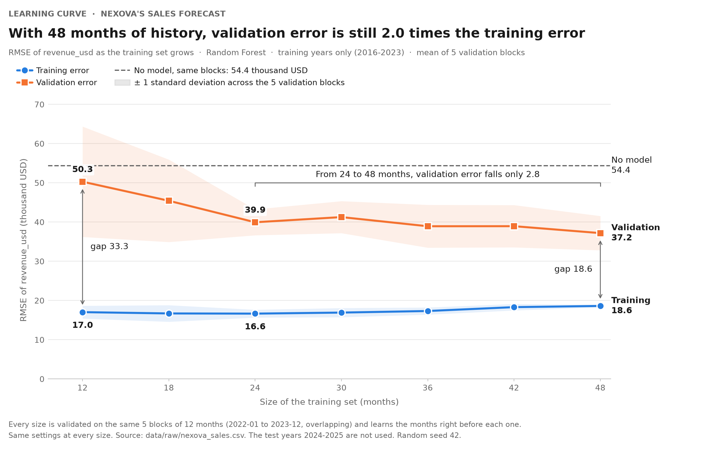

# Technical report: evaluation of Nexova's sales forecast

_Versión en español: [evaluation_report.es.md](./evaluation_report.es.md)._

Evaluated model: the Random Forest that forecasts `revenue_usd` of the `consolidated` business line, one month ahead, before it is approved for staging.

## Verdict

**Classification: OVERFITTING (moderate).**

| Question | Answer |
| --- | --- |
| Underfitting, overfitting or reasonably well fitted? | **Moderate overfitting.** It misses twice as much on validation as on training (RMSE 39,141 against 19,055 USD). Even so, on average it is better than using no model (52,353 USD). |
| Is it stable if the training portion changes? | **Only partly.** The average holds, but from one half-year to another the error goes from 26,210 to 49,851 USD, and in 2 of the 8 half-years the model loses to the no-model rule. |
| Which specific corrective action? | **Reduce the depth of the trees from 3 to 2.** It improves little (-1,868 USD on validation) and does not solve the rest of the error. |

## 1. What was measured

- **Data:** [`data/raw/nexova_sales.csv`](../raw/nexova_sales.csv), **training years only (2016-2023)**. 2024-2025 take no part in the diagnosis or in the choice of the correction.
- **Nested time-series cross-validation:** `TimeSeriesSplit` with 8 folds of 6 months (2020-2023), never shuffled. The settings of the forest are chosen again in each fold with its past only.
- **No leakage:** in every fold the chronological order is checked, and the lag and rolling features are computed again from the series cut at the boundary. They come out identical.
- **One month ahead:** inside a block, each month uses the real revenue of the months before it, also those of its own block. That is its past, and it is how the model would be used every month. The strict variant, with no real value after the cut, gives an RMSE of 38,820 ± 10,523 USD: the conclusion does not depend on this. The scaler is inside the model and is fitted on the training rows only.
- **Chronological order tested:** [`test_sales_cv_chronological_order.py`](../../tests/pipelines/test_sales_cv_chronological_order.py) checks that no index of a later fold appears before one of an earlier fold (for the validated months; training grows and reuses the past), and that it fails if the data are shuffled.

### The two metrics, and why RMSE leads

**MAE and RMSE** are both computed, on training and on validation (table in section 2). **The main one is RMSE.** The briefing gives no cost function, so what follows is our reading:

- **Most directly:** the briefing asks for the **MSE**, and RMSE is its square root, back in USD.
- **For the business the big miss weighs most.** In explaining why a high Gini matters, the briefing says Laura must tell with confidence «entre un mes flojo (típico en agosto) y una caída anómala que merezca atención inmediata» (a weak month, typical of August, from an abnormal fall that deserves immediate attention). Our understanding is that a big miss of the forecast is what can raise a false alarm or hide a real fall, and RMSE penalises it more than MAE does.
- **It shows in the data:** the 5 worst of the 48 validated months are **42 %** of the squared error, but only **25 %** of the absolute error. **August** is where the model misses most: RMSE 58,358 USD against 40,060 on the 48 months together (there are only 4 Augusts: an indication).
- **In favour of MAE:** it is explained in one sentence ("on average the miss is this much") and it is steadier. It would be better if every dollar of error cost the same; the briefing says neither that nor the opposite. That is why both are reported.
- **What matters does not change:** with both, the model is better on average than the no-model rule. One difference: it loses to it in 2 of the 8 folds with RMSE and in 3 with MAE.

The full justification is in [`regression_eval/README.md`](./regression_eval/README.md).

## 2. Diagnosis



| Training months | Training RMSE | Validation RMSE | Gap |
| ---: | ---: | ---: | ---: |
| 12 | 17,022 | 50,276 | 33,253 |
| 24 | 16,643 | 39,933 | 23,290 |
| 36 | 17,309 | 38,919 | 21,610 |
| 48 | 18,600 | 37,169 | 18,569 |

### How the learning curve reads

**Pattern of the curve: overfitting.**

- **Training:** low and almost flat, between 16,643 and 18,600 USD.
- **Validation:** far above it at every size. It falls from 50,276 to 37,169 USD and slows down from 24 months on.
- **Gap:** it narrows from 33,253 to 18,569 USD, but **the two curves never meet**.

With underfitting they would meet at a high error; with a good fit, at a low one. Every size is validated on the same 5 blocks and learns the months right before each one. scikit-learn's `learning_curve` is not used because, for the small sizes, it takes the oldest months of each fold and leaves a hole between what is learnt and what is asked.

Cross-validation, **mean ± standard deviation across the 8 folds**:

| | RMSE (USD) | RMSE (% of mean month) | MAE (USD) |
| --- | ---: | ---: | ---: |
| Training | 19,055 ± 3,514 | 2.45 ± 0.44 % | 15,799 ± 2,736 |
| **Validation** | **39,141 ± 9,120** | **4.69 ± 1.27 %** | 33,262 ± 7,432 |
| No model (same month a year before) | 52,353 ± 18,494 | 6.15 ± 2.02 % | 44,817 ± 17,949 |

**Why it is overfitting**

1. **The gap is wide and persists.** It narrows from 12 to 48 months, but at 48 the validation error is still 2.0 times the training one. Most of the validation improvement comes before 24 months: from 24 to 48 it only falls about 2,800 USD, less than the deviation between blocks (3,310 to 5,463).
2. **Past depth 2, more complexity only improves training** (same 8 folds; other settings fixed):

   | Depth of the trees | 1 | 2 | 3 (current) | no limit |
   | --- | ---: | ---: | ---: | ---: |
   | Training RMSE | 26,696 | 21,300 | 17,235 | 13,906 |
   | Validation RMSE | 36,894 | 36,752 | 37,684 | 38,255 |

   The validation differences are small against the variation between folds; what is clear is that going deeper sinks the training error and gains nothing outside it.
3. **The forest learns part of the chance.** The unpredictable variation of a month is estimated at **3.00-3.24 %**. The briefing gives a similar reference: «El resto de los meses fluctúa de forma moderada (±5%) alrededor de la tendencia de crecimiento anual» (the other months move ±5% around the yearly growth trend), which is 2.89 % if that ±5 % is evenly spread. On training the forest misses **2.45 %** (relative error). On its own this proves nothing: any fit falls below on the data it has seen (our two estimates, of 19 and 20 parameters, miss 2.69-2.88 % on theirs, which are not exactly the same months). The forest falls lower still, and that agrees with points 1 and 2.

**Why it is not underfitting:** the two curves do not meet at a high error. The training error is very low and the model has capacity to spare: given more depth, that error keeps falling.

**Why it is not well fitted:** for that the two curves would have to end low **and close**. They are not close.

**Why "moderate":** on average the model beats the no-model rule, the gap has been closing with more history and, as section 5 shows, taking complexity away changes validation little.

## 3. Is it stable?

| What changes | What happens to the validation error (RMSE) |
| --- | --- |
| The half-year forecast | Between **26,210 and 49,851 USD** (2.95 % to 6.09 % of the mean month). The deviation is 23 % of the mean. |
| Learning from all the past or from the last 24 months only | 39,141 ± 9,120 against 41,312 ± 5,966. The short window is somewhat worse on average and varies less. |
| The number of months (curve) | With 12 months it is unstable (50,276 ± 14,074). From 24 to 48 it stays between 37,169 and 41,252. |
| The settings chosen in each fold | They change: depth 3 in 7 folds and 5 in 1; the other two settings vary too. |

Against the no-model rule, **it loses in 2 of the 8 folds** (first half of 2020 and second half of 2022). Forecasting the whole half-year without any real value after the cut gives a similar result: 38,820 ± 10,523.

**Conclusion:** the average level of the error is reasonably stable from 24 months of history on; the error of a given half-year is not.

## 4. Where the error comes from

There are **two different sources**, and they are not corrected the same way.

**A. Complexity (the part that is overfitting).** It is what points 2 and 3 of section 2 show: at depth 3 the forest fits, on training, details that do not repeat.

**B. A single month as the base.** The model works out a ratio and multiplies it by **one single month**, the same one a year before (`revenue_lag_12`). Hypothesis: the chance variation of that month is copied into the forecast. If so, the error must move with how unusual the month 12 before was, **and not** with the month 11 or 13 before. That control could have refuted it:

| Correlation of the validation error with how unusual was the month… | 11 before | **12 before** | 13 before |
| --- | ---: | ---: | ---: |
| Estimate with one level per year | -0.17 | **+0.50** | -0.05 |
| Estimate with one growth rate per year | -0.07 | **+0.56** | +0.00 |

The hypothesis passes the control: the chance variation of the month 12 before explains **between a quarter and a third** of the variance of the relative error. It is a real source, **not the only one**, and it is not overfitting in the strict sense: the no-model rule, which learns nothing, uses that same month. At depth 2 the relation is still there (+0.47 and +0.52).

## 5. Corrective action

### What was tried

The list and the rule were written **before** measuring them: accept a candidate only if (a) it lowers the mean validation RMSE, (b) it lowers it in 5 of the 8 folds or more and (c) it does not widen the gap. Same folds and same nested choice. All are shown.

| Candidate | Training RMSE | Validation RMSE | Gap | Validation MAE | Change on validation (± standard error) | Folds improved | Meets the rule? |
| --- | ---: | ---: | ---: | ---: | ---: | ---: | --- |
| Current model | 19,055 | 39,141 | 20,086 | 33,262 | | | |
| **Depth 2** | 22,132 | **37,272** | **15,141** | 30,455 | -1,868 ± 1,325 | 5 of 8 | **Yes** |
| Leaves of 6 months or more | 24,051 | 39,268 | 15,217 | 32,256 | +128 ± 1,193 | 4 of 8 | No |
| Base of two years instead of one | 21,587 | 42,988 | 21,401 | 34,473 | +3,848 ± 4,953 | 3 of 8 | No |

### What to do

**In [`data/process/sales_model.py`](../process/sales_model.py), inside `PARAM_GRID`, change the depths `(3, 5, None)` to `(2,)`.** `min_samples_leaf` and `max_features` are still chosen by time validation. Then:

1. Update the test in `tests/pipelines/test_sales_forecast_model.py` that requires the current 18 settings (there would be 6) and the documents that say "depth 3".
2. Retrain with `scripts/train_sales_forecast.py`. With the 72 training rows the selection picks `max_depth=2, min_samples_leaf=2, max_features=1.0`.
3. Run this evaluation again. **Criterion to accept the change:** training ≈ 22,132, validation ≈ 37,272 and gap ≈ 15,141 USD (the seed is fixed). If they do not come out, it is not applied.

**Why it attacks the cause of the overfitting:** the complexity curve shows that past depth 2 the trees gain detail on training that does not serve them outside it. At 2, the relative training error rises from 2.45 % to 2.86 %, now near the estimated unpredictable variation; the gap falls 25 % and the mean validation error does not get worse but improves a little. It is also the right order against overfitting: reduce complexity first, never add it.

### How much to expect from it (little)

- The improvement is **1,868 USD (5 %)**, with a standard error of 1,325: with 8 folds it **cannot be safely told from chance**.
- **68 % of the gain comes from a single fold.** Without it, the mean falls only 687 USD.
- **It was not a blind test:** the complexity curve had already shown how depth 2 does on those folds. And choosing between candidates by looking at 2020-2023 makes the figure somewhat optimistic.
- **It does not cure the model:** validation is still 1.7 times training, it still loses in 2 of the 8 folds and source B is still there.

What is better supported is that the gap narrows without the mean validation error getting worse.

### What not to do, and why

- **More complexity** (deeper trees, a bigger model): the curve shows that it only improves training.
- **Bigger leaves:** they narrow the gap only because training gets worse; validation does not improve. Narrowing the gap is not enough.
- **The base of two years:** it was the direct fix for source B and it **failed**. On its own it is better than the month a year before (42,582 against 52,353 USD), but with the forest on top it gets worse. An explanation found afterwards, consistent with the data but **not proven**: the briefing says the yearly growth alternates («alterna») between 1% and 7%, and the series does. The month a year before falls far short of the real one in the high-growth years (-6.9 % on average in 2021 and -6.5 % in 2023, against -1.2 % and -0.4 % in 2020 and 2022): a shift that alternates and that the forest can learn. The base of two years reduces it (between -1.6 % and +2.2 %), but varies more *within* each year (4.91 % against 4.32 %), which is the part that is hard to correct. No further bases were tried until a good one turned up: that would be fitting to 2020-2023.
- **Presenting "more data" as the solution:** history helps (the gap goes from 33,253 to 18,569), but from 24 to 48 months validation hardly moves, and only one new month arrives each month. New months should be added, without counting on them to close the gap soon.

## 6. Recommendation for staging

This is a recommendation; the decision belongs to whoever approves the step.

- **Move to staging with the correction applied and under watch**, not as a figure reliable enough to commit budget on its own.
- Every month, compare the forecast and the no-model rule against the real revenue. Every 6 new months, run the evaluation again. **Review the model** if in a half-year its RMSE goes above 49,857 USD (the worst measured at depth 2) or if it loses to the no-model rule.
- **For Laura:** a difference the size of the usual error (RMSE of about 39,000 USD; about 58,000 in August with the current model, measured on only 4 Augusts) is **not enough on its own** to call it an abnormal fall.
- The years 2024-2025 have already been used once to report on the current model. If they are computed again with the correction, they can be reported, but they are not a clean exam and cannot be used to decide. The clean confirmation is the months from 2026-01 on.

## 7. Limits

- There are 8 folds and 48 validated months, which are not fully independent samples either.
- The learning curve uses fixed settings chosen on those same years, so it is somewhat optimistic; the reference figure is the nested validation (39,141 USD). Its 5 validation blocks overlap, and their deviation understates the uncertainty.
- The unpredictable variation is an **estimate** made with a model on all the training years, the validated ones included. It is not a known figure.
- The briefing says the dataset is generated (fixed seed): the conclusions are about this series.
- The briefing does not say whether forecasting too much or too little costs more; no asymmetric metric has been made up.

## 8. How to reproduce it

```bash
uv run python scripts/evaluate_sales_model.py     # about 10 minutes
uv run pytest tests/pipelines/test_sales_cv_chronological_order.py     # chronological order of the folds
uv run pytest tests/pipelines/test_sales_diagnosis.py tests/pipelines/test_sales_evaluation_report.py
```

All the figures: [`regression_eval/diagnosis.json`](./regression_eval/diagnosis.json) (sections 2 and 3) and [`regression_eval/root_cause.json`](./regression_eval/root_cause.json) (sections 4 and 5). Code: [`sales_diagnosis.py`](../process/sales_diagnosis.py) and [`sales_root_cause.py`](../process/sales_root_cause.py). More charts: [`diagnosis_curves.png`](./regression_eval/diagnosis_curves.png).
