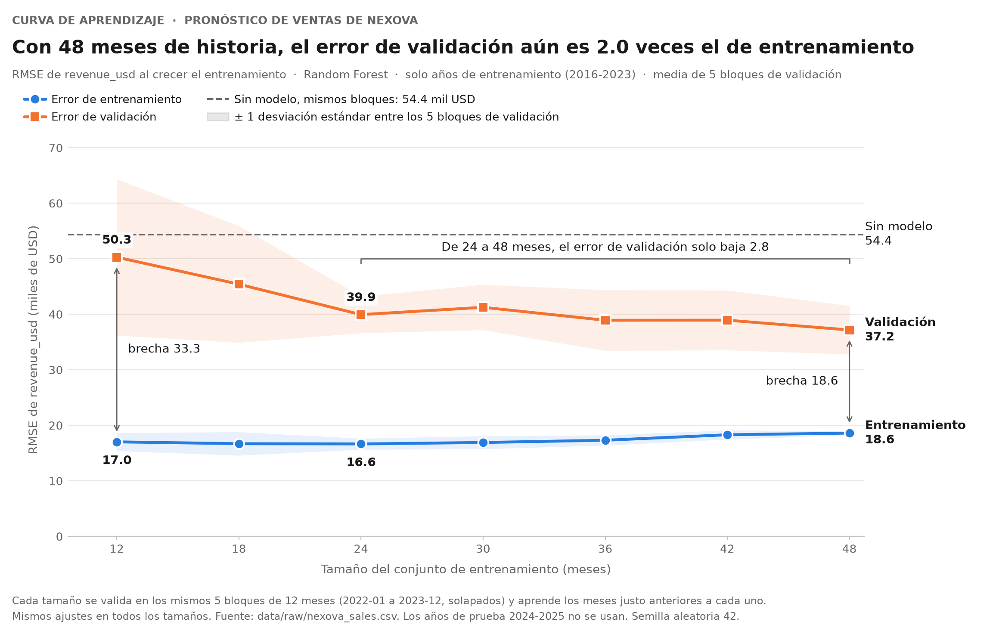

# Evaluación formal del pronóstico de ventas de Nexova

_English version: [README.md](./README.md)._

Evaluación del Random Forest que pronostica `revenue_usd` de la línea de negocio `consolidated` ([`data/raw/nexova_sales.csv`](../../raw/nexova_sales.csv)), antes de aprobar su paso a *staging*.
**Solo se usan los años de entrenamiento (2016-2023)**; 2024-2025 no intervienen.

## En resumen

**Diagnóstico: overfitting moderado.**

| Pregunta | Respuesta |
| --- | --- |
| ¿Cómo está ajustado? | **Overfitting moderado:** el RMSE de validación (39,141 USD) duplica al de entrenamiento (19,055 USD). De media mejora a la regla sin modelo (52,353 USD). |
| ¿Es estable? | **Solo en parte:** de un semestre a otro el error va de 26,210 a 49,851 USD, y en 2 de 8 la regla sin modelo falla menos. |
| ¿Qué corregir? | **Profundidad máxima de los árboles de 3 a 2.** Mejora modesta (-1,868 USD en validación) que no se distingue con seguridad del azar. **Propuesta, no aplicada.** |

📄 **Documento principal:** el [reporte técnico](../evaluation_report.es.md), con la evidencia, las correcciones probadas, la recomendación y los límites.



(Formato de las cifras, el del programa: coma para miles y punto decimal.)

## Archivos del proyecto

| Archivo | Qué es |
| --- | --- |
| [`evaluation_report.es.md`](../evaluation_report.es.md) | Reporte técnico |
| [`learning_curve.es.png`](../learning_curve.es.png) | Curva de aprendizaje |
| [`diagnosis_curves.es.png`](./diagnosis_curves.es.png) | Más historia, árboles más profundos y el error bloque a bloque |
| [`diagnosis.json`](./diagnosis.json) | Cifras de la validación cruzada y de las curvas |
| [`root_cause.json`](./root_cause.json) | Origen del error y correcciones probadas |
| [`sales_diagnosis.py`](../../process/sales_diagnosis.py) | Validación cruzada, curvas y comprobaciones de fugas |
| [`sales_root_cause.py`](../../process/sales_root_cause.py) | Origen del error y correcciones |
| [`sales_diagnosis_plot.py`](../../process/sales_diagnosis_plot.py) | Gráficas |
| [`evaluate_sales_model.py`](../../../scripts/evaluate_sales_model.py) | Ejecuta toda la evaluación |
| [`test_sales_cv_chronological_order.py`](../../../tests/pipelines/test_sales_cv_chronological_order.py) | Orden cronológico de cada fold |
| [`test_sales_diagnosis.py`](../../../tests/pipelines/test_sales_diagnosis.py) | Pruebas de la validación, las curvas, las métricas y las gráficas |
| [`test_sales_evaluation_report.py`](../../../tests/pipelines/test_sales_evaluation_report.py) | Compara el reporte y este resumen con los resultados guardados |
| [`sales-cv-chronological-order.yml`](../../../.github/workflows/sales-cv-chronological-order.yml) | CI: ejecuta la prueba del orden cronológico en cada Pull Request hacia `main` |

## Cómo ejecutarlo

Desde la raíz del repositorio, con [`uv`](https://docs.astral.sh/uv/):

```bash
uv sync --frozen                                                       # instala las versiones de uv.lock
uv run pytest tests/pipelines/test_sales_cv_chronological_order.py -v  # orden cronológico (la prueba del CI), menos de un minuto
uv run python scripts/evaluate_sales_model.py                          # unos 10 minutos: vuelve a escribir las cifras y las gráficas
uv run pytest tests/pipelines/test_sales_diagnosis.py tests/pipelines/test_sales_evaluation_report.py  # varios minutos
```

Para una prueba sin tocar los archivos del repositorio: `uv run python scripts/evaluate_sales_model.py --output /tmp/evaluacion`.

## Métricas: MAE y RMSE, en entrenamiento y en validación

Validación cruzada temporal anidada: `TimeSeriesSplit` con 8 bloques de 6 meses (2020-2023), un mes por delante. **Media ± desviación estándar de los 8 bloques.**
El porcentaje es sobre el ingreso mensual medio de los meses medidos, como pide el [briefing](../../../BRIEFING_NEXOVA_SALES.md), para leerlo sin traducción y comparar bloques de años distintos. (Formato del programa: coma para miles y punto decimal.)

| | RMSE (USD) | RMSE (% del mes medio) | MAE (USD) | MAE (% del mes medio) |
| --- | ---: | ---: | ---: | ---: |
| Entrenamiento | 19,055 ± 3,514 | 2.45 ± 0.44 % | 15,799 ± 2,736 | 2.03 ± 0.34 % |
| **Validación** | **39,141 ± 9,120** | **4.69 ± 1.27 %** | 33,262 ± 7,432 | 3.98 ± 1.01 % |
| Sin modelo (mismo mes del año anterior) | 52,353 ± 18,494 | 6.15 ± 2.02 % | 44,817 ± 17,949 | 5.26 ± 1.96 % |
| Brecha validación − entrenamiento | 20,086 | | 17,463 | |

Cada bloque, con las dos métricas en entrenamiento y validación, está en [`diagnosis.json`](./diagnosis.json) y en la salida del script. La [curva de aprendizaje](../learning_curve.es.png) usa la métrica elegida.

## Cuál refleja mejor lo que un error le cuesta a Nexova: **RMSE**

**Lo que dice el briefing, y lo que no.** No da una función de coste, ni dice si cuesta más pronosticar de más o de menos. Dice esto:

> «Un **Gini** alto es especialmente importante para Nexova: Laura necesita distinguir con confianza entre un mes flojo (típico en agosto) y una caída anómala que merezca atención inmediata.» (sección 3)

> «Laura (CEO) necesita saber si el equipo puede predecir los ingresos de los próximos meses antes de comprometer presupuesto en un dashboard ejecutivo completo. El negocio de Nexova (…) tiene ciclos de contratación muy marcados por el calendario laboral en España y en Miami, algo que Javier (Operaciones) y Marcos (Ventas) sienten en carne propia cada agosto y cada enero.» (sección 1)

> «El **MSE** repórtalo en USD² y también como porcentaje del ingreso mensual promedio, para que Marcos y Laura puedan interpretarlo sin traducción adicional.» (sección 3)

**Ojo con la primera:** el briefing la escribe para explicar por qué importa un **Gini** alto (que el pronóstico ordene bien los meses de menor a mayor), no para elegir entre MAE y RMSE. De ella tomamos solo la necesidad de Laura. El apoyo más directo de la elección es la tercera: el briefing pide el MSE, y el RMSE es su raíz (punto 3).

**La elección es nuestra lectura de esas frases**, no algo que el briefing afirme:

1. **El error que importa es el grande.** Para separar un agosto flojo normal de una caída anómala, el pronóstico es la vara de medir. Como ejemplo nuestro (las cifras no vienen del briefing): un fallo de 15,000 USD apenas cambia cómo se lee un mes, mientras que uno de 90,000 USD puede hacer saltar una falsa alarma o esconder una caída real. El RMSE eleva los errores al cuadrado, así que un fallo grande pesa mucho más que varios pequeños; en el MAE todos los dólares pesan igual.
   Medido en los 48 meses validados, **los 5 peores meses (10 % de ellos) son el 42 % del error al cuadrado**, pero solo el **25 % del error absoluto**.
2. **Los errores grandes están donde mira el briefing.** En **agosto** el modelo tiene sus mayores errores: RMSE 58,358 USD frente a 40,060 en los 48 meses (MAE: 45,621 frente a 33,262). Enero y febrero son los más fáciles (RMSE 22,834). Solo hay **4 agostos** validados: es un indicio, no una medida precisa.
3. **Es coherente con lo que el briefing ya pide y con el modelo.** El RMSE es la raíz cuadrada del **MSE** que el briefing pide: ordena los pronósticos igual y vuelve a estar en USD. Se da también como porcentaje del ingreso mensual medio para Marcos y Laura. Y los ajustes del modelo ya se eligen por RMSE.

**Lo que está a favor del MAE, y por eso se informa de los dos.** Se explica en una frase ("de media, el pronóstico falla en 33,262 USD"). Sería la mejor medida del coste **si cada dólar de error costara lo mismo**, ocurra en un fallo grande o en muchos pequeños; el briefing no dice eso, ni lo contrario. Además es más estable: con solo 48 meses, que 5 de ellos pesen un 42 % significa que un mes raro puede mover mucho el RMSE.

**¿Cambia la conclusión?** En lo principal, no: con las dos métricas el modelo es mejor de media que no usar modelo, entrenar con todo el pasado es mejor que con los últimos 24 meses, y la profundidad de los árboles con menor error de validación es 2. Una diferencia: el modelo pierde contra la regla sin modelo en **2 de los 8 bloques** con RMSE (el 1 y el 6) y en **3** con MAE (el 1, el 5 y el 6).

**Lo que ninguna de las dos dice: la dirección.** Ni el MAE ni el RMSE distinguen un pronóstico alto de uno bajo. En los 48 meses validados el modelo pronosticó **de más en 25** (35,676 USD de media) y **de menos en 23** (30,639 USD), con un error medio de +3,900 USD. Como el briefing no dice qué dirección cuesta más, **no se ha inventado una métrica asimétrica**: el sesgo se informa junto al RMSE. Si Nexova dijera que una dirección es más cara, habría que ponderar los errores de forma distinta.
