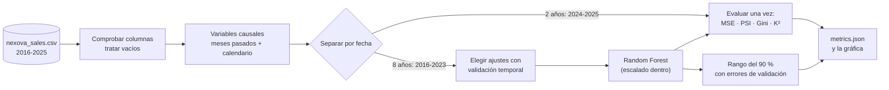
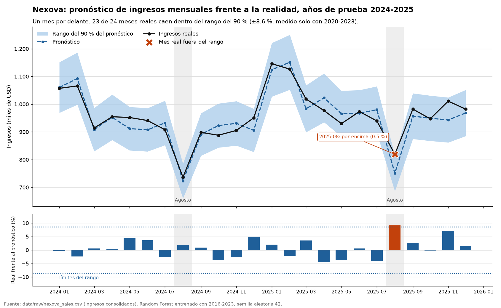

# Pronóstico de ventas — evaluación

_English version: [README.md](./README.md)._

Cómo de bueno es el pronóstico de los ingresos mensuales de Nexova en los **dos años de prueba (2024-2025)**, que no intervinieron ni en la elección ni en el entrenamiento del modelo.

## Resumen para la dirección

**La pregunta (del briefing):** ¿se pueden prever los ingresos de los próximos meses antes de comprometer presupuesto en un dashboard ejecutivo completo?

**La respuesta, en dos años con los que el modelo no se entrenó (2024-2025):**

| | Pronóstico | Repetir el año anterior (sin modelo) |
| --- | ---: | ---: |
| Fallo medio de un mes, un mes por delante | **2.85 %** | 4.98 % |
| Meses reales dentro del rango del pronóstico (±8.6 %, objetivo 90 %) | **23 de 24** | no se da |

* Pronosticando los dos años de golpe desde finales de 2023, el fallo medio es del 3.09 % (para este caso no se da rango).
* **Agosto es el mes más débil:** el fallo medio es del 5.1 % y el pronóstico se quedó corto las dos veces (solo hay dos agostos para juzgarlo).
* **Cómo usarlo:** comparar cada mes real con su rango. **Por debajo** del rango hay una caída que ni la temporada ni la tendencia explican, y merece revisarse.

**Recomendación (criterio de quien lo construyó, no un resultado de los datos):** es suficiente para apoyar la planificación mensual como primer paso. Antes de confiar en un dashboard: conseguir los ingresos mensuales de cada línea de negocio (sin ellos no se puede vigilar el cambio de reparto), contrastarlo con las cifras reales según lleguen (este dataset es anormalmente regular, así que en la realidad cabe esperar más error) y volver a entrenarlo cada año.

## Cómo funciona



## Ejecutarlo

```bash
uv run python scripts/train_sales_forecast.py     # entrena, evalúa y escribe aquí metrics.json y las dos gráficas
```

Código: [`data/process/sales_metrics.py`](../../process/sales_metrics.py) (las fórmulas) y [`data/process/sales_evaluation.py`](../../process/sales_evaluation.py).
El modelo y por qué es un Random Forest: [`data/process/sales_model.py`](../../process/sales_model.py).

**Protocolo.** El modelo se eligió con validación temporal dentro de 2016-2023 y después se midió en 2024-2025. No se cambió nada tras ver estas cifras. La semilla aleatoria está fijada (`42`), así que volver a ejecutarlo da las mismas cifras.
**El MSE, el Gini y el K² Score se calculan solo sobre los 24 meses de prueba**; el PSI, por definición, compara esos meses de prueba con el periodo de entrenamiento.

Las pruebas unitarias del reparto de 8 y 2 años y de que no hay fuga entre entrenamiento y prueba están en [`tests/pipelines/test_sales_forecast_split.py`](../../../tests/pipelines/test_sales_forecast_split.py)
(`uv run pytest tests/pipelines/test_sales_forecast_split.py`).

## Resultados en el conjunto de prueba

24 meses, ingreso mensual medio de 959,363 USD. "Sin modelo" es el rival más sencillo y honesto: cada mes se pronostica con el mismo mes del año anterior. (Los números usan el formato del programa: coma para miles y punto decimal.)

| Métrica | Modelo, 1 mes por delante | Sin modelo | Modelo, 24 meses por delante |
| --- | ---: | ---: | ---: |
| **MSE** (USD²) | 1,072,373,288 | 3,190,168,976 | 1,299,390,609 |
| raíz cuadrada del MSE (USD) | 32,747 | 56,482 | 36,047 |
| la misma, en % del mes medio | 3.41 % | 5.89 % | 3.76 % |
| **Gini** (normalizado) | 0.898 | 0.797 | 0.892 |
| **K² Score** (valor p) | 1.06 (0.59) | 0.53 (0.77) | 0.33 (0.85) |
| MAPE | 2.85 % | 4.98 % | 3.09 % |
| sesgo (bajo 0: el pronóstico se queda corto) | -0.56 % | -4.15 % | -0.43 % |
| R² | 0.856 | 0.572 | 0.826 |

| **PSI**, entrenamiento (72 filas) frente a prueba (24 meses) | Valor | Lectura |
| --- | ---: | --- |
| ingresos (USD) | 1.769 | cambio grande |
| ingresos frente al mismo mes del año anterior | 0.055 | estable |
| pronósticos del modelo (USD) | 1.769 | cambio grande |
| PSI que se alcanza solo por azar con muestras tan pequeñas (95 %) | 0.527 | |

* **1 mes por delante** es la cifra del entregable: cada mes se pronostica conociendo los meses reales anteriores.
* **24 meses por delante** (extra) se sitúa a finales de 2023 y pronostica los dos años a partir de sus propios pronósticos. Es el caso de un presupuesto, y aguanta: 3.76 % frente a 3.41 %.

## El pronóstico y su rango de variabilidad



Una sola línea escondería cuánto puede fallar el pronóstico. La gráfica muestra el pronóstico de cada mes **con el rango en el que se espera que caiga el ingreso real**.
Código: [`data/process/sales_range.py`](../../process/sales_range.py) (el rango) y [`data/process/sales_plot.py`](../../process/sales_plot.py) (la gráfica).

* **Cómo se construye el rango (decidido antes de medirlo en los años de prueba).** Al validar dentro de 2020-2023, 48 meses se pronosticaron cada uno con un modelo que no los había visto. El rango es el pronóstico **±8.6 %**: el error que al menos el 90 % de esos meses no superó
  (un intervalo *split-conformal*). Los años de prueba no intervienen.
* **En los años de prueba, 23 de los 24 meses reales caen dentro** (96 %, algo más del 90 % buscado). El único fuera es **agosto de 2025**, **por encima** del rango en un 0.5 %: ese agosto fue mejor de lo esperado, no una caída anómala.
* **Por qué no la dispersión de los árboles del bosque**, que parece el rango evidente: solo dice cuánto discrepan los árboles. Medida igual, es más estrecha (10.9 % de anchura media frente a 17.2 %) y contiene solo **20 de los 24** meses reales (83 %) cuando dice 90 %. Prometería más precisión de la que hay.
* **Cómo leerlo en agosto.** Un agosto bajo dentro del rango es la caída normal del verano. Un mes real **por debajo** del límite inferior es una caída que el modelo no explica por la temporada ni por la tendencia, y merece revisarse.
* **Lo que no promete.** Es solo para **un mes por delante** (no se da rango para los 24 meses de golpe). Su anchura es la misma proporción todos los meses, así que no sabe que unos meses son más difíciles. El 90 % es un objetivo, no una garantía: los meses de una serie no son sorteos independientes, y 24 meses son pocos para comprobarlo.

## Variables comprobadas contra los patrones del briefing

El briefing pide variables causales (meses anteriores, estadísticas móviles, calendario) validadas contra el crecimiento y la estacionalidad que describe. Todas usan solo meses pasados, y las pruebas comprueban:

| Patrón del briefing | En los datos | En las variables y el pronóstico (2024-2025) |
| --- | --- | --- |
| Agosto entre un 15 y un 25 % por debajo | sí, todos los años | el pronóstico sitúa agosto un 21.3 % y un 22.7 % por debajo de los otros meses |
| Enero y febrero entre un 15 y un 20 % por encima | sí (de 14.5 % a 20.9 %) | el pronóstico los sitúa entre un 15.5 % y un 19.0 % por encima |
| Crece siempre, alternando años rápidos y lentos | sí | `yoy_growth_lag_12` alterna (cerca del 7 % y cerca del 1 %); el pronóstico crece un 2.2 % en 2024 y un 5.3 % en 2025 (real: 2.6 % y 6.1 %) |

## Qué mide cada métrica

**MSE — error cuadrático medio.** La media de las diferencias al cuadrado entre pronóstico y realidad. Al elevar al cuadrado, un fallo grande pesa mucho más que varios pequeños. Está en **USD²**,
una unidad que nadie puede imaginar, así que se da también su raíz en dólares (32,747 USD) y esta como parte del mes medio (3.41 %). Un porcentaje del propio MSE dividiría USD² entre USD y no significaría nada.

**PSI — índice de estabilidad de la población.** No mira errores. Pregunta si los datos del periodo de prueba se reparten como los del entrenamiento: los valores de entrenamiento se cortan en 5 grupos del mismo tamaño
y se compara qué parte de los meses de prueba cae en cada uno. La lectura habitual es: menos de 0.10 estable, de 0.10 a 0.25 cambio moderado, más de 0.25 cambio grande.

* **Ingresos: 1.769, un cambio grande y real.** 21 de los 24 meses de prueba caen en el grupo más alto. La empresa creció, así que el nivel de ingresos salió de lo que el modelo había visto. Por eso el modelo **no** pronostica dólares.
* **Ingresos frente a un año antes: 0.055, estable.** Lo que el modelo pronostica de verdad se comporta en 2024-2025 como antes. Es lo que hace razonable usarlo en esos años.
* **Los umbrales de lectura están pensados para muestras grandes.** Con 72 y 24 valores, dos muestras de la misma distribución alcanzan un PSI de hasta 0.527 en el 95 % de los casos (aproximación chi-cuadrado).
  En una simulación **sin ningún cambio**, el PSI supera 0.25, la raya habitual de "cambio grande", en torno al **28 %** de las veces: la lectura habitual daría una falsa alarma más de una de cada cuatro veces.
  Un valor como 0.30 aquí **no** probaría un cambio. 1.769 está muy por encima; 0.055 está dentro, lo que no demuestra que no haya cambiado nada.
* **El cambio del reparto entre líneas de negocio no se puede medir.** El briefing pide informar de si cambió el reparto entre headhunting, outsourcing y formación entre entrenamiento y prueba. El dataset entregado solo tiene la fila
  `consolidated`. Los porcentajes del briefing (en torno al 35 %, 45 % y 20 %) son una cifra fija, no una serie: un PSI calculado con ellos sería cero por construcción, y repartir los ingresos por línea sería inventar datos.
  **Para poder informarlo, Nexova necesita los ingresos mensuales de cada línea.**

**Gini (normalizado).** Si el pronóstico **ordena bien los meses**, del que más ingresa al que menos. 1 es el mismo orden que la realidad; cerca de 0, no mejor que el azar. Al briefing le importa para distinguir un mes flojo normal
(agosto) de una caída anómala.

* 0.898 es alto, pero **hay que leerlo junto al rival**: la regla sin modelo ya llega a 0.797, porque saber que agosto es bajo y enero alto basta para acertar buena parte del orden. La aportación del modelo es la diferencia.
* Solo mira el orden. No dice cuánto falla el pronóstico, y por sí solo no detecta una anomalía: para eso hay que comparar cada mes con el rango esperado del pronóstico.

**K² Score — prueba K² de D'Agostino-Pearson sobre los errores.** El enunciado la nombra sin definirla; esta es la estadística habitual llamada K² que se aplica a los errores de una regresión. Mide cuánto se alejan los errores de una campana normal, a partir de su asimetría y su curtosis (el peso de sus extremos).
Una estadística pequeña con valor p por encima de 0.05 significa que **no hay indicios** de errores torcidos o extremos. Aquí 1.06 con p = 0.59.

* **No** demuestra que los errores sean normales: con 24 valores la prueba tiene poca potencia.
* **No** mira la media de los errores (ver la sección siguiente).
* Si el curso entiende otra métrica por "K2 Score", esta es la que habría que cambiar. El R² aparece en la tabla como contexto y es otra cosa.

**También se dan.** MAPE: cuánto se aleja de media cada mes de su pronóstico, en proporción a ese mes. Sesgo: lo mismo con su signo, así que muestra si el pronóstico se queda corto o se pasa. R²: la parte de la variación entre meses que el pronóstico explica.

## Por qué un MSE bajo no basta por sí solo

1. **Solo no significa nada.** 1,072,373,288 USD²: ¿bajo comparado con qué? Solo dice algo junto a un rival (3,190,168,976 sin modelo) y convertido en dólares y en porcentaje.
2. **No ve el sesgo.** El mismo MSE puede salir de errores que se compensan o de un pronóstico que siempre se queda corto, y el segundo haría que un presupuesto fallara siempre en la misma dirección. En estos resultados, la regla sin modelo se queda corta un 4.15 % de media y su K² Score parece perfectamente correcto (p = 0.77):
   ni la forma de los errores ni el MSE lo dicen. El sesgo hay que mirarlo aparte.
3. **No dice si el orden es correcto.** Un pronóstico que falla el mismo porcentaje todos los meses tiene un Gini perfecto y un MSE malo; otro con menor MSE puede intercambiar meses flojos y fuertes. Para distinguir agosto de una caída real importan el orden y el rango.
4. **Es una media y esconde dónde están los errores.** El modelo falla un 2.85 % en total, pero un 5.1 % en **agosto**, quedándose corto las dos veces; en enero y febrero falla un 1.7 %. Agosto es justo el mes que el negocio quiere leer bien.
5. **No dice si el modelo sigue siendo fiable.** Un buen MSE con datos pasados no dice nada si los datos han cambiado. Eso lo vigila el PSI: aquí el nivel de ingresos cambió mucho (1.769), mientras que lo que el modelo pronostica siguió estable (0.055).
6. **No describe los errores.** Muchos errores pequeños y unos pocos enormes pueden dar el mismo MSE. El K² Score mira esa forma.

## Límites de estos resultados

* **El periodo de prueba se miró una vez antes de evaluar, al explorar los datos.** La estacionalidad y el crecimiento del briefing se comprobaron en los 10 años, y se vio que dos meses de 2025 superan todo valor del entrenamiento y que el crecimiento frente al año anterior se mantiene dentro de lo visto al entrenar.
  Eso sugirió pronosticar ese crecimiento en vez de dólares. La decisión en sí se apoya en la validación dentro de 2016-2023 (un bosque sobre dólares: RMSE 54 006 USD; sobre el crecimiento: 37 274 USD), y ninguna variable ni ajuste se eligió con un error medido en los años de prueba. Un protocolo más estricto no los miraría.
* **24 meses de prueba**, y solo **2 agostos** y 4 meses de enero-febrero: las cifras por tipo de mes son indicios, no medidas precisas.
* El dataset se generó con una semilla fija y una estacionalidad regular (briefing, sección 4). Los ingresos reales tienen sucesos que esta serie no tiene: en la realidad cabe esperar errores mayores.
* El pronóstico es solo de los ingresos **consolidados**.
* Un cambio posterior a estos resultados (otra variable, otro ajuste) necesitaría meses nuevos para probarse con honestidad.
