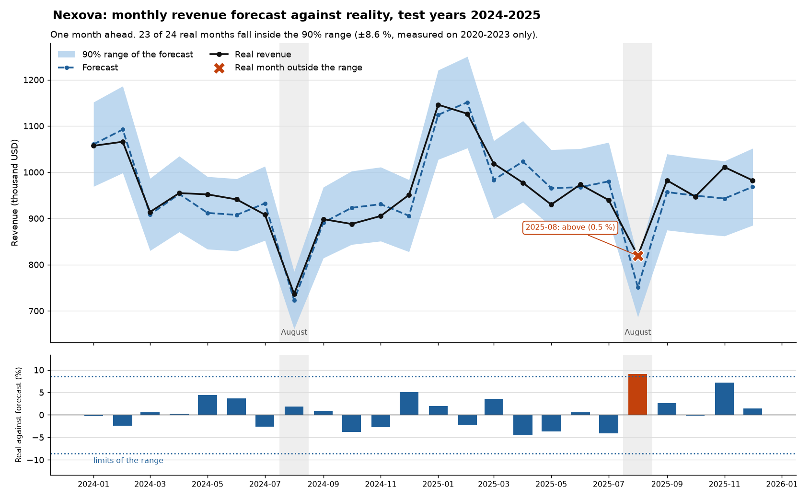

# Sales forecast — evaluation

_Versión en español: [README.es.md](./README.es.md)._

How good the forecast of Nexova's monthly revenue is on the **two test years (2024-2025)**, which took no part in choosing or training the model.

```bash
uv run python scripts/train_sales_forecast.py     # trains, evaluates and writes metrics.json and the two pictures here
```

Code: [`data/process/sales_metrics.py`](../../process/sales_metrics.py) (the formulas) and [`data/process/sales_evaluation.py`](../../process/sales_evaluation.py).
The model and why it is a Random Forest: [`data/process/sales_model.py`](../../process/sales_model.py).

**Protocol.** The model was chosen by time validation inside 2016-2023, then measured on 2024-2025. Nothing was changed after reading these numbers. The random seed is fixed (`42`), so running it again gives the same numbers.
**MSE, Gini and K² Score are computed on the 24 test months only**; the PSI, by definition, compares those test months with the training period.

The unit tests of the 8 / 2 years split and of the absence of leakage between training and test are in [`tests/pipelines/test_sales_forecast_split.py`](../../../tests/pipelines/test_sales_forecast_split.py)
(`uv run pytest tests/pipelines/test_sales_forecast_split.py`).

## Results on the test set

24 months, mean monthly revenue 959,363 USD. "No model" is the simplest honest rival: each month is forecast with the same month a year before.

| Metric | Model, 1 month ahead | No model | Model, 24 months ahead |
| --- | ---: | ---: | ---: |
| **MSE** (USD²) | 1,072,373,288 | 3,190,168,976 | 1,299,390,609 |
| square root of the MSE (USD) | 32,747 | 56,482 | 36,047 |
| the same, as % of the mean month | 3.41 % | 5.89 % | 3.76 % |
| **Gini** (normalized) | 0.898 | 0.797 | 0.892 |
| **K² Score** (p-value) | 1.06 (0.59) | 0.53 (0.77) | 0.33 (0.85) |
| MAPE | 2.85 % | 4.98 % | 3.09 % |
| bias (below 0: the forecast falls short) | -0.56 % | -4.15 % | -0.43 % |
| R² | 0.856 | 0.572 | 0.826 |

| **PSI**, training (72 rows) against test (24 months) | Value | Reading |
| --- | ---: | --- |
| revenue (USD) | 1.769 | large change |
| revenue against the same month a year before | 0.055 | stable |
| the model's forecasts (USD) | 1.769 | large change |
| PSI that chance alone reaches with samples this small (95 %) | 0.527 | |

* **1 month ahead** is the figure of the deliverable: each month is forecast knowing the real months before it.
* **24 months ahead** (extra) stands at the end of 2023 and forecasts both years from its own forecasts. It is the case of a budget, and it holds up: 3.76 % against 3.41 %.

## The forecast and its range of variability



A single line would hide how much the forecast can miss. The picture shows each month's forecast **with the range where the real revenue is expected to fall**.
Code: [`data/process/sales_range.py`](../../process/sales_range.py) (the range) and [`data/process/sales_plot.py`](../../process/sales_plot.py) (the picture).

* **How the range is built (decided before measuring it on the test years).** While validating inside 2020-2023, 48 months were each forecast by a model that had not seen them. The range is the forecast **±8.6 %**: the error that at least 90 % of those months did not exceed
  (a split-conformal interval). The test years take no part in it.
* **On the test years, 23 of the 24 real months fall inside** (96 %, a little more than the 90 % aimed at). The one outside is **August 2025**, **above** the range by 0.5 %: that August was stronger than expected, not an abnormal fall.
* **Why not the spread of the forest's trees**, which looks like the obvious range: it only says how much the trees disagree. Measured the same way, it is narrower (10.9 % wide on average against 17.2 %) and holds only **20 of the 24** real months (83 %) when it says 90 %. It would promise more precision than there is.
* **How to read it for August.** A low August inside the range is the usual summer fall. A real month **below** the lower limit is a fall the model does not explain by the season or the trend, and deserves a look.
* **What it does not promise.** It is for **one month ahead** only (no range is given for the 24 months ahead). Its width is the same share every month, so it does not know that some months are harder. 90 % is an aim, not a guarantee: months of a series are not independent draws, and 24 months are few to check it.

## Features checked against the patterns of the briefing

The briefing asks for causal features (lags, rolling statistics, calendar) checked against the growth and the seasonality it describes. All of them use past months only, and the tests check:

| Pattern of the briefing | In the data | In the features and the forecast (2024-2025) |
| --- | --- | --- |
| August 15-25 % below | yes, every year | the forecast puts August 21.3 % and 22.7 % below the other months |
| January and February 15-20 % above | yes (14.5 % to 20.9 %) | the forecast puts them 15.5 % to 19.0 % above |
| Always growing, fast and slow years in turn | yes | `yoy_growth_lag_12` alternates (about 7 % and about 1 %); the forecast grows 2.2 % in 2024 and 5.3 % in 2025 (real: 2.6 % and 6.1 %) |

## What each metric measures

**MSE — mean squared error.** The average of the squared differences between forecast and reality. Squaring makes one big miss weigh much more than several small ones. It is in **USD²**,
a unit nobody can picture, so it is also given as its square root in dollars (32,747 USD) and that as a share of the mean month (3.41 %). A percentage of the MSE itself would divide USD² by USD and mean nothing.

**PSI — Population Stability Index.** It does not look at errors. It asks whether the data of the test period is distributed like the data of the training period: the training values are cut into 5 groups of equal size,
and it compares which share of the test months falls in each. The usual reading is: below 0.10 stable, 0.10 to 0.25 a moderate change, above 0.25 a large one.

* **Revenue: 1.769, a large and real change.** 21 of the 24 test months fall in the top group. The company grew, so the level of revenue left what the model had seen. This is why the model does **not** forecast dollars.
* **Revenue against a year before: 0.055, stable.** What the model actually forecasts behaves in 2024-2025 as it did before. This is what makes its use on those years reasonable.
* **The reading thresholds were made for large samples.** With 72 and 24 values, two samples of the very same distribution reach a PSI of up to 0.527 in 95 % of cases (a chi-square approximation).
  In a simulation with **no change at all**, the PSI passes 0.25, the usual line of a "large change", in about **28 %** of the cases: the usual reading would raise a false alarm more than one time in four.
  A value such as 0.30 here would **not** be evidence of a change. 1.769 is well above it; 0.055 is well within it, which does not prove that nothing changed.
* **The mix of business lines cannot be measured.** The briefing asks to report whether the mix of headhunting, outsourcing and training changed between training and test. The given dataset only has the
  `consolidated` row. The shares in the briefing (about 35 %, 45 % and 20 %) are one fixed figure, not a series: a PSI computed from them would be zero by construction, and splitting the revenue by line would mean inventing data.
  **To report it, Nexova needs the monthly revenue of each line.**

**Gini (normalized).** Whether the forecast **puts the months in the right order**, from the highest revenue to the lowest. 1 is the same order as reality, about 0 is no better than chance. The briefing cares about it to tell a normal quiet month
(August) from an abnormal fall.

* 0.898 is high, but **read it next to the rival**: the rule without a model already reaches 0.797, because August being low and January high is enough to get much of the order right. The model's contribution is the difference.
* It only looks at the order. It does not say by how much the forecast misses, and on its own it does not detect an anomaly: for that, a month has to be compared with the expected range of the forecast.

**K² Score — D'Agostino-Pearson K² test on the errors.** The brief names it without defining it; this is the standard statistic called K² that applies to the errors of a regression. It measures how far the errors are from a normal bell, from their skewness and their kurtosis (how heavy their extremes are).
A small statistic with a p-value above 0.05 means there is **no evidence** of lopsided or extreme errors. Here 1.06 with p = 0.59.

* It does **not** prove that the errors are normal: with 24 values the test has little power.
* It does **not** look at the mean of the errors (see the next section).
* If the course means another metric by "K2 Score", this is the one to replace. R² is given in the table as context, and is a different thing.

**Also given.** MAPE: how far a month is from its forecast, on average, relative to that month. Bias: the same with its sign, so it shows whether the forecast falls short or goes over. R²: the share of the month-to-month variation that the forecast explains.

## Why a low MSE is not enough on its own

1. **It has no meaning by itself.** 1,072,373,288 USD²: low compared with what? It only says something next to a rival (3,190,168,976 without a model) and turned into dollars and into a percentage.
2. **It cannot see bias.** The same MSE comes from errors that cancel out or from a forecast that always falls short, and the second one would make a budget systematically wrong. In these results, the rule without a model falls short by 4.15 % on average, and its K² Score looks perfectly fine (p = 0.77):
   neither the shape of the errors nor the MSE tells that. The bias has to be looked at on its own.
3. **It does not say whether the order is right.** A forecast that is wrong by the same percentage every month has a perfect Gini and a bad MSE; another with a smaller MSE can swap the weak months with the strong ones. For telling August from a real fall, the order and the range matter.
4. **It is an average, and it hides where the errors are.** The model misses by 2.85 % overall, but by 5.1 % in **August**, falling short both times; in January and February it misses by 1.7 %. August is exactly the month the business wants to read well.
5. **It does not say whether the model can still be trusted.** A good MSE on past data says nothing if the data has changed. The PSI watches that: here the level of revenue changed a lot (1.769), while what the model forecasts stayed stable (0.055).
6. **It does not describe the errors.** Many small errors and a few huge ones can give the same MSE. The K² Score looks at that shape.

## Limits of these results

* **The test period was looked at once before the evaluation, while exploring the data.** The seasonality and growth of the briefing were checked on the 10 years, and it was seen that two months of 2025 are above every training value, and that the growth against a year before stays inside the training range.
  That is what suggested forecasting that growth instead of dollars. The decision itself rests on the validation inside 2016-2023 (a forest on dollars: RMSE 54 006 USD; on the growth: 37 274 USD), and no feature or setting was chosen with an error measured on the test years. A stricter protocol would not look at them at all.
* **24 test months**, and only **2 Augusts** and 4 January-February months: the figures by kind of month are indications, not measurements with precision.
* The dataset was generated with a fixed seed and a regular seasonality (briefing, section 4). Real revenue has events that this series does not: expect larger errors in real life.
* The forecast is of the **consolidated** revenue only.
* A change after these results (another feature, another setting) would need new months to be tested honestly.
