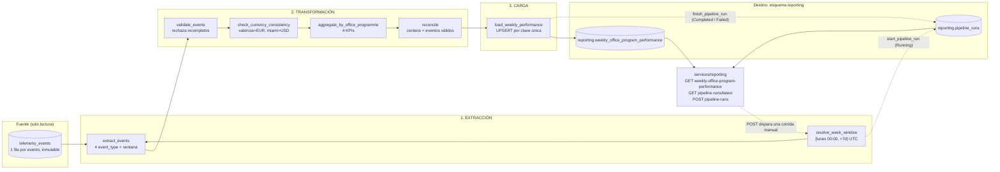

# PIPELINE_DESIGN — Reporte Semanal de Desempeño por Oficina y Programa

> Estado: **documento de diseño (Parte 1 de 3)**. No incluye código de orquestación: un prototipo vive aparte, en la rama `feature/weekly-performance-pipeline`, y se alineará con este diseño en la Parte 2. Pendientes: ver sección 11.
> Fuentes: `pipeline.parte(1de3-nexova-BRIEFING.md` y `nexova-BRIEFING.es.md` (telemetría).

## Estado Actual

> Fuente: rama `feature/telemetry-report` (contiene `feature/telemetry-capture` y `feature/telemetry-storage`) y `docs/telemetry/`. **Esas ramas aún no están integradas en `main`.**

**Eventos de telemetría capturados.** El backoffice emite 32 de los 41 tipos del catálogo, en lotes de 20 eventos o 10 s, con contrato JSON Schema 2.1.0 (`docs/telemetry/event-schemas.json`). Los 5 obligatorios del briefing están instrumentados:

| Evento | Propiedades relevantes para este pipeline |
| --- | --- |
| `inbound_order_created` | `office`, `programme_id`, `product_id`, `quantity`, `currency`, `order_id`, `supplier_id`, `unit_cost_minor`, **`total_cost_minor`** |
| `outbound_order_created` | `office`, `programme_id`, `product_id`, `quantity`, `currency`, `order_id`, `stock_before`, `stock_after` |
| `stock_threshold_triggered` | igual que el anterior + `minimum_stock` |
| `kit_cost_variance_detected` | `order_id`, `supplier_id`, `unit_cost_minor`, `reference_unit_cost_minor`, `variance_percent` (> 10 %) |
| `direct_stock_edit_rejected` | (no lo usa este pipeline) |

También hay eventos de autenticación, navegación, flujos, proveedores, incidencias, errores y web vitals. El contrato ya impone que Valencia ⇒ `EUR` y Miami ⇒ `USD`, y que no haya datos personales (el `user_id` es un seudónimo HMAC).

**Dónde se almacenan.** Tabla `telemetry_events`, en la misma base SQL del inventario (Supabase/PostgreSQL, o SQLite local). Es inmutable (solo `INSERT`) y se deduplica por `event_id`. Ocho columnas: `event_id`, `event_type`, `timestamp` (UTC), `service`, `user_id`, `session_id`, `environment`, `tags` (JSONB con las `properties` del evento). Índices: `timestamp`, `event_type` y GIN sobre `tags`. La retención de 90 días está propuesta pero no implementada.

**Qué responde ya el reporte técnico.** `GET /telemetry/report` (solo admin; `services/api/telemetry/analysis.py`, resultado cacheado, ventana por defecto de 7 días móviles) calcula salud técnica para ingeniería: eventos por día, tipo y origen; tasa de errores; fallos de login y su latencia; accesos denegados y sesiones expiradas; latencia de carga por sección; web vitals; y tráfico HTTP por ruta, con hallazgos contra umbrales.

## La brecha

**Pregunta de negocio sin responder (del briefing):** *¿cómo está cada oficina (Valencia y Miami) en inversión y entrega de material de formación, programa por programa, semana a semana?* — el reporte que Laura quiere abrir los lunes sin llamar a Elena ni a Patricia.

El reporte técnico no puede responderla, por cuatro motivos concretos:

1. **Dimensión:** agrupa por día, tipo, origen o ruta; nunca por `office` × `programme_id`, que son justo las dimensiones del negocio.
2. **Medida:** cuenta eventos, pero no suma costes: `total_cost_minor` no se usa en ningún cálculo, y no existe nada parecido a "gasto por oficina y programa".
3. **Tiempo:** trabaja con una ventana móvil de 7 días, no con semanas ISO cerradas (lunes–domingo) comparables entre sí.
4. **Persistencia y audiencia:** su resultado es una respuesta cacheada, solo para administradores e ingenieros; no queda una tabla histórica por semana que un no técnico pueda consultar ni auditar, y mezcla monedas si se sumara a ciegas.

Por eso hace falta un pipeline dedicado: lee los 4 eventos obligatorios de negocio de `telemetry_events`, los agrega por oficina × programa × semana ISO y los deja en `reporting.weekly_office_program_performance`.

## Propósito

> **Producir cada lunes por la mañana el consolidado semanal por oficina y programa que alimenta el "Reporte Semanal de Desempeño por Oficina y Programa" de Laura (CEO) y Elena (L&D), calculando los KPIs *costo de material por oficina/programa*, *kits entregados*, *frecuencia de escasez* y *frecuencia de variación de costo* a partir de las métricas obligatorias `inbound_order_created`, `outbound_order_created`, `stock_threshold_triggered` y `kit_cost_variance_detected`.**

Este pipeline existe para producir el **"Reporte Semanal de Desempeño por Oficina y Programa"** que Laura (CEO) y Elena (L&D) abrirán cada lunes sin pedírselo a nadie. Responde una pregunta que hoy nadie contesta de forma confiable: *¿cómo están Valencia y Miami en inversión y entrega de material de formación?*

Lo alimentan estas métricas obligatorias de telemetría:

| Métrica obligatoria | KPI que alimenta |
| --- | --- |
| `inbound_order_created` | Costo de material por oficina/programa |
| `outbound_order_created` | Kits entregados |
| `stock_threshold_triggered` | Frecuencia de escasez |
| `kit_cost_variance_detected` | Frecuencia de variación de costo |

**Criterio de pertenencia a la v1:** una etapa solo entra si sostiene alguno de estos 4 KPIs o si hace al resultado idempotente, observable o recuperable (sección 5). Lo que no cumpla ninguno de los dos criterios queda fuera (ver sección 10).

## 0. Por qué un pipeline nuevo (y no el reporte técnico)

| | Reporte técnico (existente) | Este pipeline (nuevo) |
| --- | --- | --- |
| Lector | Ingeniería | Laura (CEO) y Elena (L&D) |
| Pregunta que responde | ¿El servicio funciona? (volumen, errores, latencia) | ¿Cómo está cada oficina en inversión y entrega de material? |
| Unidad | Evento / petición | Oficina × programa × semana |
| Destino | `GET /telemetry/report` | `reporting.weekly_office_program_performance` |

Qué **no** cambia: `services/telemetry/analysis.py`, `GET /telemetry/report` y `telemetry_events` como tabla (el pipeline solo la lee). Qué cambia: nace un esquema `reporting` y un módulo de API propio.

**Extensión aditiva de la telemetría: ninguna necesaria.** El enunciado permite añadir campos de payload a eventos obligatorios existentes (p. ej. un coste), pero `inbound_order_created` ya lleva `unit_cost_minor` y `total_cost_minor` en el contrato 2.1.0. El pipeline solo lee; no cambia el esquema de captura.

## 1. Entregable de negocio y trazabilidad

| Elemento | Valor |
| --- | --- |
| Entregable | "Reporte Semanal de Desempeño por Oficina y Programa" |
| Audiencia | Laura (CEO) y Elena (Gerente de L&D), no técnicos |
| Frecuencia | Semanal. Fresco el lunes por la mañana (UTC): la corrida automática termina antes de las 06:00 UTC |
| Tabla de destino | `reporting.weekly_office_program_performance` |
| Endpoint de lectura | `GET /reporting/weekly-office-program-performance` |

Todo lo de este documento existe para calcular estos 4 KPIs:

| KPI | Campo en destino | Evento de origen | Agregación |
| --- | --- | --- | --- |
| Costo de material por oficina/programa | `total_material_cost` | `inbound_order_created` | SUM de `tags.total_cost_minor` ÷ 100 (céntimos → unidad de moneda), por moneda |
| Kits entregados | `kits_delivered_count` | `outbound_order_created` | COUNT |
| Frecuencia de escasez | `shortage_events_count` | `stock_threshold_triggered` | COUNT |
| Frecuencia de variación de costo | `cost_variance_events_count` | `kit_cost_variance_detected` | COUNT |

Más `currency` (`EUR` Valencia / `USD` Miami). **Sin conversión de monedas** (v2).

## 2. Grano y claves

- Grano: una fila por `office` × `programme_id` × semana ISO.
- `week_start` = lunes de la semana, UTC. Ventana: `[week_start 00:00, week_start+7d 00:00)`.
- Clave natural / idempotencia: `unique (office, programme_id, week_start)`.
- Una combinación sin eventos en la semana **no genera fila**, salvo que otro KPI sí tenga eventos (entonces los demás campos valen 0).

## 3. Datos de origen y formato de extracción

**Fuente única:** `telemetry_events`. Ninguna otra tabla de dominio hace falta en la v1: `office`, `programme_id`, `currency` y el costo viajan dentro de cada evento, así que leer también `assets`/`asset_entries` duplicaría la fuente y abriría la puerta a discrepancias entre dos verdades.

| Aspecto | Detalle |
| --- | --- |
| Formato de llegada | Filas SQL (PostgreSQL/Supabase; SQLite en local), **una fila por evento**, inmutables. Columnas: `event_id` (PK), `event_type`, `timestamp` (UTC), `service`, `user_id`, `session_id`, `environment`, `tags` (JSONB = `properties` del evento). |
| Cómo se extrae | Un `SELECT event_type, timestamp, tags` con `event_type IN (4 tipos)` y `timestamp >= week_start AND < week_start + 7d`. Ambos filtros usan índices existentes (`event_type`, `timestamp`). El `tags` llega como objeto JSON y el pipeline lo convierte en filas tipadas en memoria. |
| Claves de `tags` usadas | `office` (`valencia`/`miami`), `programme_id`, `currency` (`EUR`/`USD`) y, solo en `inbound_order_created`, `total_cost_minor` (entero en céntimos; costo = `total_cost_minor / 100`). Para deduplicar: `order_id`. |
| Frecuencia de actualización de la fuente | Continua: el backoffice envía lotes cada 20 eventos o 10 s y el receptor inserta de inmediato. |
| Frecuencia de lectura del pipeline | Semanal, lunes 05:00 UTC, sobre la semana ISO ya cerrada. Un evento tardío (reintento, `sendBeacon`) conserva su `timestamp` original, por eso se recalcula la semana completa en cada corrida (sección 5). |
| Modo | **Solo lectura.** Nunca se escribe en `telemetry_events`. |
| Garantías de la fuente | `event_id` único (un reenvío de lote no duplica filas); el contrato impone Valencia ⇒ `EUR`, Miami ⇒ `USD` y excluye datos personales. El pipeline no lee `user_id`. |

Prerrequisito de despliegue: las ramas de telemetría deben estar integradas en la rama desde la que se despliega (ya lo están en el `main` local).

## 3b. Flujo de datos



Las etapas de extracción, transformación y carga están separadas por tasks de Prefect; solo la extracción lee la fuente y solo la carga escribe en el destino.

## 3c. Fuentes que actualizan registros existentes

En nuestro caso `telemetry_events` es inmutable (solo `INSERT`), pero el diseño no puede asumir que siempre será así ni que los datos de la semana estén completos. La estrategia, concreta, para no duplicar:

1. **Clave natural en el destino:** `unique (office, programme_id, week_start)`. Una fila representa una oficina, un programa y una semana; hay una sola, siempre.
2. **Reemplazo, no acumulación:** la carga es `INSERT ... ON CONFLICT (office, programme_id, week_start) DO UPDATE SET <los 4 KPIs> = EXCLUDED.<...>, computed_at = EXCLUDED.computed_at`. Nunca `kpi = kpi + nuevo`: sumar sobre lo existente duplicaría las cifras en cada reejecución.
3. **Recalcular la ventana completa**, no solo "lo nuevo desde la última vez" (sin *watermark*). Así cubre los tres casos de actualización: evento tardío que cambia una semana pasada, reenvío de un lote, y (si un día la fuente permitiera editar) un registro modificado: la próxima corrida recalcula desde la fuente tal como está.
4. **Deduplicación defensiva en la transformación:** antes de agregar se cuenta una sola vez cada pareja (`event_type`, `order_id`). La fuente ya garantiza `event_id` único; esto protege si un mismo pedido llegara con dos `event_id` distintos.
5. **Filas que dejan de existir:** si tras recalcular una combinación oficina/programa ya no tiene eventos válidos, su fila previa se borra de esa semana (un `DELETE` de las claves de la ventana que no están en el resultado, en la misma transacción que el upsert). Sin esto, un valor viejo se quedaría para siempre.

Resultado: dos corridas sobre los mismos datos dejan la tabla idéntica; una corrida tras un cambio en la fuente deja la tabla igual a lo que la fuente dice ahora.

## 4. Estructura Prefect

Prefect organiza el trabajo en **flows** (funciones orquestadas), **tasks** (unidades con reintentos y caché), **states** (resultado de cada run) y **blocks** (configuración y credenciales reutilizables).

### 4.1 Flow principal

`weekly_office_performance_flow(week_start: date | None = None)`

- Si `week_start` es `None`, calcula la semana ISO completa anterior (lunes anterior a la ejecución).
- Parametrizado, de modo que sirve para la corrida programada, la manual (`POST`) y los backfills.

### 4.2 Tasks

| # | Task | Responsabilidad | Reintentos |
| --- | --- | --- | --- |
| 0 | `start_pipeline_run` | Inserta la corrida en `reporting.pipeline_runs` con estado `Running` **antes** de tocar datos | no |
| 1 | `resolve_week_window` | Normaliza a lunes UTC y calcula `[start, end)` | no |
| 2 | `extract_events` | Query de lectura a `telemetry_events` (4 tipos, ventana) | sí (3, backoff) |
| 3 | `validate_events` | Descarta eventos sin `office`, `programme_id`, `currency` o (en entradas) `total_cost_minor` válido; cuenta rechazados | no |
| 4 | `aggregate_by_office_programme` | Deduplica por (`event_type`, `order_id`), agrupa por (office, programme_id) y calcula los 4 KPIs. Lógica pura, vive en `data/process/` | no |
| 4b | `reconcile` | Comprueba que los conteos agregados = eventos válidos de cada tipo; si no cuadra, falla | no |
| 5 | `check_currency_consistency` | Verifica `EUR`↔valencia y `USD`↔miami; falla si se mezclan | no |
| 6 | `load_weekly_performance` | En **una transacción**: UPSERT por la clave única (reemplazo) + borrado de las filas de esa semana que ya no tienen eventos | sí (3, backoff) |
| 7 | `finish_pipeline_run` | Actualiza esa fila: estado final, conteos, duración, error (alimenta `/pipeline-runs/latest`) | sí (3) |

Las tasks 4, 4b y 5 son puras (sin I/O) para poder probarlas sin base de datos.

### 4.3 Subflows

**No hay subflows en la v1.** Un flow plano de 7 tasks ya da reintentos y estados por etapa; dividirlo en subflows no sostiene ningún KPI. Se reconsidera solo si aparece un segundo pipeline que reutilice la extracción.

### 4.4 States y manejo de errores

- `Completed`: todo bien. `Failed`: fallo de extract/load tras reintentos. `Crashed`: error de infraestructura.
- Cualquier fila rechazada en `validate_events` **no** hace fallar el flow; se registra en el run (`rejected_count`).
- Mezcla de monedas en `check_currency_consistency` **sí** hace fallar el flow (violación de regla de negocio).
- Cualquier excepción se captura, se registra en `finish_pipeline_run` como `Failed` y se relanza (la corrida de Prefect también termina `Failed`).
- Un proceso que muere sin poder escribir (`Crashed`) deja su fila en `Running`: ver recuperabilidad (sección 5).

### 4.5 Blocks (configuración)

| Block | Contenido |
| --- | --- |
| `Secret` `telemetry-db-url` | Conexión de lectura a `telemetry_events` (usuario de solo lectura) |
| `Secret` `reporting-db-url` | Conexión de escritura al esquema `reporting` |

Reintentos y zona horaria (UTC) son constantes del código en v1: un block de configuración no sostiene ningún KPI. Nada de credenciales en el repo; solo nombres de blocks.

### 4.6 Programación (deployment)

- Schedule cron `0 5 * * 1` (lunes 05:00 UTC), por tanto fresco antes del trabajo del lunes.
- Parámetro `week_start=None` en la corrida automática.

## 5. Robustez: idempotencia, observabilidad, recuperabilidad

### 5.1 Idempotencia

- La ventana es determinista: `[week_start, week_start+7d)` en UTC. Mismo `week_start` + mismos eventos de origen = mismo resultado.
- La carga es `INSERT ... ON CONFLICT (office, programme_id, week_start) DO UPDATE`: actualiza los 4 KPIs y `computed_at`, nunca inserta un duplicado ni suma sobre lo anterior (los valores se **reemplazan**, no se acumulan).
- Se recalcula la semana completa, no de forma incremental, porque los eventos pueden llegar tarde; el recálculo corrige la fila en lugar de duplicar.
- El pipeline es de solo lectura sobre `telemetry_events`: repetirlo no altera la fuente.

### 5.2 Observabilidad (rastro de auditoría)

Cada corrida deja una fila en `reporting.pipeline_runs`: `id`, `trigger` (`scheduled`/`manual`), `week_start`, `state`, `events_read`, `rejected_count`, `rows_written`, `error`, `started_at`, `finished_at`. Con eso se responde *qué pasó, cuándo y por qué*.

- **Trazabilidad de cada número:** `computed_at` de cada fila del reporte se corresponde con la ventana `started_at`–`finished_at` de una corrida; los eventos rechazados se escriben en el log de la corrida de Prefect con su motivo.
- **Conciliación (task `reconcile`):** `events_read = válidos + rechazados` y la suma de los conteos por fila es igual al número de eventos válidos de cada tipo. Si no cuadra, la corrida falla: un reporte que no concilia no se publica.
- **Qué NO es v1:** una tabla con el detalle de cada evento rechazado. Los conteos y el log bastan para el entregable; se añade si Elena pide investigar rechazos.

### 5.3 Recuperabilidad

- **Sin estado entre corridas:** no hay checkpoints ni offsets. La unidad de trabajo es la semana, así que "retomar" es volver a ejecutar esa semana; el resultado es idéntico (5.1).
- **Atomicidad:** la carga va en una sola transacción. Si falla, no queda una semana a medias: la tabla conserva exactamente los datos de la última carga buena.
- **Fallo transitorio:** `extract_events` y `load_weekly_performance` reintentan 3 veces con espera creciente (5 s, 30 s, 2 min) antes de marcar `Failed`.
- **Corrida muerta:** si el proceso cae sin poder escribir su estado final, la fila queda en `Running`. La siguiente corrida marca como `Crashed` cualquier `Running` con más de 1 h de antigüedad y procede con normalidad; así `GET /pipeline-runs/latest` nunca miente con un `Running` eterno.
- **Reproceso:** `POST /reporting/pipeline-runs` con `week_start` permite repetir cualquier semana, también las pasadas (backfill).

## 6. Tabla de destino

```sql
create schema if not exists reporting;

create table reporting.weekly_office_program_performance (
  id uuid primary key default gen_random_uuid(),
  office text not null,
  programme_id text not null,
  week_start date not null,
  total_material_cost numeric not null default 0,
  kits_delivered_count integer not null default 0,
  shortage_events_count integer not null default 0,
  cost_variance_events_count integer not null default 0,
  currency text not null,
  computed_at timestamptz not null default now(),
  unique (office, programme_id, week_start)
);
```

Más `reporting.pipeline_runs` (campos en 5.2). Ambas tablas viven en el esquema `reporting`; nada se escribe en `telemetry_events`.

## 7. Organización del código

```
data/
  pipelines/
    PIPELINE_DESIGN.md                      <- este documento
    weekly_office_performance/
      flow.py                               <- flow + tasks Prefect (orquestación)
      storage.py, sql/                      <- tablas del esquema `reporting` y DDL
      seed_telemetry.py                     <- datos demo (solo dev local)
  process/weekly_performance.py             <- agregación y validación puras
  eval/                                     <- reservado para calidad de datos
services/api/reporting/                     <- módulo NUEVO (importa de data/pipelines)
  router.py, schemas.py, service.py, database.py
```

El módulo de la API vive en `services/api/reporting/`, junto al resto de dominios (`inventory/`, `suppliers/`...), porque `services/api` es una única app FastAPI.
Regla de dependencia: `services/api/reporting/` importa de `data/pipelines/`, nunca al revés.

## 8. Endpoints de `services/reporting/`

> Nota de ruta: en este monorepo la API es una sola app FastAPI en `services/api/`, y cada dominio es un paquete dentro de ella. Igual que `services/telemetry/` del briefing es `services/api/telemetry/`, `services/reporting/` es `services/api/reporting/`.

| Método | Ruta | Descripción |
| --- | --- | --- |
| GET | `/reporting/weekly-office-program-performance?week_start=` | **Consulta de KPIs:** entradas de la semana (por defecto, la más reciente calculada) |
| GET | `/reporting/pipeline-runs/latest` | **Estado:** metadata y resultado de la última corrida |
| POST | `/reporting/pipeline-runs` | **Disparo manual** (acepta `week_start` opcional) |

**Tablas de destino** (esquema `reporting`; nombre exacto de la sección *Destination table* del briefing):

- `reporting.weekly_office_program_performance`: el resultado de negocio.
- `reporting.pipeline_runs`: soporte de auditoría del propio pipeline.

**Separación explícita:**

| | Telemetría técnica | Reporting (este pipeline) |
| --- | --- | --- |
| Módulo | `services/api/telemetry/` | `services/api/reporting/` |
| Tablas | `telemetry_events` (solo la lee este pipeline) | `reporting.*` |
| Endpoints | `/telemetry/events`, `GET /telemetry/report` | `/reporting/...` |
| Código | `analysis.py` (no se toca) | `services/api/reporting/` → importa de `data/pipelines/` |

## 8b. Frescura y observabilidad

- **Frescura:** el reporte de la semana N se considera fresco si `computed_at` es del lunes N+1 antes de las 06:00 UTC.
- **Señal de fallo:** si el último run de la semana está en `Failed`, `GET /reporting/pipeline-runs/latest` lo muestra; la alerta (correo/Slack desde Prefect) queda para la Parte 3.
- **Calidad:** `rejected_count` y `events_read` por run permiten detectar semanas con telemetría anómala (p. ej. muchos eventos rechazados o cero eventos).

## 9. Pruebas previstas

- Unitarias de `aggregate_by_office_programme` con eventos sintéticos: conteos, suma de costos, límites de semana (domingo 23:59 / lunes 00:00).
- Moneda: mezcla EUR/USD debe fallar; Valencia y Miami salen en filas separadas.
- Idempotencia: ejecutar dos veces no duplica filas ni cambia los valores.
- Recuperabilidad: tras un fallo de carga, la tabla queda intacta; una corrida `Running` antigua pasa a `Crashed`.
- Conciliación: si los conteos no cuadran con los eventos válidos, la corrida falla.
- Semana sin eventos: ninguna fila; el run termina en `Completed` con `rows_written = 0`.
- Eventos incompletos: se rechazan y se cuentan.

## 10. Fuera de alcance (v1)

Conversión de monedas, subflows, block de configuración, tabla de detalle de eventos rechazados, eventos fuera de los 4 listados, modificación de `telemetry_events`, `services/telemetry/analysis.py` y `GET /telemetry/report`.

## 11. Preguntas abiertas

1. Las ramas `feature/telemetry-*` no están en `main`: ¿se integran antes de implementar el pipeline?
2. ¿PostgreSQL/Supabase real o SQLite local para el esquema `reporting`? (Hoy `telemetry_events` y el inventario comparten base.)
3. ¿Prefect Cloud o servidor local para el deployment y el cron del lunes?
4. El prototipo de código aún asume columnas y claves antiguas (`occurred_at`, `properties`, `total_cost`); hay que alinearlo con `timestamp`, `tags` y `total_cost_minor` (Parte 2).
