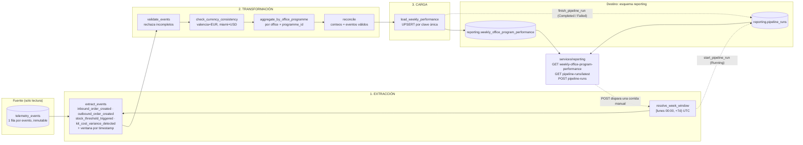

# PIPELINE_DESIGN — Reporte Semanal de Desempeño por Oficina y Programa

> Estado: **diseño aprobado (Parte 1) e implementado (Parte 2)**. La sección «Implementación del diseño» dice qué está ya en el código y qué queda pendiente, sin maquillar. Código: [`pipeline.py`](./pipeline.py).
> Fuentes: `pipeline.parte(1de3-nexova-BRIEFING.md` y `nexova-BRIEFING.es.md` (telemetría).

## Implementación del diseño (Parte 2)

Lo que este documento especifica y dónde está en el código. Lo que no está implementado se dice como tal.

| Pieza del diseño | Estado | Dónde / nota |
| --- | --- | --- |
| Flow `weekly_office_performance_flow` y sus tasks (secciones 3b y 4) | ✅ Implementado | `data/pipelines/pipeline.py`: extracción, transformación y carga, más 3 pasos opcionales |
| Tasks críticas y opcionales, `return_state=True` (4.2b) | ✅ | Las opcionales no detienen la corrida; su fallo queda en `warnings` |
| Reintentos 5 s, 30 s y 2 min con justificación (4.2c) | ✅ | Comentario junto a `RETRIES` |
| Caché de una hora, con `cache_key_fn` (4.2d) | ✅ | Extracción y agregación; la carga y el log nunca se cachean |
| Carga idempotente, *no-op* si no hay cambios (3c, 5.1) | ✅ | `repository.load_week`; comprobado contra PostgreSQL 16 |
| Log de 17 campos (5.2) | ✅ | `reporting.pipeline_runs` |
| Candado de corridas simultáneas, `Crashed` por antigüedad (5.1b) | ✅ | Índice único parcial; lo impone la base de datos |
| Hook `on_crashed` (4.4) | ✅ | `mark_run_crashed` en `pipeline.py` |
| Endpoints `/reporting` y fachada `interface.py` (8) | ✅ | `services/api/reporting/` |
| Línea de comandos y ciclo semanal (4.2e, 4.6) | ✅ | `python data/pipelines/pipeline.py` |
| **Filtro por entorno de telemetría** | ✅ *Añadido al implementar* | No estaba en la primera versión del diseño: el contrato marca cada evento `development`/`test`/`staging`/`production` y solo `production` entra en un reporte de dirección (sección 3) |
| Credenciales con `Secret` blocks de Prefect (4.5) | ⏳ **Pendiente** | Hoy entran por variables de entorno (`DATABASE_URL`, `TELEMETRY_DATABASE_URL`, `REPORTING_DATABASE_URL`) o por el `.env` de la API. Los blocks requieren un servidor de Prefect desplegado |
| Roles de base de datos separados, lectura y escritura (4.5) | ⏳ Recomendado | No aplicado: se usa una sola conexión |
| *Deployment* de Prefect con los crons del lunes y del jueves (4.6) | ⏳ **Pendiente** | Documentado y ejecutable con el script; ningún programador lo lanza solo |
| Alertas por Slack o correo (8b), subflows y *backfill* (4.3) | ⏳ Parte 3 | |
| Conciliación contra las tablas de inventario, historial de valores pasados (anexo, I-3 y R-2) | ⏳ v2 | Límites conocidos, no se han implementado |

## Estado Actual (Current State)

> Fuente: rama `feature/telemetry-report` (contiene `feature/telemetry-capture` y `feature/telemetry-storage`) y `docs/telemetry/`. **Esas ramas están en sus propios PRs (#24 plan, #27 captura, #28 almacenamiento y #29 reporte), aún abiertos y no integrados en `main`.** Este documento los describe tal como están en esas ramas.

**Eventos de telemetría capturados.** El backoffice emite 32 de los 41 tipos del catálogo, en lotes de 20 eventos o 10 s, con contrato JSON Schema 2.1.0 (`docs/telemetry/event-schemas.json`). Los 5 obligatorios del briefing están instrumentados:

| Evento | Propiedades relevantes para este pipeline |
| --- | --- |
| `inbound_order_created` | `office`, `programme_id`, `product_id`, `quantity`, `currency`, `order_id`, `supplier_id`, `unit_cost_minor`, **`total_cost_minor`** |
| `outbound_order_created` | `office`, `programme_id`, `product_id`, `quantity`, `currency`, `order_id`, `stock_before`, `stock_after` |
| `stock_threshold_triggered` | igual que el anterior + `minimum_stock` |
| `kit_cost_variance_detected` | `order_id`, `supplier_id`, `unit_cost_minor`, `reference_unit_cost_minor`, `variance_percent` (> 10 %) |
| `direct_stock_edit_rejected` | (no lo usa este pipeline) |

También hay eventos de autenticación, navegación, flujos, proveedores, incidencias, errores y web vitals. El contrato ya impone que Valencia ⇒ `EUR` y Miami ⇒ `USD`, y que no haya datos personales (el `user_id` es un seudónimo HMAC).

**Dónde se almacenan.** Tabla `telemetry_events`, en la misma base SQL del inventario (Supabase/PostgreSQL, o SQLite local). Es inmutable (solo `INSERT`) y se deduplica por `event_id`. Ocho columnas: `event_id`, `event_type`, `timestamp` (UTC), `service`, `user_id`, `session_id`, `environment`, `tags` (JSONB con las `properties` del evento). Índices: `timestamp`, `event_type` y GIN sobre `tags`. La retención de 90 días está propuesta pero no implementada.

**Qué responde ya el reporte técnico.** `GET /telemetry/report` (solo admin; `services/api/telemetry/analysis.py`, resultado cacheado, ventana por defecto de 7 días móviles) calcula salud técnica para ingeniería: eventos por día, tipo y origen; tasa de errores; fallos de login y su latencia; accesos denegados y sesiones expiradas; latencia de carga por sección; web vitals; y tráfico HTTP por ruta, con hallazgos contra umbrales.

## La brecha de negocio (Business Gap)

**Pregunta de negocio sin responder (del briefing):** *¿cómo está cada oficina (Valencia y Miami) en inversión y entrega de material de formación, programa por programa, semana a semana?* — el reporte que Laura quiere abrir los lunes sin llamar a Elena ni a Patricia.

El reporte técnico no puede responderla, por cuatro motivos concretos:

1. **Dimensión:** agrupa por día, tipo, origen o ruta; nunca por `office` × `programme_id`, que son justo las dimensiones del negocio.
2. **Medida:** cuenta eventos, pero no suma costes: `total_cost_minor` no se usa en ningún cálculo, y no existe nada parecido a "gasto por oficina y programa".
3. **Tiempo:** trabaja con una ventana móvil de 7 días, no con semanas ISO cerradas (lunes–domingo) comparables entre sí.
4. **Persistencia y audiencia:** su resultado es una respuesta cacheada, solo para administradores e ingenieros; no queda una tabla histórica por semana que un no técnico pueda consultar ni auditar, y mezcla monedas si se sumara a ciegas.

Por eso hace falta un pipeline dedicado: lee los 4 eventos obligatorios de negocio de `telemetry_events`, los agrega por oficina × programa × semana ISO y los deja en `reporting.weekly_office_program_performance`.

## Propósito

> **Producir cada lunes por la mañana el consolidado semanal por oficina y programa que alimenta el "Reporte Semanal de Desempeño por Oficina y Programa" de Laura (CEO) y Elena (L&D), calculando los KPIs *costo de material por oficina/programa*, *kits entregados*, *frecuencia de escasez* y *frecuencia de variación de costo* a partir de las métricas obligatorias `inbound_order_created`, `outbound_order_created`, `stock_threshold_triggered` y `kit_cost_variance_detected`.**

Este pipeline existe para producir el **"Reporte Semanal de Desempeño por Oficina y Programa"** que Laura (CEO) y Elena (L&D) abrirán cada lunes sin pedírselo a nadie. Responde una pregunta que hoy nadie contesta de forma confiable: *¿cómo están Valencia y Miami en inversión y entrega de material de formación?*

Lo alimentan estas métricas obligatorias de telemetría:

| Métrica obligatoria | KPI que alimenta |
| --- | --- |
| `inbound_order_created` | Costo de material por oficina/programa |
| `outbound_order_created` | Kits entregados |
| `stock_threshold_triggered` | Frecuencia de escasez |
| `kit_cost_variance_detected` | Frecuencia de variación de costo |

**Criterio de pertenencia a la v1:** una etapa solo entra si sostiene alguno de estos 4 KPIs o si hace al resultado idempotente, observable o recuperable (sección 5). Lo que no cumpla ninguno de los dos criterios queda fuera (ver sección 10).

## 0. Por qué un pipeline nuevo (y no el reporte técnico)

| | Reporte técnico (existente) | Este pipeline (nuevo) |
| --- | --- | --- |
| Lector | Ingeniería | Laura (CEO) y Elena (L&D) |
| Pregunta que responde | ¿El servicio funciona? (volumen, errores, latencia) | ¿Cómo está cada oficina en inversión y entrega de material? |
| Unidad | Evento / petición | Oficina × programa × semana |
| Destino | `GET /telemetry/report` | `reporting.weekly_office_program_performance` |

Qué **no** cambia: `services/telemetry/analysis.py`, `GET /telemetry/report` y `telemetry_events` como tabla (el pipeline solo la lee). Qué cambia: nace un esquema `reporting` y un módulo de API propio.

**Extensión aditiva de la telemetría: ninguna necesaria.** El enunciado permite añadir campos de payload a eventos obligatorios existentes (p. ej. un coste), pero `inbound_order_created` ya lleva `unit_cost_minor` y `total_cost_minor` en el contrato 2.1.0. El pipeline solo lee; no cambia el esquema de captura.

## 1. Entregable de negocio y trazabilidad

| Elemento | Valor |
| --- | --- |
| Entregable | "Reporte Semanal de Desempeño por Oficina y Programa" |
| Audiencia | Laura (CEO) y Elena (Gerente de L&D), no técnicos |
| Frecuencia | Semanal. Fresco el lunes por la mañana (UTC): la corrida automática termina antes de las 06:00 UTC |
| Tabla de destino | `reporting.weekly_office_program_performance` |
| Endpoint de lectura | `GET /reporting/weekly-office-program-performance` |

Todo lo de este documento existe para calcular estos 4 KPIs:

| KPI | Campo en destino | Evento de origen | Agregación |
| --- | --- | --- | --- |
| Costo de material por oficina/programa | `total_material_cost` | `inbound_order_created` | SUM de `tags.total_cost_minor` ÷ 100 (céntimos → unidad de moneda), por moneda |
| Kits entregados | `kits_delivered_count` | `outbound_order_created` | COUNT |
| Frecuencia de escasez | `shortage_events_count` | `stock_threshold_triggered` | COUNT |
| Frecuencia de variación de costo | `cost_variance_events_count` | `kit_cost_variance_detected` | COUNT |

Más `currency` (`EUR` Valencia / `USD` Miami). **Sin conversión de monedas** (v2).

## 2. Grano y claves

- Grano: una fila por `office` × `programme_id` × semana ISO.
- `week_start` = lunes de la semana, UTC. Ventana: `[week_start 00:00, week_start+7d 00:00)`.
- Clave natural / idempotencia: `unique (office, programme_id, week_start)`.
- Una combinación sin eventos en la semana **no genera fila**, salvo que otro KPI sí tenga eventos (entonces los demás campos valen 0).

## 3. Datos de origen y formato de extracción

**Fuente única:** `telemetry_events`. Ninguna otra tabla de dominio hace falta en la v1: `office`, `programme_id`, `currency` y el costo viajan dentro de cada evento, así que leer también `assets`/`asset_entries` duplicaría la fuente y abriría la puerta a discrepancias entre dos verdades.

| Aspecto | Detalle |
| --- | --- |
| Formato de llegada | Filas SQL (PostgreSQL/Supabase; SQLite en local), **una fila por evento**, inmutables. Columnas: `event_id` (PK), `event_type`, `timestamp` (UTC), `service`, `user_id`, `session_id`, `environment`, `tags` (JSONB = `properties` del evento). |
| Cómo se extrae | Un `SELECT event_type, timestamp, tags` con `event_type IN (4 tipos)` y `timestamp >= week_start AND < week_start + 7d`. Ambos filtros usan índices existentes (`event_type`, `timestamp`). El `tags` llega como objeto JSON y el pipeline lo convierte en filas tipadas en memoria. |
| Claves de `tags` usadas | `office` (`valencia`/`miami`), `programme_id`, `currency` (`EUR`/`USD`) y, solo en `inbound_order_created`, `total_cost_minor` (entero en céntimos; costo = `total_cost_minor / 100`). Para deduplicar: `order_id`. |
| Frecuencia de actualización de la fuente | Continua: el backoffice envía lotes cada 20 eventos o 10 s y el receptor inserta de inmediato. |
| Frecuencia de lectura del pipeline | Semanal, lunes 05:00 UTC, sobre la semana ISO ya cerrada. Un evento tardío (reintento, `sendBeacon`) conserva su `timestamp` original, por eso se recalcula la semana completa en cada corrida (sección 5). |
| Modo | **Solo lectura.** Nunca se escribe en `telemetry_events`. |
| Garantías de la fuente | `event_id` único (un reenvío de lote no duplica filas); el contrato impone Valencia ⇒ `EUR`, Miami ⇒ `USD` y excluye datos personales. El pipeline no lee `user_id`. |

Prerrequisito de despliegue: los PRs de telemetría (#24, #27, #28 y #29) deben estar integrados en la rama desde la que se despliega; el pipeline lee `telemetry_events`, que solo existe en esas ramas hasta que se integren.

**Forma del payload** (una fila de `telemetry_events` para `inbound_order_created`; valores ilustrativos tomados del formato de `docs/telemetry/seed-data.json`):

```json
{
  "event_id": "7c1f0c2e-…",
  "event_type": "inbound_order_created",
  "timestamp": "2026-10-27T09:00:00+00:00",
  "service": "inventory_api",
  "environment": "production",
  "tags": {
    "office": "valencia", "programme_id": "ventas-b2b", "product_id": "product-001",
    "product_category": "training_kit", "quantity": 5, "currency": "EUR",
    "order_id": "in-001", "supplier_id": "supplier-print-01",
    "unit_cost_minor": 1000, "total_cost_minor": 5000
  }
}
```

`user_id` y `session_id` existen en la fila pero el pipeline no los lee.

## 3b. Flujo de datos



Las etapas de extracción, transformación y carga están separadas por tasks de Prefect; solo la extracción lee la fuente y solo la carga escribe en el destino.

## 3c. Fuentes que actualizan registros existentes

En nuestro caso `telemetry_events` es inmutable (solo `INSERT`), pero el diseño no puede asumir que siempre será así ni que los datos de la semana estén completos. La estrategia, concreta, para no duplicar:

1. **Clave natural en el destino:** `unique (office, programme_id, week_start)`. Una fila representa una oficina, un programa y una semana; hay una sola, siempre.
2. **Reemplazo, no acumulación:** la carga es `INSERT ... ON CONFLICT (office, programme_id, week_start) DO UPDATE SET <los 4 KPIs> = EXCLUDED.<...>, computed_at = EXCLUDED.computed_at WHERE <algún KPI IS DISTINCT FROM el nuevo>`. El `WHERE` hace que repetir la corrida sea un *no-op* real: si nada cambió, la fila ni se toca (tampoco `computed_at`). Nunca `kpi = kpi + nuevo`: sumar sobre lo existente duplicaría las cifras en cada reejecución.
3. **Recalcular la ventana completa**, no solo "lo nuevo desde la última vez" (sin *watermark*). Así cubre los tres casos de actualización: evento tardío que cambia una semana pasada, reenvío de un lote, y (si un día la fuente permitiera editar) un registro modificado: la próxima corrida recalcula desde la fuente tal como está.
4. **Deduplicación defensiva en la transformación:** antes de agregar se cuenta una sola vez cada pareja (`event_type`, `order_id`). La fuente ya garantiza `event_id` único; esto protege si un mismo pedido llegara con dos `event_id` distintos.
5. **Filas que dejan de existir:** si tras recalcular una combinación oficina/programa ya no tiene eventos válidos, su fila previa se borra de esa semana (un `DELETE` de las claves de la ventana que no están en el resultado, en la misma transacción que el upsert). Sin esto, un valor viejo se quedaría para siempre.

Resultado: dos corridas sobre los mismos datos dejan la tabla idéntica; una corrida tras un cambio en la fuente deja la tabla igual a lo que la fuente dice ahora.

## 4. Mapeo a Prefect

Prefect organiza el trabajo en **flows** (funciones orquestadas), **tasks** (unidades con reintentos), **states** (resultado de cada run) y **blocks** (configuración y credenciales reutilizables).

### 4.0 Resumen del mapeo

| Concepto del diseño | Concepto de Prefect | En este pipeline |
| --- | --- | --- |
| El pipeline completo de una semana | **Flow** | `weekly_office_performance_flow(week_start, trigger)` |
| Etapa de **extracción** | **Tasks** | `resolve_week_window`, `extract_events` |
| Etapa de **transformación** | **Tasks** | `validate_events`, `check_currency_consistency`, `aggregate_by_office_programme`, `reconcile` |
| Etapa de **carga** | **Tasks** | `load_weekly_performance`, `finish_pipeline_run` |
| Resultado de una corrida | **State** | `Running`, `Completed`, `Failed` (+ `Crashed`, `AwaitingRetry`) |
| Conexión a Supabase / PostgreSQL | **Blocks** (`Secret`) | `telemetry-db-url`, `reporting-db-url` |
| Lunes 05:00 UTC y disparo manual | **Deployment** (schedule + parámetros) | cron `0 5 * * 1`, `week_start=None` |
| Reproceso de semanas pasadas | El **mismo flow** con parámetro | `week_start` histórico (un flow de *backfill* es opcional y queda para la Parte 3) |

### 4.1 Flow principal

`weekly_office_performance_flow(week_start: date | None = None, trigger: str = "scheduled")`

- Si `week_start` es `None`, procesa la última semana ISO completa (lunes anterior a la ejecución).
- Parametrizado, de modo que sirve para la corrida programada, la manual (`POST`) y los reprocesos.
- Vive en `data/pipelines/pipeline.py`. Orquesta; no calcula. La lógica de transformación vive en funciones puras de `data/process/` que las tasks llaman, y el SQL en `repository.py`.
- Además de las tasks de la tabla, deja dos salidas por corrida: la copia de los eventos leídos en `data/raw/` y un informe de validación en `data/eval/`.

### 4.2 Tasks (agrupadas por etapa, en orden de ejecución)

| Etapa | # | Task | Responsabilidad | Reintentos |
| --- | --- | --- | --- | --- |
| — | 0 | `start_pipeline_run` | Si ya hay una corrida `Running` reciente de esa semana, termina como `Skipped`; si no, inserta la corrida con estado `Running` **antes** de tocar datos | no |
| **Extracción** | 1 | `resolve_week_window` | Normaliza a lunes UTC y calcula `[start, end)` | no |
| **Extracción** | 2 | `extract_events` | Query de solo lectura a `telemetry_events` (4 tipos, ventana) | sí (3, backoff) |
| **Transformación** | 3 | `validate_events` | Descarta eventos sin `office`, `programme_id`, `currency` o (en entradas) `total_cost_minor` válido; cuenta rechazados | no |
| **Transformación** | 4 | `check_currency_consistency` | Verifica `EUR`↔valencia y `USD`↔miami; falla si se mezclan | no |
| **Transformación** | 5 | `aggregate_by_office_programme` | Deduplica por (`event_type`, `order_id`), agrupa por (office, programme_id) y calcula los 4 KPIs | no |
| **Transformación** | 6 | `reconcile` | Comprueba que los conteos agregados = eventos válidos de cada tipo; si no cuadra, falla | no |
| **Carga** | 7 | `load_weekly_performance` | En **una transacción**: UPSERT por la clave única (reemplazo) + borrado de las filas de esa semana que ya no tienen eventos | sí (3, backoff) |
| — | 8 | `finish_pipeline_run` | Actualiza la fila de log: estado final, conteos, error (alimenta `/pipeline-runs/latest`) | sí (3) |

- Los reintentos solo están en las tasks que tocan red/base de datos y son idempotentes (2, 7, 8); una task de transformación que falla es un error de datos o de lógica, y reintentarla no lo arregla.
- Las tasks 4, 5 y 6 son puras (sin I/O), por lo que se prueban sin base de datos.

### 4.2b Tasks críticas y tasks opcionales (tolerancia a fallos parciales)

Un fallo no tumba siempre toda la corrida: depende de si la task es imprescindible para un reporte honesto.

| Tipo | Tasks | Si fallan |
| --- | --- | --- |
| **Crítica** | `start_pipeline_run`, `resolve_week_window`, `extract_events`, `validate_events`, `check_currency_consistency`, `aggregate_by_office_programme`, `reconcile`, `load_weekly_performance`, `finish_pipeline_run` | La corrida se detiene, queda `Failed` en el log y no se carga nada (o se hace *rollback*) |
| **Opcional** | `count_window_events` (señal de vida), `save_raw_snapshot` (copia en `data/raw/`), `save_eval_report` (informe en `data/eval/`) | Se anota en el campo `warnings` del log y la corrida **continúa y termina `Completed`** |

Reglas: un dato que falla queda como **desconocido, nunca como cero** (`window_events_total` es `null` si su task falló). En Prefect las opcionales se llaman con `return_state=True`, que devuelve el estado de la task en lugar de lanzar su error.

### 4.2c Reintentos

**Por qué 3 reintentos (4 intentos en total, 155 s de espera como máximo):** los fallos de una base de datos tras un *pooler* son breves: una conexión inactiva ya cerrada (segundos), un *pooler* saturado (segundos o un minuto) o una conmutación por fallo corta (un par de minutos). Cada espera cubre uno de esos casos y crece para no martillear una base que se recupera. Más reintentos no ayudan: una base caída tras ~2,5 minutos ya no es transitoria (credenciales, esquema, caída real) y reintentar solo escondería el fallo; además la espera total debe quedar muy por debajo de la hora tras la cual una corrida abierta se considera muerta y dentro del objetivo de frescura de las 06:00 UTC. Reintentar es seguro porque todas las tasks son idempotentes. La justificación está también en un comentario del código (`pipeline.py`).

Toda task que toca la base de datos reintenta con espera creciente (5 s, 30 s y 2 min): `extract_events`, `load_weekly_performance`, `start_pipeline_run` y `finish_pipeline_run` (3 reintentos), y `count_window_events` (1 reintento, porque es opcional y no debe retrasar la corrida). Las tasks puras no reintentan: repetirlas no arregla un error de datos.

### 4.2d Caché de una hora

Una task que ya terminó bien hace menos de una hora no se repite (`cache_expiration = 1 h`):

| Task | ¿Caché? | Por qué |
| --- | --- | --- |
| `extract_events` | Sí, clave = base de datos + entorno + ventana | Es la lectura cara. Tras una carga fallida, reintentar no vuelve a leer la fuente |
| `aggregate_by_office_programme` | Sí, `cache_key_fn`: clave = semana + huella (SHA-256) del contenido de los eventos, ordenados | Es una función pura: mismos eventos y misma semana, mismas filas. Si cambia un solo evento, cambia la clave y se recalcula |
| `load_weekly_performance`, `start/finish_pipeline_run`, `reconcile`, `check_currency_consistency` | **Nunca** | Actúan sobre el mundo o son comprobaciones: saltárselas sería peligroso |

Solo se guardan en caché las tasks que terminaron `Completed`: un fallo nunca se reutiliza.

**Tensión con "recalcular la semana completa" (sección 3c):** durante la hora siguiente, una corrida repetida no vería un evento tardío. La salida es `refresh`: el disparo manual (`POST`) y la opción `--refresh` ignoran la caché. La corrida programada del lunes y la de corrección del jueves están separadas por días, así que la caché nunca esconde nada entre ellas.

### 4.2e Línea de comandos

```bash
python data/pipelines/pipeline.py                      # la última semana ISO completa
python data/pipelines/pipeline.py --week-start 2026-10-26 --refresh
```

Opciones: `[--week-start AAAA-MM-DD] [--environment production] [--refresh] [--trigger manual|scheduled] [--demo]`. Funciona desde cualquier carpeta y también como `python -m data.pipelines.pipeline` desde la raíz. Código de salida `0` si termina (o si se omite porque la semana ya corre) y `1` si falla, para que un programador de tareas lo detecte.

Sin argumentos lee la telemetría que guarda la API (`DATABASE_URL`, o su SQLite local). **En un clon limpio** (sin `DATABASE_URL` y sin telemetría local todavía) lo avisa por pantalla y usa los datos de demostración, para que el comando se pueda ejecutar de punta a punta. Con una base de datos configurada nunca hace eso: un fallo real debe seguir siendo un fallo.

### 4.3 Subflows

**No hay subflows en la v1.** Un flow plano de 9 tasks ya da reintentos y estados por etapa; dividirlo en subflows no sostiene ningún KPI. La Parte 3 dividirá las etapas en subflows (`extract`, `transform`, `load`) y puede añadir un flow de *backfill* que llame al principal para un rango de semanas.

### 4.4 States relevantes

| State de Prefect | Cuándo ocurre aquí | Qué hacemos |
| --- | --- | --- |
| `Scheduled` / `Pending` | El deployment espera al lunes 05:00 UTC | Nada: es el estado normal entre corridas |
| **`Running`** | El flow está ejecutando sus tasks | La fila de `pipeline_runs` se crea en `Running` |
| `AwaitingRetry` (task) | `extract_events` o `load_weekly_performance` falló y espera su reintento | Prefect reintenta con espera creciente (5 s, 30 s, 2 min) |
| **`Completed`** | Todas las tasks terminaron bien (también con 0 filas escritas) | El log pasa a `Completed` |
| **`Failed`** | Una task agotó sus reintentos o lanzó un error de negocio (p. ej. mezcla de monedas) | El flow captura la excepción, escribe `Failed` + `error` en el log y la relanza, así que la corrida de Prefect también queda `Failed` |
| `Crashed` | El proceso o la infraestructura murieron | El hook `on_crashed` intenta marcar el log `Crashed`; si ni eso fue posible, la siguiente corrida marca como `Crashed` cualquier `Running` de más de 1 h |

Aclaración: `reporting.pipeline_runs.state` es el estado **de auditoría** del pipeline, derivado del state final de Prefect. `Skipped` es solo nuestro (no existe en Prefect): el flow de Prefect termina `Completed` tras salir pronto, y el log dice `Skipped`.

Reglas de negocio sobre fallos:
- Un evento rechazado en `validate_events` **no** hace fallar el flow; se cuenta en `rejected_count`.
- La mezcla de monedas y una conciliación que no cuadra **sí** lo hacen fallar.

### 4.5 Blocks (configuración y credenciales)

| Block | Tipo | Contenido | Quién lo usa |
| --- | --- | --- | --- |
| `telemetry-db-url` | `Secret` | URI de conexión a la base de Supabase (Transaction pooler) con un **rol de solo lectura** sobre `telemetry_events` | `extract_events` |
| `reporting-db-url` | `Secret` | URI de conexión a la misma base con un **rol con escritura solo en el esquema `reporting`** | `start/finish_pipeline_run`, `load_weekly_performance` |

- Dos blocks para una misma base de datos a propósito: aplican el principio de mínimo privilegio y hacen que sea imposible por permisos escribir en `telemetry_events`, además de por diseño.
- Los blocks se cargan en tiempo de ejecución (`Secret.load("reporting-db-url")`); el repo solo contiene sus nombres, nunca la URI. En desarrollo local, a falta de blocks, se usa `DATABASE_URL` (SQLite local).
- **Estado en la implementación:** los blocks son el destino de producción, pero **aún no están implementados**: hace falta un servidor de Prefect donde guardarlos. Hoy la conexión sale de variables de entorno (`TELEMETRY_DATABASE_URL`, `REPORTING_DATABASE_URL`, o `DATABASE_URL` para ambas) y del `.env` de la API; nunca del repositorio.
- No hay block de configuración (`JSON`) en v1: reintentos y zona horaria (UTC) son constantes del código y no sostienen ningún KPI.
- Fuera de la v1: un block de notificación (Slack o correo) para avisar de un `Failed` cuando Laura y Elena dependan del reporte (ver 8b).

### 4.6 Frecuencia del ciclo de reporting y programación

**Ciclo de reporting de Nexova: semanal.** Laura (CEO) y Elena (L&D) leen el "Reporte Semanal de Desempeño por Oficina y Programa" cada **lunes por la mañana**, sobre la semana ISO que acaba de cerrar (lunes a domingo, UTC). Por eso el pipeline corre una vez por semana, no cada día:

| Corrida | Cuándo | Qué hace |
| --- | --- | --- |
| **Programada** | Cada **lunes 05:00 UTC** (cron `0 5 * * 1`), lista antes de las 06:00 UTC | Calcula la semana que acaba de cerrar |
| **De corrección** | Cada **jueves 05:00 UTC** (cron `0 5 * * 4`) | Recalcula esa misma semana para absorber eventos tardíos (anexo, I-3) |
| **Manual** | Cuando un administrador la pide (`POST /reporting/pipeline-runs`) | Recalcula una semana concreta, ignorando la caché |

**Comando de ejecución** (el mismo para las tres; solo cambian los argumentos):

```bash
python data/pipelines/pipeline.py --trigger scheduled   # lunes 05:00 UTC; la semana por defecto es la última completa
python data/pipelines/pipeline.py --trigger scheduled --refresh   # jueves 05:00 UTC: ignora la caché de 1 h
python data/pipelines/pipeline.py --week-start 2026-10-26 --refresh   # reproceso de una semana concreta
```

Con Prefect, el equivalente es un *deployment* `weekly-office-performance` sobre un *work pool* de tipo `process`, con esos dos crons en UTC, `week_start=None` y `trigger="scheduled"`. Se ejecuta con el script de arriba mientras no haya un servidor de Prefect desplegado. El `POST /reporting/pipeline-runs` lanza el mismo flow con `trigger="manual"` y, opcionalmente, un `week_start`.

## 5. Robustez: idempotencia, observabilidad, recuperabilidad

### 5.1 Idempotencia

- La ventana es determinista: `[week_start, week_start+7d)` en UTC. Mismo `week_start` + mismos eventos de origen = mismo resultado.
- La carga es `INSERT ... ON CONFLICT (office, programme_id, week_start) DO UPDATE ... WHERE <algún KPI cambió>`: reemplaza los 4 KPIs (y `computed_at`) solo si cambiaron, nunca inserta un duplicado ni suma sobre lo anterior (los valores se **reemplazan**, no se acumulan).
- Se recalcula la semana completa, no de forma incremental, porque los eventos pueden llegar tarde; el recálculo corrige la fila en lugar de duplicar.
- El pipeline es de solo lectura sobre `telemetry_events`: repetirlo no altera la fuente.

### 5.1b Si el pipeline falla durante la carga y se vuelve a correr

**Estrategia:** la carga es **una sola transacción de base de datos** (todo o nada) y escribe por **reemplazo sobre una clave única**. Cada garantía tiene un mecanismo concreto:

| Garantía | Mecanismo |
| --- | --- |
| Los datos ya cargados no se corrompen | Un fallo a mitad de carga (conexión caída, error de constraint, proceso muerto) hace *rollback* de toda la transacción: la tabla queda exactamente como estaba antes del intento. Nunca hay una semana a medias, y comparar oficinas sigue siendo válido. |
| No se duplican | `unique (office, programme_id, week_start)` lo impone la propia base de datos, no el código. Aunque dos corridas escribieran a la vez, la segunda actualiza la fila en lugar de insertar otra. |
| Repetir no suma | `ON CONFLICT ... DO UPDATE SET kpi = EXCLUDED.kpi` **reemplaza**. Nunca `kpi = kpi + nuevo`. |
| Repetir da lo mismo, exactamente | La ventana `[week_start, week_start+7d)` es determinista y se recalcula desde la fuente; mismos eventos ⇒ mismas filas. Además el `UPSERT` solo actualiza si algún KPI cambió: tras dos corridas la tabla es **idéntica**, `id` y `computed_at` incluidos. |
| No quedan filas viejas | En la misma transacción se borran las filas de esa semana que ya no aparecen en el resultado. |
| La carga se verifica | Dentro de la transacción, un `SELECT count(*)` de la semana debe igualar las filas calculadas; si no, *rollback* y la corrida falla. |

Qué ocurre según *dónde* falla (y qué hace la siguiente corrida):

| Punto del fallo | Estado de `reporting.weekly_...` | Siguiente corrida de esa semana |
| --- | --- | --- |
| En extracción o transformación | Sin cambios (aún no se escribió nada) | Recalcula y carga normalmente |
| Durante la carga, antes del *commit* | Sin cambios (*rollback*) | Recalcula y carga normalmente |
| El *commit* se envió pero la respuesta se perdió (timeout) | Puede estar ya cargada, correcta y completa | El reintento hace el mismo *upsert*: valores idénticos, sin duplicados y sin tocar la fila |
| Tras el *commit*, antes de cerrar el log | Correcta | La fila de log queda `Running`; la siguiente corrida la marca `Crashed` y vuelve a cargar los mismos valores |

Los 3 reintentos automáticos de Prefect sobre la carga son seguros precisamente porque la carga es idempotente.

**Corridas simultáneas** (el cron del lunes y un `POST` manual a la vez): antes de empezar, si ya hay una corrida `Running` de la misma `week_start` de menos de 1 h, la nueva no se ejecuta (`409 Conflict` en el `POST`; el cron registra la corrida como `Skipped`). La comprobación no se deja a una lectura previa (dos corridas podrían leer a la vez): la garantiza un **índice único parcial** `unique (flow_name, week_start) where state = 'Running'` sobre `pipeline_runs`, de modo que la segunda inserción `Running` falla en la base de datos. Antes de insertar, la corrida marca como `Crashed` cualquier `Running` de más de 1 h para no quedar bloqueada por una corrida muerta. Como segundo cinturón, el deployment de Prefect limita su concurrencia a 1.

### 5.2 Log de ejecución (observabilidad y auditoría)

Cada corrida es **una fila** en `reporting.pipeline_runs`, creada como `Running` al empezar y actualizada al terminar. Campos mínimos y por qué es necesario cada uno en producción:

| Campo | Tipo | Por qué es necesario |
| --- | --- | --- |
| `id` | uuid | Identifica la corrida de forma única; permite citarla en una incidencia y enlazar con el rastro de cada fila cargada. |
| `flow_name` | text | Deja que la misma tabla sirva a futuros pipelines (`/pipeline-runs/latest` por pipeline) sin mezclar sus historiales. |
| `trigger` | `scheduled` / `manual` | Distingue el cron de un reproceso humano. Si los números de una semana cambian, se sabe si fue el proceso automático o alguien quien lo disparó. |
| `prefect_flow_run_id` | text | Enlace con los logs por tarea y los reintentos de Prefect: la fila dice *qué* pasó, Prefect dice *dónde*. |
| `week_start` | date | La semana procesada. Sin ella no se sabe a qué reporte afecta una corrida fallida ni qué semana reprocesar. |
| `started_at` | timestamptz | **Hora de inicio.** Ordena las corridas (la "última" es la de mayor `started_at`), mide la frescura contra el objetivo del lunes y detecta corridas `Running` muertas (más de 1 h). |
| `finished_at` | timestamptz (null si `Running`) | **Hora de fin.** Junto a `started_at` da la duración: una duración que se dispara avisa de un problema en la fuente antes de que falle. |
| `state` | `Running` / `Completed` / `Failed` / `Crashed` / `Skipped` | **Estado.** Es lo primero que lee un operador; `Crashed` y `Running` antiguo distinguen "falló y lo sé" de "murió sin avisar". |
| `events_read` | integer | **Registros procesados (entrada).** Una semana con 0 o muy pocos eventos es sospechosa aunque la corrida termine bien: un pipeline que "funciona" sobre una fuente vacía produciría un reporte vacío de apariencia correcta. |
| `rejected_count` | integer | Eventos descartados por incompletos. Un aumento repentino indica que cambió la telemetría (esquema, campo faltante). |
| `rows_written` | integer | **Registros procesados (salida).** Se concilia contra `events_read` y contra lo que hay en la tabla; sin él, no se puede probar que la carga coincide con el cálculo. |
| `rows_deleted` | integer | Filas obsoletas eliminadas en la carga. Hace visible que una semana se corrigió a la baja, algo que de otro modo cambiaría cifras en silencio. |
| `rows_changed` | integer | Filas que ya existían y cuyos KPIs cambiaron respecto a la carga anterior. Si una corrida de una semana ya publicada tiene `rows_changed > 0`, el log deja constancia de **que** y **cuándo** se corrigió esa semana (ver anexo, I-3). |
| `window_events_total` | integer (`null` si se desconoce) | Eventos de **cualquier tipo** en la ventana (no solo los 4 de negocio). Es la señal de control para distinguir un cero real de una captura caída (ver anexo, O-1). |
| `environment` | text | Entorno de telemetría que se leyó (`production` por defecto). Sin él no se sabría si una cifra vino de datos reales o de pruebas. |
| `warnings` | text (null si no hubo) | Fallos de tasks **opcionales**: la corrida terminó, pero algo secundario no se pudo hacer. Sin este campo, un `Completed` ocultaría que faltó, por ejemplo, la señal de vida. |
| `error` | text (null si no hubo) | **Errores.** Tipo y mensaje de la excepción (por ejemplo `CurrencyMismatchError: miami/EUR`), para diagnosticar sin entrar al servidor. Nunca contiene el contenido de los eventos ni `user_id`. |

**Consultas de auditoría que este log permite responder:** ¿corrió el pipeline el lunes y terminó antes de las 06:00 UTC? (`state`, `finished_at`); ¿por qué cambió la cifra de la semana pasada? (corridas `manual` o con `rows_deleted > 0` sobre esa `week_start`); ¿hubo corridas que murieron sin cerrar? (`state = 'Running'` con `started_at` antiguo).

**Lo que el log no guarda a propósito:** el detalle de cada evento rechazado (queda en el log de Prefect con su motivo, sin datos personales) y cualquier dato del evento. Si Elena necesita investigar rechazos, se añade una tabla de detalle más adelante.

**Trazabilidad de cada número:** el `computed_at` de cada fila del reporte cae dentro de la ventana `started_at`–`finished_at` de exactamente una corrida: la última que la creó o la cambió (una corrida que no cambia nada no toca la fila). **Conciliación (task `reconcile`):** `events_read = válidos + rechazados` y la suma de los conteos por fila iguala los eventos válidos de cada tipo; si no cuadra, la corrida falla: un reporte que no concilia no se publica.

### 5.3 Recuperabilidad

- **Sin estado entre corridas:** no hay checkpoints ni offsets. La unidad de trabajo es la semana, así que "retomar" es volver a ejecutar esa semana; el resultado es idéntico (5.1).
- **Atomicidad:** la carga va en una sola transacción. Si falla, no queda una semana a medias: la tabla conserva exactamente los datos de la última carga buena.
- **Fallo transitorio:** `extract_events` y `load_weekly_performance` reintentan 3 veces con espera creciente (5 s, 30 s, 2 min) antes de marcar `Failed`.
- **Corrida muerta:** si el proceso cae sin poder escribir su estado final, la fila queda en `Running`. La siguiente corrida marca como `Crashed` cualquier `Running` con más de 1 h de antigüedad y procede con normalidad; así `GET /pipeline-runs/latest` nunca miente con un `Running` eterno.
- **Reproceso:** `POST /reporting/pipeline-runs` con `week_start` permite repetir cualquier semana, también las pasadas (backfill).

## 6. Tabla de destino

```sql
create schema if not exists reporting;

create table reporting.weekly_office_program_performance (
  id uuid primary key default gen_random_uuid(),
  office text not null,
  programme_id text not null,
  week_start date not null,
  total_material_cost numeric not null default 0,
  kits_delivered_count integer not null default 0,
  shortage_events_count integer not null default 0,
  cost_variance_events_count integer not null default 0,
  currency text not null,
  computed_at timestamptz not null default now(),
  unique (office, programme_id, week_start)
);
```

Más `reporting.pipeline_runs` (campos en 5.2, con su justificación). Ambas tablas viven en el esquema `reporting`; nada se escribe en `telemetry_events`.

## 7. Organización del código

```
data/
  pipelines/
    PIPELINE_DESIGN.md                      <- este documento
    pipeline.py                             <- PUNTO DE ENTRADA: flow + tasks Prefect (orquestación) y línea de comandos
    weekly_office_performance/
      interface.py                          <- fachada pública: lo único que services/ puede llamar
      repository.py                         <- todo el SQL: leer eventos, cargar, log de corridas
      storage.py, sql/                      <- tablas del esquema `reporting`, conexiones y DDL
      seed_telemetry.py                     <- datos demo (solo local y tests)
  process/weekly_performance.py             <- validación, deduplicación, agregación y conciliación puras
  raw/                                      <- copia de los eventos leídos en cada corrida (JSONL, no se versiona)
  eval/                                     <- informe de validación de cada corrida (JSON, no se versiona)
services/api/reporting/                     <- módulo NUEVO (importa solo interface.py)
  router.py, schemas.py, database.py        <- solo HTTP: sin SQL ni ETL
```

El módulo de la API vive en `services/api/reporting/`, junto al resto de dominios (`inventory/`, `suppliers/`...), porque `services/api` es una única app FastAPI.
Regla de dependencia: `services/api/reporting/` importa de `data/pipelines/`, nunca al revés (lo comprueban tests de arquitectura).

## 8. Integración con la aplicación: endpoints de `services/reporting/`

> Nota de ruta: en este monorepo la API es una sola app FastAPI en `services/api/`, y cada dominio es un paquete dentro de ella. Igual que `services/telemetry/` del briefing es `services/api/telemetry/`, `services/reporting/` es `services/api/reporting/`.

### 8.1 Reparto de responsabilidades

| Capa | Hace | No hace |
| --- | --- | --- |
| `services/reporting/` (HTTP) | Autenticación y rol, validar parámetros, traducir excepciones a códigos HTTP, serializar | Ningún SQL, ninguna agregación, ninguna lógica de ETL |
| `data/pipelines/weekly_office_performance/interface.py` (fachada pública) | Único punto de entrada: lectura de resultados, lectura del log y disparo del flow. Es el dueño del esquema `reporting` | Nada de HTTP |
| `flow.py` + `data/process/` | Orquestación (Prefect) y cálculo puro | — |

Regla de dependencia: `services/reporting/` importa de `data/pipelines/`; nunca al revés. Las tres funciones de la fachada son lo único que `services/` puede llamar.

### 8.2 Los tres endpoints

| # | Para qué | Endpoint | Llama a (en `data/pipelines/`) | Acceso |
| --- | --- | --- | --- | --- |
| 1 | **Consulta de estado** | `GET /reporting/pipeline-runs/latest` | `interface.get_latest_run(engine)` | sesión válida |
| 2 | **Disparo manual** | `POST /reporting/pipeline-runs` | `interface.run_weekly_office_performance(target_engine=…, source_engine=…, week_start=…)` → ejecuta el flow `weekly_office_performance_flow` con `trigger="manual"` | solo `admin` |
| 3 | **Consulta de KPIs** (feed del dashboard de la Parte 3) | `GET /reporting/weekly-office-program-performance?week_start=` | `interface.get_weekly_performance(engine, week_start)` | sesión válida |

Las tres funciones que `services/reporting/router.py` importa, y nada más de `data/pipelines/`:

```python
from data.pipelines.weekly_office_performance.interface import (
    get_latest_run,                    # endpoint 1: consulta de estado
    run_weekly_office_performance,     # endpoint 2: disparo manual (ejecuta weekly_office_performance_flow)
    get_weekly_performance,            # endpoint 3: consulta de KPIs
)
```

Todos separados de `telemetry_events`, de `services/telemetry/` y de `GET /telemetry/report`, que no se tocan.

**1. `GET /reporting/pipeline-runs/latest`**: respuesta `200`:

```json
{
  "id": "5d0e…", "flow_name": "weekly-office-performance", "trigger": "scheduled",
  "prefect_flow_run_id": "9b1c…", "week_start": "2026-10-26", "environment": "production",
  "state": "Completed",
  "started_at": "2026-11-02T05:00:03Z", "finished_at": "2026-11-02T05:00:09Z",
  "events_read": 17, "window_events_total": 18, "rejected_count": 0,
  "rows_written": 5, "rows_changed": 0, "rows_deleted": 0,
  "error": null, "warnings": null
}
```
Errores: `404` si el pipeline nunca ha corrido; `401`/`403` sin sesión.

**2. `POST /reporting/pipeline-runs`**: cuerpo opcional `{"week_start": "2026-10-26"}` (cualquier día de la semana; se normaliza al lunes UTC; vacío = última semana completa). Ejecuta el flow y responde `201` con la misma forma que el endpoint 1. Errores: `409` si ya hay una corrida activa de esa semana; `422` si `week_start` no es una fecha; `500` con el `error` si el flow falla (la corrida queda registrada como `Failed`); `403` si no es `admin`. Es `admin` porque una corrida recalcula y reemplaza cifras que ve la dirección; consultar sí es para cualquier usuario con sesión (Laura y Elena no son administradores técnicos).

**3. `GET /reporting/weekly-office-program-performance`**: `week_start` opcional (por defecto, la semana más reciente calculada). Respuesta `200` (valores ilustrativos):

```json
{
  "week_start": "2026-10-26",
  "entries": [
    { "office": "valencia", "programme_id": "ventas-b2b", "total_material_cost": 1240.50,
      "kits_delivered_count": 18, "shortage_events_count": 1,
      "cost_variance_events_count": 0, "currency": "EUR" },
    { "office": "miami", "programme_id": "onboarding-soporte", "total_material_cost": 980.00,
      "kits_delivered_count": 12, "shortage_events_count": 0,
      "cost_variance_events_count": 1, "currency": "USD" }
  ]
}
```
Errores: `404` si ninguna semana se ha calculado aún; una semana sin datos devuelve `200` con `entries: []`; `422` si `week_start` no es una fecha. El dashboard agrupa por `currency` y **nunca suma EUR con USD**.

### 8.3 Vocabulario de dominio (el de la compañía, no genérico)

Los nombres y valores son los de la telemetría ya implementada (contrato 2.1.0) y del inventario:

| Campo | Valores / formato | Procedencia |
| --- | --- | --- |
| `office` | `valencia`, `miami` (minúsculas) | `tags.office` del evento |
| `programme_id` | id del contrato (`^[A-Za-z0-9][A-Za-z0-9_-]*$`); en los datos de referencia: `ventas-b2b`, `liderazgo-basico`, `onboarding-soporte` | `tags.programme_id` |
| `currency` | `EUR` (Valencia) / `USD` (Miami) | `tags.currency` |
| `total_material_cost` | importe en unidades de moneda (`total_cost_minor / 100`), `numeric` | suma de `tags.total_cost_minor` |
| Eventos | `inbound_order_created`, `outbound_order_created`, `stock_threshold_triggered`, `kit_cost_variance_detected` | `event_type` |
| Entidades relacionadas | `order_id` (`in-001`, `out-001`), `product_id` (`product-001`), `supplier_id` (`supplier-print-01`) | solo se usan para deduplicar; no salen en la API |

El inventario (`inventory.models.Office`) guarda `"Valencia"`/`"Miami"` con mayúscula; el pipeline usa la forma de la telemetría (minúsculas) porque lee de `telemetry_events`.

### 8.4 Tablas de destino (esquema `reporting`)

Nombre exacto de la sección *Destination table* del briefing:
- `reporting.weekly_office_program_performance`: el resultado de negocio.
- `reporting.pipeline_runs`: soporte de auditoría del propio pipeline.

### 8.5 Separación explícita

| | Telemetría técnica | Reporting (este pipeline) |
| --- | --- | --- |
| Módulo | `services/api/telemetry/` | `services/api/reporting/` |
| Tablas | `telemetry_events` (solo la lee este pipeline) | `reporting.*` |
| Endpoints | `/telemetry/events`, `GET /telemetry/report` | `/reporting/...` |
| Código de cálculo | `analysis.py` (no se toca) | `data/pipelines/` + `data/process/` |

## 8b. Frescura y observabilidad

- **Frescura:** el reporte de la semana N se considera fresco si existe una corrida `Completed` de esa semana con `finished_at` el lunes N+1 antes de las 06:00 UTC. Se mide con el log y no con `computed_at`, porque una corrida que no cambia nada no toca las filas.
- **Señal de fallo:** si el último run de la semana está en `Failed`, `GET /reporting/pipeline-runs/latest` lo muestra; la alerta (correo/Slack desde Prefect) queda para la Parte 3.
- **Calidad:** `rejected_count` y `events_read` por run permiten detectar semanas con telemetría anómala (p. ej. muchos eventos rechazados o cero eventos).

## 9. Pruebas previstas

- Unitarias de `aggregate_by_office_programme` con eventos sintéticos: conteos, suma de costos, límites de semana (domingo 23:59 / lunes 00:00).
- Moneda: mezcla EUR/USD debe fallar; Valencia y Miami salen en filas separadas.
- Idempotencia: ejecutar dos veces no duplica filas ni cambia los valores.
- Recuperabilidad: tras un fallo de carga, la tabla queda intacta; una corrida `Running` antigua pasa a `Crashed`.
- Conciliación: si los conteos no cuadran con los eventos válidos, la corrida falla.
- Semana sin eventos: ninguna fila; el run termina en `Completed` con `rows_written = 0`.
- Eventos incompletos: se rechazan y se cuentan.

## 10. Fuera de alcance (v1)

Conversión de monedas, subflows, block de configuración, tabla de detalle de eventos rechazados, eventos fuera de los 4 listados, modificación de `telemetry_events`, `services/telemetry/analysis.py` y `GET /telemetry/report`.

## 11. Preguntas abiertas

1. Las ramas `feature/telemetry-*` (PRs #24, #27, #28 y #29) no están en `main`: el pipeline lee `telemetry_events`, que solo existe en ellas hasta que se integren.
2. *(Respondida en parte)* **Base de datos:** el pipeline se ha probado contra **PostgreSQL 16** real (idempotencia, candado, *rollback*, tipos y DDL) y contra SQLite. **Falta probarlo con las credenciales de Supabase de Nexova**, en particular los permisos para crear el esquema `reporting`.
3. ¿Prefect Cloud o servidor propio para los *blocks*, el *deployment* y los dos crons?
4. *(Resuelta en la Parte 2)* El código usa ya `timestamp`, `tags` y `total_cost_minor`.
5. **Kits entregados:** el briefing define `kits_delivered_count` como «conteo de `outbound_order_created`», y así se implementa (una salida de 24 unidades cuenta 1). Si Elena prefiere sumar unidades, es un cambio pequeño pero se apartaría de la definición escrita.

## 12. Anexo: preguntas de diseño respondidas

Borrador escrito antes del diseño. Son 10 preguntas (3 de idempotencia, 3 de observabilidad, 3 de recuperabilidad y 1 transversal). Cada una lleva un ejemplo y una pista propios, y la respuesta dice **cómo se maneja en este monorepo**, con lo que el código hace hoy (rama de telemetría integrada en `main`).

### Idempotencia

**I-1. Duplicados en el origen: ¿cómo evito contar la misma acción dos veces?**
- *Ejemplo:* el backoffice de Miami envía un lote de 20 eventos de entregas de `liderazgo-basico`; el 200 se pierde por la red y el navegador reenvía **el mismo lote** un segundo después.
- *Pista:* compara `accepted` con `stored` en la respuesta del receptor.
- *Respuesta:* la clave de deduplicación es el `eventId` del envelope, que es la clave primaria `event_id` de `telemetry_events`. Se aplica en la **ingesta**, en una sola capa: `telemetry/store.py` inserta con `ON CONFLICT (event_id) DO NOTHING` y devuelve cuántos eran nuevos (`stored`); un reenvío cuenta como `accepted` pero no se guarda otra vez. El pipeline añade una **segunda defensa** en su propia capa: antes de agregar deduplica por (`event_type`, `order_id`), por si un mismo pedido llegara con dos `eventId`. Y como los KPIs se **recalculan** desde la fuente en cada corrida (nunca se incrementan), un duplicado nunca se acumula entre corridas.

**I-2. Reintento tras un fallo: ¿qué pasa si muere a mitad de la carga?**
- *Ejemplo:* la corrida del lunes calcula 6 filas (3 de Valencia y 3 de Miami) y la conexión se cae después de escribir 4.
- *Pista:* al reintentar, cuenta las filas de esa semana: deben ser 6, no 10.
- *Respuesta:* la carga es una sola transacción, así que las 4 filas nunca llegan a confirmarse (*rollback*). El reintento recalcula la ventana y hace `UPSERT` por `(office, programme_id, week_start)` con reemplazo. Resultado idéntico al de una corrida limpia (sección 5.1b). Verificación: el conteo de filas de la semana debe igualar las calculadas dentro de la misma transacción.

**I-3. Eventos tardíos: ¿cómo recalculo una semana ya publicada sin inflar las cifras ni perder el rastro?**
- *Ejemplo:* Elena registra una entrega el domingo a las 20:10 UTC, pero su portátil estaba sin conexión; el evento llega el martes, con la semana ya publicada el lunes.
- *Pista:* la semana se decide por el `timestamp` del evento, nunca por la hora de llegada.
- *Respuesta:* el evento conserva su `timestamp` original, así que cae en su semana correcta. Al recalcular se **reemplaza** la fila, no se suma, por lo que no hay inflado. Dos mecanismos lo absorben: (1) una **corrida de corrección** el jueves 05:00 UTC sobre la semana anterior, y (2) el `POST` manual para casos excepcionales. Rastro: cada corrida deja su fila de log y `rows_changed > 0` sobre una semana ya publicada documenta que se corrigió y cuándo. **Límite honesto:** `telemetry_events` no tiene columna de hora de llegada, así que no se puede detectar "tardío" por llegada; y la v1 no conserva los valores anteriores de la fila. Si Laura necesita ver "qué decía el reporte el lunes", hace falta una tabla de historial (v2).

### Observabilidad

**O-1. Silencio vs. ausencia real: ¿cómo distingo un cero de una captura caída o de un pipeline que nunca corrió?**
- *Ejemplo:* el martes, Miami no registra ninguna `outbound_order_created` entre las 09:00 y las 13:00 hora local.
- *Pista:* busca otra señal de vida de la misma oficina en esa ventana, de un tipo que no sea de negocio.
- *Respuesta:* son tres situaciones con señales distintas.

| Situación | Señal |
| --- | --- |
| El pipeline nunca corrió | No hay fila en `pipeline_runs` para el lunes, o el último `Completed` programado tiene más de 8 días |
| La captura está caída | La corrida existe, pero `window_events_total` es 0 o muy inferior a lo habitual |
| Cero real | `window_events_total` > 0 (hay `section_viewed`, sesiones activas) y los 4 eventos de negocio = 0 |

No hace falta un evento *heartbeat* nuevo: el contrato está cerrado y los eventos de navegación ya son esa señal de vida. Por eso el log guarda `window_events_total`, además de `events_read`.

**O-2. Trazabilidad: ¿qué rastros reconstruyen el camino evento → reporte y detectan huecos, ráfagas o desfases?**
- *Ejemplo:* Valencia/`ventas-b2b` muestra un 40 % más de costo que la semana anterior: ¿compras reales o una ventana procesada dos veces?
- *Pista:* sigue la cadena de identificadores, de la fila hacia atrás.
- *Respuesta:* la cadena es `event_id` + `timestamp` (evento) → `week_start` (ventana) → `run id` (corrida: `started_at`, `events_read`, `prefect_flow_run_id`) → `computed_at` (fila) → endpoint. Con ella, sumar a mano `total_cost_minor` de esa ventana contra la fila responde la pregunta. Detección: **huecos** (eventos por día y oficina con un día en cero entre días normales), **ráfagas** (muchos eventos con el mismo `timestamp`) y **desfases** (`started_at` lejos del cron de las 05:00). Aviso: `requestId` viaja en el evento pero **no se guarda** en `telemetry_events`, así que no sirve para correlacionar; se usa `session_id`, `timestamp` y el `run id` de la corrida.

**O-3. Crecimiento vs. pérdida: ¿cómo sé si el negocio crece o estoy perdiendo o duplicando mediciones?**
- *Ejemplo:* martes 210 `outbound_order_created`, miércoles 95, sin ningún cambio en la operación.
- *Pista:* divide los eventos entre las sesiones activas, y compara el mismo día de la semana.
- *Respuesta:* se compara `events_read` con la mediana de las 4 semanas anteriores y, por día, los eventos **por sesión activa** (`COUNT(DISTINCT session_id)`): si las sesiones bajan y los eventos por sesión se mantienen, es menos actividad; si los eventos por sesión se desploman, es pérdida. Los duplicados se ven aparte: el receptor registra `duplicate event(s) skipped` y la diferencia `accepted - stored`; los rechazos se ven en `rejected_count`. Un fin de semana bajo es normal (oficinas de lunes a viernes); lo que se vigila es la desviación contra el mismo día de la semana anterior, con umbral inicial del 50 % (propuesta pendiente de línea base real).

### Recuperabilidad

**R-1. Caída de la base de datos: ¿dónde retomo y qué checkpoint persisto?**
- *Ejemplo:* la agregación terminó (6 filas en memoria) y el pooler de Supabase se queda sin conexiones justo al abrir la transacción de carga.
- *Pista:* pregúntate qué cuesta más, guardar el estado intermedio o volver a calcular la semana.
- *Respuesta:* **no persisto checkpoints de datos.** La extracción es una consulta indexada y la agregación ocurre en memoria sobre una semana (cientos de eventos); recalcular es más barato y más fiable que guardar un estado intermedio que podría quedar desactualizado. Persisto solo el **estado de la corrida** (`Running` → `Failed`/`Crashed`). La carga se reintenta **completa** (3 veces, con espera de 5 s, 30 s y 2 min), nunca "lo que faltaba". La fase donde falló queda en el `error` del log y en los states de las tasks de Prefect.

**R-2. Buffer en el frontend: ¿tiene sentido bufferear eventos offline, qué riesgos introduce y quién los asume?**
- *Ejemplo:* Elena cierra el portátil en un vuelo con 12 eventos aún en cola.
- *Pista:* el inventario es el libro de contabilidad real; los eventos son solo su reflejo.
- *Respuesta:* hoy el backoffice guarda la cola **solo en memoria** (no en `localStorage`): lotes de 20 eventos o cada 10 s, tope de 100 eventos / 256 KB (descarta los más antiguos), 3 reintentos con espera de 1, 2 y 4 s solo ante red caída, 429 o 5xx, y `sendBeacon`/`keepalive` al ocultar la pestaña. Riesgos: se pierden eventos si se cierra el navegador o se llena la cola, y llegan tarde con su `timestamp` original. Quién asume qué: el **cliente** limita el tamaño; el **servidor** valida y deduplica (`eventId`); el **pipeline** absorbe lo tardío recalculando. No propongo `localStorage` en v1: guardaría datos de sesión en equipos compartidos y se enviaría tras un cambio de usuario. La pérdida es un hecho conocido: los eventos de inventario los emite el navegador tras la respuesta de la API, no el servidor, así que los KPIs de la v1 pueden **subestimar**. El control correcto es una reconciliación (v2) de los conteos semanales contra las tablas reales del inventario (`asset_entries`, `asset_exits`).

**R-3. Reintento de transmisión: ¿cómo reintento sin romper la idempotencia y qué respuesta significa "ya almacenado" y cuál "reintenta"?**
- *Ejemplo:* el cliente agota el tiempo (10 s) aunque el servidor ya guardó los 20 eventos.
- *Pista:* mira los campos `stored` y `accepted` de la respuesta, no solo el código HTTP.
- *Respuesta:* no hace falta una cabecera `Idempotency-Key` por petición, porque cada evento ya trae su `eventId` (granularidad más fina). La respuesta se interpreta así:

| Respuesta del receptor | Significado | El cliente |
| --- | --- | --- |
| `200` con `stored` = `accepted` | Guardado ahora | Da el lote por entregado |
| `200` con `stored` < `accepted` (incluso 0) | Ya estaba almacenado (reintento previo) | Da el lote por entregado |
| `200` con eventos en `rejected` | Evento mal formado | No reintenta ese evento |
| `503` | La base de datos falló; no se almacenó | **Reintenta el mismo lote** |
| `429` / `5xx` / sin red | Transitorio | Reintenta |
| otro `4xx` | Lote rechazado entero | Lo descarta |

### Transversal

**T-1. Corridas concurrentes: ¿qué observo, cómo evito condiciones de carrera en la carga y cómo me recupero cuando el cron y un disparo manual se solapan?**
- *Ejemplo:* el cron del lunes arranca a las 05:00 y a las 05:02 un admin pulsa "Recalcular" para la misma semana desde el backoffice.
- *Pista:* una lectura previa ("¿hay alguien corriendo?") no basta si dos corridas leen a la vez; la garantía tiene que vivir en la base de datos.
- *Respuesta:* **qué observo:** dos filas de `pipeline_runs` de la misma `week_start`, una `scheduled` y otra `manual`, con `started_at` casi iguales, y la segunda en `Skipped`. **Cómo evito la carrera:** un índice único parcial `unique (flow_name, week_start) where state = 'Running'`; la segunda inserción `Running` falla en la base de datos (de ahí el `409` del `POST`), sin depender de ningún chequeo previo. Un `Running` de más de 1 h se marca `Crashed` antes de insertar, para que una corrida muerta no bloquee la semana. Semanas distintas (un reproceso de la anterior mientras corre la actual) no chocan. **Cómo me recupero:** si la primera falla, no afecta a la segunda; como la carga es idempotente, incluso si por un error ambas escribieran, el resultado final sería el mismo.
