# Auditoría de serialización de la API

Rama `feature/serialization-audit`. Alcance: los 38 endpoints de `services/api` (más el alias oculto
`/api/suppliers`, que comparte router con `/suppliers`) y su único consumidor, el backoffice (`uis/backoffice`).

**Estado final: los 38 endpoints están ✅.** Este documento recoge el estado original de cada uno, lo que se cambió y por qué.

## Cómo se ha auditado

Para cada endpoint se contestaron las tres preguntas del briefing:

1. **Qué recibe**: ¿el cuerpo acepta solo lo que debe, con un esquema distinto del de salida?
2. **Qué debería devolver**: lo que el consumidor lee de verdad. Se rastreó en el frontend (`uis/backoffice/src`) qué campos
   toca cada pantalla, no qué columnas tiene el modelo.
3. **Qué devuelve hoy**: el `response_model` declarado y lo que el servicio construye realmente.

### Los tres estados

| Estado | Criterio |
|---|---|
| ✅ **Ya serializado** | `response_model` explícito y el esquema es adecuado. |
| ⚠️ **Parcialmente serializado** | Tiene `response_model`, pero está incompleto, expone campos innecesarios, está acoplado a otro modelo o su entrada acepta campos que no debe. |
| ❌ **Sin serializar** | Devuelve un objeto ORM en crudo o un dict / respuesta sin tipar. |

Punto de partida, sobre los 38 endpoints: **16 ✅, 20 ⚠️, 2 ❌**. Ninguno devolvía un objeto ORM ni un documento de TinyDB en
crudo, y los servicios de inventario ya construían `AssetOut`/`OrderOut` a mano. Los ❌ son dos respuestas sin tipar
(`/health` con `dict[str, str]` y el CSV de exportación). Los ⚠️ eran esquemas de almacenamiento que hacían de esquema de
respuesta, respuestas más anchas de lo que usa la UI, y entradas que ignoraban en silencio los campos desconocidos.

---

## 1. Rutas de auth (las de mayor riesgo)

| Ruta | Qué devolvía | Qué devuelve ahora |
|---|---|---|
| `POST /auth/login` | `Token` (`access_token`, `token_type`, `expires_in`). Sin email ni usuario. | Igual. ✅ |
| `POST /users` (alta pública) | ⚠️ `SignUpOut` heredaba de `UserOut`: **reenviaba el email** y añadía `id`, `role`, `is_active`, `created_at`. | `{"message": "Account created. You can sign in now."}` y nada más. ✅ |
| `GET /auth/me` | ⚠️ `MeOut` con el `profile` completo (`id` interno y `user_id` repetido). Se construía con `**user.model_dump()`, que pasaba `hashed_password` al constructor y confiaba en que el esquema lo descartara. | `MeOut` + `ProfileMe`, construidos campo a campo. Devuelve el `email` del propio llamante (la vista de perfil depende de ello). ✅ |
| Forgot / reset password | **No existen** en esta API (no hay ninguna ruta de restablecimiento). | Cuando se añadan, deben responder con un mensaje genérico de confirmación, sin reenviar el email (hay un test que fija esa regla para el alta y el login). |

Decisión sobre el email: se recibe en la petición y **no se reenvía** en ninguna ruta de auth no autenticada. El cliente ya lo tiene,
y tras el alta inicia sesión con las credenciales que acaba de teclear. El `id` de la cuenta tampoco se devuelve en el alta: no lo
necesita nadie. Ninguna respuesta de la API contiene `hashed_password` ni ningún token interno (lo vigila
`test_serialization_contract.py`, ver el apartado de verificación).

---

## 2. Inventario de endpoints

`Antes` = estado original; `Ahora` = tras los cambios. La columna *Respuesta original* dice qué tipo declaraba y qué devolvía.

### Sistema y auth

| Método | Ruta | Propósito | Respuesta original | Antes | Cambio aplicado | Ahora |
|---|---|---|---|---|---|---|
| GET | `/health` | Liveness | `dict[str, str]` sin tipar | ❌ | `HealthOut` (`status: Literal["ok"]`) | ✅ |
| POST | `/auth/login` | Iniciar sesión (OAuth2 password) | `Token` | ✅ | — | ✅ |
| GET | `/auth/me` | Usuario de la sesión y su perfil | `MeOut` con `profile` completo | ⚠️ | `profile` pasa a `ProfileMe` (sin `id` ni `user_id`); construcción explícita | ✅ |

### Usuarios

| Método | Ruta | Propósito | Respuesta original | Antes | Cambio aplicado | Ahora |
|---|---|---|---|---|---|---|
| GET | `/users` | Listar usuarios (admin) | `list[UserOut]` | ✅ | — | ✅ |
| GET | `/users/directory` | Nombres de usuarios activos (cualquier sesión) | `list[DirectoryEntry]` (`user_id`, `name`) | ✅ | — | ✅ |
| POST | `/users` | Alta pública | `SignUpOut` = `UserOut` + `message` | ⚠️ | `SignUpOut` = solo `message` | ✅ |
| GET | `/users/{id}` | Ver una cuenta (dueño o admin) | `UserOut` | ✅ | — | ✅ |
| PUT | `/users/{id}` | Editar una cuenta | `UserOut`; entrada `UserUpdate` (`extra="forbid"`) | ✅ | — | ✅ |
| DELETE | `/users/{id}` | Borrar cuenta y su perfil | 204 sin cuerpo | ✅ | — | ✅ |

### Perfiles

| Método | Ruta | Propósito | Respuesta original | Antes | Cambio aplicado | Ahora |
|---|---|---|---|---|---|---|
| GET | `/profiles` | Listar perfiles (admin) | `Profile` = documento de TinyDB con `id` interno | ⚠️ | `ProfileOut` | ✅ |
| GET | `/profiles/me` | Mi perfil | `Profile` | ⚠️ | `ProfileMe` | ✅ |
| PUT | `/profiles/me` | Editar mi perfil | `Profile`; entrada `ProfileUpdate` estricta | ⚠️ | `ProfileMe` | ✅ |
| PUT | `/profiles/{user_id}` | Editar mi perfil por id (solo el dueño) | `Profile` | ⚠️ | `ProfileOut` | ✅ |
| GET | `/profiles/{user_id}` | Ver un perfil (dueño o admin) | `Profile` | ⚠️ | `ProfileOut` | ✅ |

### Proveedores (también montado, oculto, en `/api/suppliers`)

| Método | Ruta | Propósito | Respuesta original | Antes | Cambio aplicado | Ahora |
|---|---|---|---|---|---|---|
| GET | `/suppliers` | Listar, con filtros `country` y `category` | `SupplierOut`, que heredaba de `Supplier` → `SupplierCreate` | ⚠️ | `SupplierOut` independiente, campo a campo | ✅ |
| GET | `/suppliers/search/by-country` | Buscar por país | ídem | ⚠️ | ídem | ✅ |
| GET | `/suppliers/search/by-category` | Buscar por categoría | ídem | ⚠️ | ídem | ✅ |
| GET | `/suppliers/{id}` | Detalle | ídem | ⚠️ | ídem | ✅ |
| POST | `/suppliers` | Crear | ídem; entrada `SupplierCreate` estricta | ⚠️ | ídem | ✅ |
| PATCH | `/suppliers/{id}` | Editar | ídem; entrada `SupplierUpdate` estricta | ⚠️ | ídem | ✅ |
| PATCH | `/suppliers/{id}/rate` | Cambiar tarifa mensual | ídem; entrada `SupplierRateUpdate` | ⚠️ | ídem | ✅ |
| PATCH | `/suppliers/{id}/status` | Activar / suspender | ídem; entrada `SupplierStatusUpdate` | ⚠️ | ídem | ✅ |
| DELETE | `/suppliers/{id}` | Borrar | 204 | ✅ | — | ✅ |

### Incidencias (`/api/incidents`)

| Método | Ruta | Propósito | Respuesta original | Antes | Cambio aplicado | Ahora |
|---|---|---|---|---|---|---|
| POST | `/analyze` | Analizar un CSV subido | `AnalyzeResponse` | ✅ | — | ✅ |
| GET | `/results/export` | Descargar el último análisis | `Response` CSV sin contrato en OpenAPI | ❌ | OpenAPI declara `text/csv` (200) y `ErrorResponse` (404) | ✅ |
| GET | `/` | Listado paginado con filtros | `IncidentPage` con filas de ~15 campos | ⚠️ | `IncidentListItem` de 8 campos | ✅ |
| GET | `/summary` | Métricas del panel | `IncidentSummary` | ✅ | — | ✅ |
| GET | `/facets` | Valores para los filtros | `IncidentFacets` | ✅ | — | ✅ |
| POST | `/` | Crear incidencia | `IncidentOut`; entrada `IncidentCreate` estricta | ✅ | — | ✅ |
| GET | `/{id}` | Detalle con historial | `IncidentOut` | ✅ | — | ✅ |
| PATCH | `/{id}` | Editar campos | `IncidentOut`; entrada `IncidentUpdate` estricta | ✅ | — | ✅ |
| PATCH | `/{id}/status` | Cambiar estado | `IncidentOut`; entrada `StatusChange` estricta | ✅ | — | ✅ |

### Inventario (`/inventory`)

| Método | Ruta | Propósito | Respuesta original | Antes | Cambio aplicado | Ahora |
|---|---|---|---|---|---|---|
| GET | `/products` | Catálogo con stock | `list[AssetOut]` | ✅ | — | ✅ |
| POST | `/products` | Dar de alta un activo | `AssetOut`; entrada `AssetCreate` **sin** `extra="forbid"` | ⚠️ | Entrada estricta | ✅ |
| GET | `/products/{id}` | Detalle de un activo | `AssetOut` | ✅ | — | ✅ |
| POST | `/orders/inbound` | Registrar una entrada | `OrderOut` con `asset` anidado; entrada `AssetEntryCreate` laxa | ⚠️ | `OrderOut` plano + entrada estricta | ✅ |
| POST | `/orders/outbound` | Registrar una salida | ídem; entrada `AssetExitCreate` laxa | ⚠️ | ídem | ✅ |
| GET | `/orders` | Historial de órdenes | `list[OrderOut]` con `asset` anidado | ⚠️ | `OrderOut` plano | ✅ |

---

## 3. Payloads objetivo de los endpoints modificados

### `POST /users` → `SignUpOut`
```json
{ "message": "Account created. You can sign in now." }
```
Una confirmación genérica. La UI solo comprueba que la petición no falle (`register()` ignora el cuerpo y pasa a iniciar sesión).

### `GET /auth/me` → `MeOut`
```json
{ "id": "uuid", "email": "…", "is_active": true, "role": "admin|manager|user", "created_at": "…",
  "profile": { "name": "…", "contact_email": null, "phone": null, "address": null } }
```
La UI lee `user.email` y `user.profile.name` (Layout) y los cuatro campos editables (página de perfil). Nunca `profile.id` ni
`profile.user_id` (este último es el `id` de la propia sesión, repetido).

### `GET|PUT /profiles/me` → `ProfileMe`
`name`, `contact_email`, `phone`, `address`. Misma forma que `profile` dentro de `/auth/me`, a propósito: la UI sustituye
`user.profile` por la respuesta del `PUT` (`AuthContext.saveProfile`).

### `GET /profiles`, `GET|PUT /profiles/{user_id}` → `ProfileOut`
`user_id`, `name`, `contact_email`, `phone`, `address`. Aquí sí hace falta `user_id` (el admin necesita saber de quién es cada
perfil). El `id` propio del documento es una clave de almacenamiento y no sale de la API. `Profile` queda documentado como esquema de almacenamiento.

### `/suppliers…` → `SupplierOut`
`id, name, country, categories, monthly_rate, currency, status, contract_renewal_date, contact_email, notes, updated_at`.
`SupplierRow` muestra todos, así que listado y detalle comparten esquema: aquí es correcto, porque la lista de campos encaja con
todos los consumidores. El cambio es de acoplamiento: antes `SupplierOut` heredaba de `SupplierCreate`, y añadir un campo de
entrada lo habría publicado sin decidirlo (además, el validador `currency_matches_country` se ejecutaba al serializar).

### `GET /api/incidents` → `IncidentPage.items[]: IncidentListItem`
`id, title, category, status, origin, branch, created_at, updated_at`.
`IncidentTable` lee exactamente `id`, `title`, `category`, `origin`, `branch`, `status`, `created_at`; `updated_at` se queda
porque es un criterio de orden (`sort=updated_at`). Se eliminan `description` (el campo más pesado), `client_company`,
`agent_id`, `satisfaction_score`, `discard_reason`, `allowed_transitions`, `editable` (lógica de ciclo de vida que solo hace
falta en el detalle) y `customer_email_masked`: el dato personal del cliente no sale en el listado ni enmascarado, porque nadie
lo muestra. El detalle (`IncidentOut`) conserva todo, incluido `customer_email` e `history`.

### `/inventory/orders…` → `OrderOut`
`type, id, asset_id, asset_name, asset_sku, quantity, office, created_at, user_uuid, supplier, exit_type, assigned_to`.
El objeto `asset` anidado llevaba `id, name, sku, category, office`; la UI lee `name` y `sku`. `category` no se usa y `office` es
siempre igual al de la orden (el servicio rechaza lo contrario con 422). Se aplana.

### `GET /health` → `HealthOut`
`{"status": "ok"}`.

### `GET /api/incidents/results/export`
Sigue siendo un CSV adjunto; OpenAPI declara `text/csv` para el 200 y `ErrorResponse` para el 404.

---

## 4. Relaciones: qué se devuelve y por qué

Para cada relación presente en una respuesta se decidió entre *objeto anidado completo*, *solo el ID* o *proyección plana*.

| Respuesta | Relación | Decisión | Motivo |
|---|---|---|---|
| `GET /auth/me` | usuario → perfil | **Proyección** (`ProfileMe`, 4 campos) | La vista de perfil necesita los datos en la misma llamada que la sesión; no necesita las claves (`id`, `user_id`). |
| `GET /profiles`, `/profiles/{id}` | perfil → usuario | **Solo el ID** (`user_id`) | El admin identifica de quién es; el email y el rol se piden a `/users/{id}`. |
| `GET /inventory/orders` y `POST …/orders/*` | orden → activo | **Proyección plana** (`asset_id`, `asset_name`, `asset_sku`) | La fila muestra nombre y SKU; el resto del activo es ruido. |
| `GET /inventory/orders` y `POST …/orders/*` | orden → usuario autor | **Solo el ID** (`user_uuid`) | La UI lo resuelve con `/users/directory` (solo `user_id` y `name`), así que no se incrusta ningún dato personal del usuario. Es una clave foránea con sentido de contrato, no un campo interno: sin ella la pantalla no puede mostrar quién registró la orden. |
| `GET /api/incidents` (listado) | incidencia → historial | **Excluido** | El listado no lo pinta. |
| `GET /api/incidents/{id}` | incidencia → historial | **Anidado completo** (`history[]`) | Es un hijo propio de la incidencia y el detalle lo muestra como línea de tiempo. |
| `/suppliers…` | proveedor → categorías | **Lista de valores** (enum) | Son valores, no entidades relacionadas. |

---

## 5. Entrada y salida separadas

Ningún esquema de salida se reutiliza como entrada, ni al revés. Dónde estaba la mezcla, se ha cortado:

| Dominio | Entrada | Salida | Almacenamiento |
|---|---|---|---|
| Usuarios | `UserCreate`, `UserUpdate` | `UserOut`, `SignUpOut`, `DirectoryEntry` | `User` (con `hashed_password`) |
| Perfiles | `ProfileUpdate` | `ProfileMe`, `ProfileOut` | `Profile` (con `id`) |
| Proveedores | `SupplierCreate`, `SupplierUpdate`, `SupplierRateUpdate`, `SupplierStatusUpdate` | `SupplierOut` (ya no hereda de `SupplierCreate`) | `Supplier` |
| Incidencias | `IncidentCreate`, `IncidentUpdate`, `StatusChange` | `IncidentListItem`, `IncidentOut`, `IncidentPage`, … | `IncidentRecord` |
| Inventario | `AssetCreate`, `AssetEntryCreate`, `AssetExitCreate` (ahora `extra="forbid"`) | `AssetOut`, `OrderOut` | tablas SQLModel (nunca salen de la API) |

Todos los cuerpos de escritura rechazan campos desconocidos con 422. Antes, en inventario, `current_stock` o `user_uuid` en el
cuerpo se descartaban sin avisar; es seguro, pero el cliente creía haberlos enviado. Esto destapó un fallo real en el seed
(`inventory/seeding.py` pasaba `sku` a `AssetEntryCreate`); corregido.

---

## 6. Qué se ha dejado como está

- **`/users` (lista), `/users/{id}`, `/users/directory`**: ya cumplen.
- **`summary`, `facets`, `analyze`**: son agregados, no filas; su forma coincide con lo que pintan los paneles.
- **`allowed_transitions` y `editable` en el detalle**: se calculan en el servidor; el cliente no repite las reglas del ciclo de vida.

## 7. Pendiente y recomendaciones (no se han tocado)

Son cambios de comportamiento o de contrato más amplios, que conviene decidir aparte:

1. **Los listados no están paginados**: `/suppliers`, `/users`, `/profiles`, `/inventory/products` y `/inventory/orders` devuelven la
   colección entera. Hoy son decenas de filas; con tráfico real hará falta `page`/`page_size`, como ya tiene `/api/incidents`.
2. **`GET /inventory/orders?type=`** filtra en Python después de cargar todas las órdenes; debería filtrar en SQL.
3. **`OrderOut` es una unión disfrazada**: `supplier` solo existe en entradas, `exit_type`/`assigned_to` solo en salidas. Una unión
   discriminada por `type` sería más precisa, pero cambia el JSON (las claves ausentes dejan de ser `null`) y obliga a tocar el frontend.
4. **`SupplierCreate.contact_email` es `str`**, sin validar formato (el resto de la API usa `EmailStr`).
5. **`history[].actor` es el correo del empleado** que hizo el cambio y lo ve cualquier sesión válida. Aceptable en una herramienta
   interna; si se abre a otros roles, sustituirlo por el nombre del directorio.
6. **Tipos del frontend escritos a mano** (`uis/backoffice/src/types`, `packages/shared/types`): se han actualizado a mano. Generarlos
   desde OpenAPI (como propone `docs/ARCHITECTURE_PROPOSAL.md`, §4.2) eliminaría la deriva que esta auditoría ha tenido que corregir.
7. **`/api/suppliers` está fuera de OpenAPI** (`include_in_schema=False`) pero es lo que llama el backoffice. Hoy lo cubre un test sobre
   el router compartido; lo ideal es que el cliente use la ruta documentada.
8. **El 422 de validación devuelve el `input` rechazado** fuera de `/auth`, `/users` y `/api/incidents` (`core/errors.py`). Hoy no hay
   secretos en esas rutas, pero la lista es una allowlist de rutas sensibles: una ruta nueva con datos personales tendría que añadirse.

---

## 8. Verificación

**Tests.**
- Backend (`services/api`): 820 passed, 7 xfailed (los 7 xfail ya existían).
- Frontend (`uis/backoffice`): `npm run typecheck` sin errores, 550 tests de `jest` en verde. Paquete compartido (`npm run test:shared`): 9 en verde.
- `tests/test_serialization_contract.py` lee el OpenAPI que publica la app y comprueba, para cada endpoint: que declara un
  esquema de respuesta (o 204, o el CSV explícito); que ningún esquema de respuesta alcanza `hashed_password`, `password` ni
  `current_password`; que el alta y el login no alcanzan ningún `email`; que los perfiles no exponen su `id`; que todo cuerpo
  `*Create`/`*Update`/`*Change` tiene `additionalProperties: false`; que el listado de incidencias es un subconjunto estricto del
  detalle; que el alias oculto `/api/suppliers` tiene `response_model` en cada ruta; y que **todo decorador de ruta** declara
  `response_model` en el código fuente. Las rutas sin cuerpo JSON (los tres `DELETE` con 204 y el CSV de exportación) lo declaran como
  `response_model=None`, una decisión explícita en vez de una omisión.
- Se actualizaron los tests existentes a los contratos nuevos (perfiles, `/auth/me`, alta, órdenes, listado de incidencias, cuerpos
  de inventario rechazados con 422).

**Prueba manual contra el servidor real.** Se arrancó una copia aislada de la API con `uvicorn` (datos nuevos, fuera del repo) y se
llamó a los endpoints con `curl`, comparando la respuesta con el esquema. Después se repitió la prueba a mano en la interfaz
interactiva `/docs` de FastAPI (capturas más abajo).

| Petición | Resultado observado |
|---|---|
| `POST /users` | `{"message": "Account created. You can sign in now."}` (sin email, id ni rol) |
| `POST /auth/login` | `access_token`, `token_type`, `expires_in` |
| `GET /auth/me` | `id, email, is_active, role, created_at, profile{name, contact_email, phone, address}` |
| `PUT /profiles/me` | `name, contact_email, phone, address` |
| `GET /profiles` (admin) | filas con `user_id, name, contact_email, phone, address` |
| `GET /inventory/orders` | `asset_id, asset_name, asset_sku` planos, sin objeto `asset` |
| `GET /suppliers` | los 11 campos de `SupplierOut` |
| `POST /inventory/products` con `current_stock` | `422 extra_forbidden` |
| `GET /auth/me`, `/users/directory`, `/users` | ninguna contiene `hashed_password` |

Limitación: la instancia de prueba no tenía incidencias cargadas, así que el listado de incidencias se verificó con los tests
(`test_list_is_paginated_and_sorted`, `test_list_rows_carry_no_email_description_or_audit_trail`), no a mano.

### Evidencia: pruebas en `/docs`

Capturas hechas en la interfaz interactiva de FastAPI (`/docs`) contra la API en marcha. Cada captura va en dos partes: la petición
(`a`) y la respuesta del servidor (`b`). Los datos personales (email, nombre) y el `access_token` están tapados; el alta usa una cuenta de prueba.

| # | Endpoint | Petición | Respuesta | Qué demuestra |
|---|---|---|---|---|
| 1 | `POST /users` | 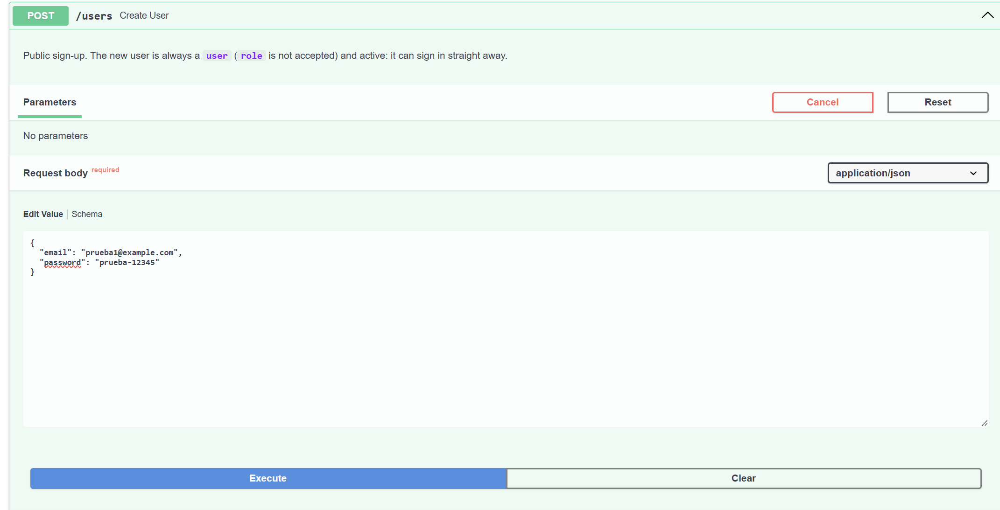 | 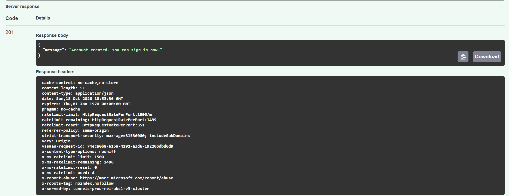 | El alta responde `201` solo con `message`: ni email, ni id, ni rol. |
| 2 | `POST /auth/login` | 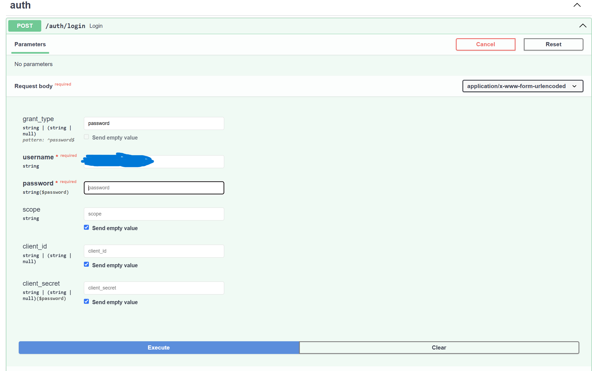 | 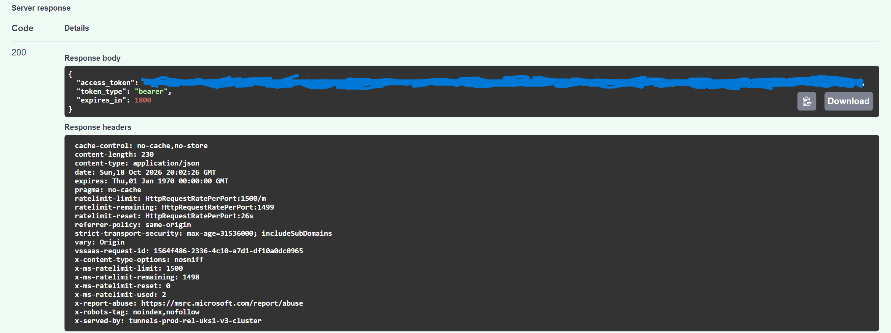 | El login devuelve solo `access_token`, `token_type` y `expires_in`. |
| 3 | `GET /auth/me` | 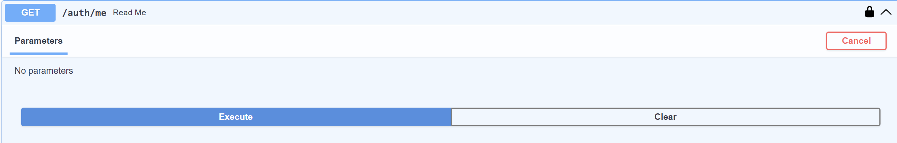 | 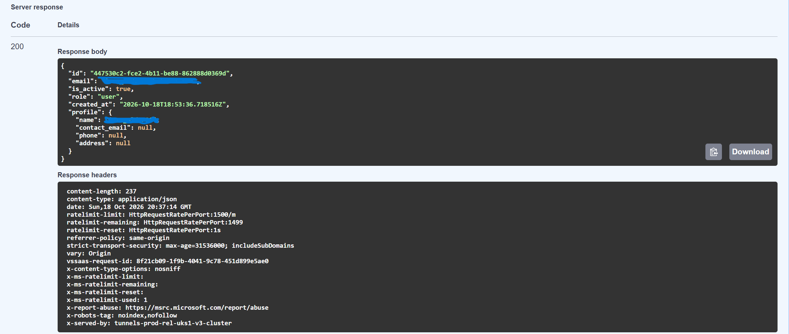 | `profile` trae solo `name`, `contact_email`, `phone` y `address`; sin `id` ni `user_id`. |
| 4 | `GET /inventory/orders` | 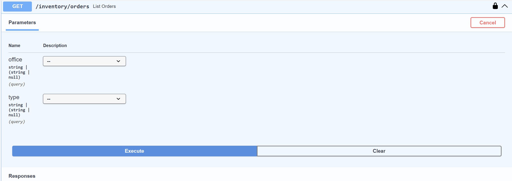 | 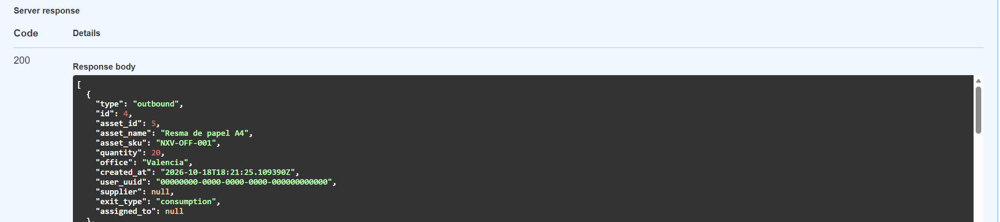 | El activo va aplanado (`asset_id`, `asset_name`, `asset_sku`), sin objeto `asset` anidado. |
| 5 | `POST /inventory/products` con `current_stock` | 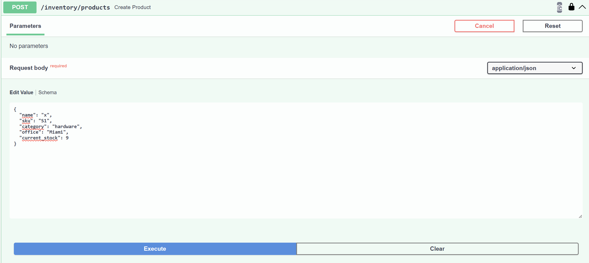 | 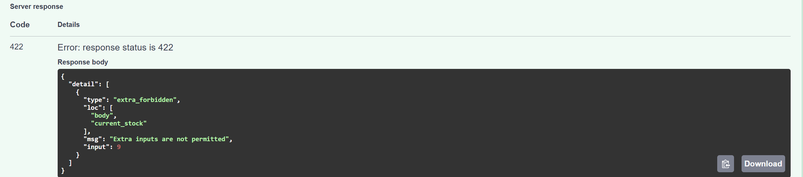 | Un campo que no es de entrada se rechaza con `422 extra_forbidden` en vez de ignorarse. |
| 6 | Todos los endpoints | 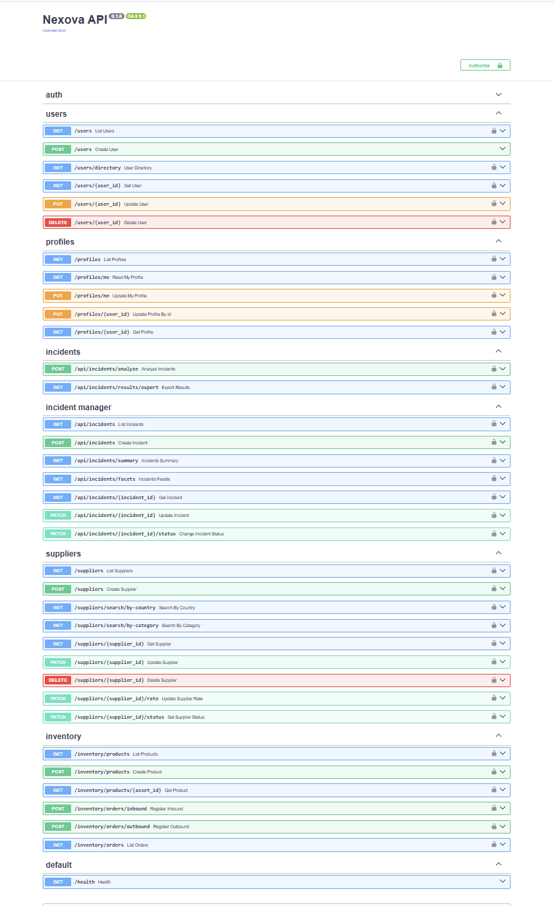 | | Los 38 endpoints aparecen documentados en OpenAPI, y los públicos (`/auth/login`, `POST /users`, `/health`) no llevan candado. |
