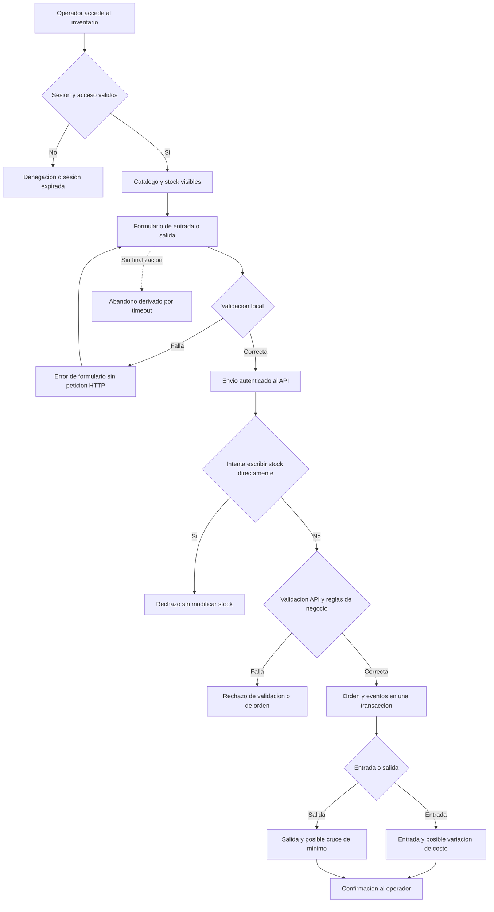

# Plan de telemetria de Nexova

Estado: diseno, version 2.0.0. Respuesta al RFI de gestion. No hay instrumentacion, almacenamiento ni servidor nuevo en esta entrega.

## 1. Objetivo y fuente de verdad

Se ha leido completo el [briefing de Nexova](../../nexova-BRIEFING.es.md), incluidas sus seis secciones. Este plan cubre inventario, autenticacion, uso del backoffice y website, proveedores, incidencias, procesos internos y salud tecnica. Los cinco eventos del briefing son el piso obligatorio, no el limite del catalogo de 40 tipos. El contrato ejecutable es [event-schemas.json](event-schemas.json); la guia de la entrega esta en [README.md](README.md).

Respuesta al RFI: el sistema puede producir informacion accionable si se instrumentan los puntos identificados y se completan los prerrequisitos indicados. Hoy no se acredita que exista dicha captura en produccion ni que se disponga de todos los campos. El entregable responde que capturar, por que, donde y con que contrato; no implementa colectores.

Elena necesita anticipar reposiciones y controlar costes; Patricia necesita detectar intentos de saltarse la trazabilidad; Laura necesita un resumen ejecutivo semanal. No se pueden inferir matriculas ni finalizaciones de cursos a partir de entregas de kits: esas metricas futuras necesitan fuentes educativas adicionales.

### Clasificacion individual de Fase 1

La clasificacion expresa el origen del requisito, no su urgencia. **Obligatorio** significa que viene del briefing de Nexova; **Oportunidad identificada** significa que lo propone este plan. Una oportunidad P0 sigue sin ser una metrica obligatoria del briefing. Las hipotesis y decisiones de cada fila estan en los catalogos de las secciones 5 y 10.

| event_type | Clasificacion |
| --- | --- |
| `inbound_order_created` | Obligatorio |
| `outbound_order_created` | Obligatorio |
| `stock_threshold_triggered` | Obligatorio |
| `direct_stock_edit_rejected` | Obligatorio |
| `kit_cost_variance_detected` | Obligatorio |
| `product_created` | Oportunidad identificada |
| `product_updated` | Oportunidad identificada |
| `inventory_order_rejected` | Oportunidad identificada |
| `inventory_validation_failed` | Oportunidad identificada |
| `login_attempted` | Oportunidad identificada |
| `login_succeeded` | Oportunidad identificada |
| `login_failed` | Oportunidad identificada |
| `logout_completed` | Oportunidad identificada |
| `session_expired` | Oportunidad identificada |
| `authorization_denied` | Oportunidad identificada |
| `registration_completed` | Oportunidad identificada |
| `registration_failed` | Oportunidad identificada |
| `profile_updated` | Oportunidad identificada |
| `section_viewed` | Oportunidad identificada |
| `search_performed` | Oportunidad identificada |
| `flow_started` | Oportunidad identificada |
| `flow_step_completed` | Oportunidad identificada |
| `flow_completed` | Oportunidad identificada |
| `flow_cancelled` | Oportunidad identificada |
| `supplier_created` | Oportunidad identificada |
| `supplier_updated` | Oportunidad identificada |
| `supplier_deleted` | Oportunidad identificada |
| `incident_created` | Oportunidad identificada |
| `incident_status_changed` | Oportunidad identificada |
| `incident_analysis_completed` | Oportunidad identificada |
| `incident_analysis_failed` | Oportunidad identificada |
| `talent_form_submitted` | Oportunidad identificada |
| `talent_form_rejected` | Oportunidad identificada |
| `http_request_completed` | Oportunidad identificada |
| `dependency_call_completed` | Oportunidad identificada |
| `application_error_occurred` | Oportunidad identificada |
| `background_job_completed` | Oportunidad identificada |
| `telemetry_delivery_failed` | Oportunidad identificada |
| `section_load_completed` | Oportunidad identificada |
| `form_validation_failed` | Oportunidad identificada |

Comprobacion de Fase 1: cinco obligatorios y 35 oportunidades con nombre, contrato y justificacion; no hay cuota que limite la exploracion. Las ideas futuras de la seccion 13 son oportunidades candidatas adicionales, fuera del contrato hasta definir su fuente. Los nombres Product, InboundOrder, OutboundOrder, office y programme, las seis propiedades minimas y los enums de categoria/oficina/moneda se conservan como los define el briefing, sin sustituirlos por el vocabulario antiguo del backend.

## 2. Entidades y restricciones

| Entidad | Identidad y datos de negocio |
| --- | --- |
| Product | `product_id` estable; `product_category`: `training_kit`, `certification` u `onboarding_equipment`; `programme_id` obligatorio; oficina propietaria. |
| InboundOrder | Entrada de unidades recibidas; `order_id`, producto, cantidad positiva, proveedor identificado por ID, coste unitario y autor autenticado. No es una mera solicitud de compra. |
| OutboundOrder | Entrega efectiva de unidades; `order_id`, producto, cantidad positiva y autor autenticado. No es una reserva. |
| office | `valencia` o `miami`, independiente del idioma de la interfaz. |
| programme | ID estable del programa o area; para equipos generales se debe registrar un area real, por ejemplo `onboarding-soporte`, nunca inventar un curso. |

Reglas obligatorias:

- Valencia usa EUR y Miami USD. No convertir monedas ni sumar importes EUR y USD en un mismo total.
- Stock = suma de entradas confirmadas menos suma de salidas confirmadas, por producto y oficina. Nunca aceptar ediciones directas ni stock negativo.
- Toda orden debe ser trazable a un usuario autenticado en el sistema operacional.
- No enviar nombres, correos, destinatarios, textos libres, credenciales, tokens ni cuerpos completos de peticiones a telemetria. Solo IDs opacos de producto/programa/proveedor y un autor seudonimizado.

## 3. Diferencias respecto al codigo actual

Se han revisado [models.py](../../services/api/inventory/models.py) y [service.py](../../services/api/inventory/service.py). Esta entrega no los modifica.

| Actual | Contrato de telemetria / trabajo previo a instrumentar |
| --- | --- |
| `Asset`, `AssetEntry`, `AssetExit` | Equivalen a Product, InboundOrder y OutboundOrder; conservar las entidades actuales y adaptar nombres al emitir. |
| IDs enteros y oficinas `Valencia` / `Miami` | Serializar IDs como cadenas; traducir oficinas mediante un mapa cerrado a minusculas. |
| `hardware`, `peripherals`, `office_supplies`, `training_materials` | Agregar clasificacion de negocio explicita por producto. No mapear automaticamente todo `training_materials` a certificacion ni todos los perifericos a equipo de onboarding. Elena debe validar el catalogo. |
| Sin programa, umbral de stock ni costes | Incorporar `programme_id`, `minimum_stock`, `unit_cost_minor`, moneda y proveedor por ID antes de habilitar los eventos correspondientes. |
| Proveedor como texto libre; destinatario `assigned_to` | Resolver proveedor a un ID operacional; no exportar ninguno de esos textos. |
| `user_uuid` en las ordenes | Mantener la trazabilidad original con acceso restringido; emitir `userId = HMAC-SHA256(clave por entorno, user_uuid)` en hexadecimal. No exportar el UUID original. |
| `register_inbound` y `register_outbound` hacen commit directamente | Incorporar posteriormente una outbox en su misma transaccion; no publicar antes del commit ni depender de una llamada externa despues del commit. |
| No hay PUT/PATCH de productos ni ordenes | Detectar campos de stock prohibidos en las rutas de escritura existentes; un 405 por metodo inexistente solo cuenta como peticion HTTP, no prueba una edicion de stock. `product_updated` requiere una futura funcion de edicion de metadatos, nunca de stock. |

Estas carencias son prerrequisitos de una fase futura, no cambios implementados ni errores corregidos en esta entrega. El arranque actual solo llama a `SQLModel.metadata.create_all()`: crea tablas nuevas, pero no migra las existentes. Para agregar programa, categoria de negocio, minimo, coste y proveedor-ID hace falta una migracion versionada y un backfill revisado; no se deben inferir esos valores automaticamente desde las categorias legacy.

## 4. Envelope y propiedades comunes

Cada objeto es un evento JSON validable por el esquema Draft 2020-12. Todos los campos de la siguiente tabla son obligatorios.

| Campo | Contrato |
| --- | --- |
| `eventId` | UUID v4, generado una sola vez por evento logico y conservado en reintentos. |
| `event_type` | Uno de los 40 nombres cerrados del catalogo; formato `entidad_accion` en snake_case. Los cinco obligatorios conservan sus nombres literales del briefing. |
| `schemaVersion` | `2.0.0`; no confundir con la version del producto o del backend. |
| `timestamp` | Instante del hecho en UTC, ISO 8601/RFC 3339 terminado en Z; para ordenes se captura en la transaccion, no al entregar el mensaje. |
| `userId` | HMAC hexadecimal de 64 caracteres calculado en backend, o null cuando no hay usuario autenticado. Sigue siendo dato seudonimizado, no anonimo. Obligatorio no nulo en eventos de inventario y login/registro exitosos. |
| `sessionId` | UUID v4 de sesion analitica, no token JWT. Obligatorio no nulo en navegador; null permitido para llamadas directas al API y procesos sin sesion humana. |
| `requestId` | UUID v4 de la operacion causal; compartido por eventos derivados de la misma peticion. En acciones locales o jobs es el ID de operacion, sin fingir que hubo HTTP. |
| `environment` | `development`, `test`, `staging` o `production`; conjuntos de datos separados. |
| `source` | `inventory_api`, `api`, `backoffice`, `website` o `worker`; restringido por evento. El navegador no es fuente de verdad para cambios de stock. |
| `properties` | Objeto cerrado por tipo de evento con dimensiones y medidas. |

En los eventos de inventario, `properties` exige `office`, `product_id`, `product_category`, `programme_id`, `quantity` y `currency`, tambien en rechazos y alertas. No imponer dimensiones de inventario a un login anonimo o a un fallo de red. Los IDs son cadenas opacas de hasta 128 caracteres. `quantity` expresa unidades fisicas de la orden causal; cero en rechazos o cambios de catalogo porque no se movio material. No representa dinero ni el stock restante.

La primera propuesta local usaba `event_id`, `occurred_at`, `actor_id`, `request_id` y `event_version`, y no incluia sesion. Se sustituye por este envelope para ajustarse al enunciado completo; se incrementa la version mayor a 2.0.0 por cambio incompatible. No hay eventos instrumentados que migrar en esta entrega. El contrato nuevo rechaza los nombres viejos; no enviar ambos formatos a la vez.

Los importes son enteros en centimos (`*_minor`) y se calculan con aritmetica decimal o entera, nunca con floats binarios financieros. `currency` debe corresponder a la oficina y al precio operacional validado. No confiar en dimensiones suministradas por el navegador: leerlas del catalogo.

## 5. Catalogo de los cinco eventos obligatorios

| Evento | Disparo exacto y propiedades especificas | Hipotesis y decision |
| --- | --- | --- |
| `inbound_order_created` | Una orden de recepcion se confirma. `order_id`, `supplier_id`, `unit_cost_minor`, `total_cost_minor`; `quantity > 0`; total = cantidad por coste unitario. | Saber cuanto material se compra/produce por programa y coste; Elena planifica produccion frente a demanda. |
| `outbound_order_created` | Una entrega se confirma despues de comprobar stock suficiente. `order_id`, `stock_before`, `stock_after`; `quantity > 0`; despues = antes menos cantidad. | Medir consumo por programa y ritmo de entregas; Elena anticipa reposicion. |
| `stock_threshold_triggered` | Una salida confirmada cruza de `stock_before >= minimum_stock` a `stock_after < minimum_stock`. `order_id`, `stock_before`, `stock_after`, `minimum_stock` positivo; cantidad de esa salida. | Identificar programas que se quedan cortos; ajustar minimos o acelerar produccion. |
| `direct_stock_edit_rejected` | El API identifica y rechaza una escritura explicita de `stock` o `current_stock` de un producto existente y con dimensiones resolubles. `quantity = 0`, `attempted_field` y `reason = direct_stock_write_forbidden`. No copiar el valor ni la peticion. | Detectar intentos de evitar trazabilidad; Patricia decide formacion o revision de permisos por oficina. |
| `kit_cost_variance_detected` | Entrada confirmada cuya variacion absoluta no redondeada supera el 10% del historico elegible. `order_id`, `supplier_id`, `unit_cost_minor`, `reference_unit_cost_minor`, `baseline_order_count = 5`, `variance_percent`, `threshold_percent = 10`; cantidad de esa entrada. | Detectar cambios anomalos de precio; Elena y Laura revisan proveedor y renegocian. |

### Semantica de umbral

Comparacion estricta: quedar exactamente en el minimo no dispara alerta. Mientras el stock siga por debajo, nuevas salidas no repiten la alerta. Una entrada que reponga hasta el minimo o mas rearma implicitamente el siguiente cruce. No se emite por crear un producto a stock cero ni por cambiar la configuracion del minimo. `minimum_stock = 0` deshabilita esta alerta. Guardar en el evento el umbral vigente en la operacion para no reinterpretarlo mas tarde.

### Semantica de costes

Decision de diseno (el briefing solo sugiere un 10%): umbral inicial fijo del 10%, tanto subidas como bajadas. Baseline = las cinco ultimas entradas confirmadas anteriores a la actual del mismo producto, proveedor, oficina y moneda, ordenadas por `created_at` descendente y despues ID numerico descendente en empates. Usar una instantanea consistente de esas filas en la transaccion. Referencia = media ponderada `SUM(quantity * unit_cost_minor) / SUM(quantity)`, redondeada a centimos con HALF_UP.

Si faltan cinco entradas elegibles o la referencia es cero, no emitir variacion; registrar solo la entrada normal. Calcular `100 * abs(actual - referencia) / referencia` y comparar sin redondear con 10: exactamente 10 no alerta. Guardar `variance_percent` sin redondeo de presentacion; los informes pueden mostrar dos decimales. Ejemplo: referencia 1000 centimos y actual 1200 -> 20%. El proveedor no cambia de identidad por variaciones de su nombre comercial.

### Rechazos sin producto resoluble

Peticiones no autenticadas, productos inexistentes, rutas inexistentes o rechazos que no permitan resolver programa/categoria no generan un evento de inventario incompleto. Se registran, sin payload ni datos personales, en logs tecnicos/de seguridad separados. No atribuir estas peticiones a una oficina inferida del idioma. La metrica de rechazos de este plan se limita explicitamente a productos existentes, clasificados y peticiones autenticadas.

## 6. Donde instrumentar y como entregar (fase posterior)

1. Validar autenticacion, permisos, producto, dimensiones, moneda, cantidad y precio. En el rechazo especifico de edicion, construir un evento sanitizado antes de devolver el error contractual 422, o 403 si lo determina la autorizacion.
2. En `register_inbound`, guardar orden y evento de entrada en la misma transaccion; calcular baseline y posible variacion con la misma instantanea. Serializar las entradas concurrentes del mismo producto con el bloqueo usado para salidas.
3. En `register_outbound`, mantener el bloqueo del producto, obtener stock anterior, guardar la salida y construir evento de salida y posible cruce de umbral. Persistirlos en la outbox dentro del mismo commit. Rollback implica cero eventos de exito.
4. Un rechazo no tiene transaccion de orden confirmada: persistir su evento en una transaccion independiente y acotada antes de responder. Si falla, conservar el rechazo, incrementar un contador tecnico sin PII y alertar de la perdida; nunca permitir la escritura por fallar telemetria.
5. Un publicador futuro valida cada evento, entrega al menos una vez y reintenta con el mismo `eventId` (1, 2, 4, 8... segundos hasta un maximo de 5 minutos). Tras 10 fallos consecutivos lo mueve a cuarentena para revision y replay manual con el mismo ID. Eventos invalidos van directamente a cuarentena sanitizada.
6. Consumidor con indice unico en `eventId`; acusar recibo solo tras persistir. Los eventos de una misma orden tienen IDs distintos y el mismo `requestId`. Una clave unica operacional `(tipo de orden, order_id, event_type)` evita duplicar eventos de exito en la outbox. Para rechazos, `(requestId, event_type)` limita un evento por peticion. Si se incorpora idempotencia HTTP, reintentar una orden debe recuperar la misma orden y eventos, no crear otra.

No asumir orden de llegada ni entrega exactamente una vez. Agregar por `timestamp`, deduplicar por `eventId` y permitir recalculo de periodos por llegadas tardias. Un replay no cuenta como una nueva compra ni una nueva entrega. Las alertas se derivan del estado operacional en transaccion, nunca del orden de llegada al consumidor.

### Mapa completo del flujo de inventario

Puntos de diseno para instrumentar despues; no son emisores instalados. El recorrido comienza cuando el operador autenticado accede al inventario y termina con una orden confirmada o una rama de rechazo/abandono. Autenticacion y permisos se verifican de nuevo en backend aunque el frontend ya haya permitido entrar.

| Punto | Donde / instante exacto | Evento(s) o resultado | Hipotesis / decision |
| --- | --- | --- | --- |
| I01 | Sesion validada en AuthContext y autorizacion por peticion en el API | `authorization_denied`; `session_expired` si cliente descarta la sesion | Saber si el acceso bloquea el trabajo / revisar permisos o recuperacion de sesion. |
| I02 | Montaje/navegacion a inventario y fin de carga del catalogo/stock | `section_viewed`; `section_load_completed` | Separar visitas de esperas o cargas fallidas / optimizar datos o render de la seccion. |
| I03 | Primera interaccion con el formulario de entrada/salida | `flow_started`, flow_name inbound/outbound | Conocer cuantos operadores empiezan una gestion / calcular conversion del flujo. |
| I04 | `handleSubmit` encuentra errores en `validateInbound` o `validateOutbound` y retorna sin llamar al API | `form_validation_failed`; nunca `inventory_validation_failed` del API | Saber que validaciones bloquean en cliente / corregir formulario sin atribuir peticiones inexistentes al servidor. |
| I05 | Validacion local superada y envio de `createInboundOrder`/`createOutboundOrder` | `flow_step_completed`, pasos validated y submitted; mismo requestId que la peticion | Separar perdida antes y despues del envio / mejorar el paso con mayor friccion. |
| I06 | API identifica campo prohibido stock/current_stock sobre producto resoluble | `direct_stock_edit_rejected`, sin escritura | Detectar intentos de saltar trazabilidad / revisar formacion o permisos. Requiere implementar rechazo explicito, no deducirlo de un 405. |
| I07 | Validacion del API falla antes de ejecutar servicio, producto conocido | `inventory_validation_failed` | Identificar errores que el cliente no filtro / alinear contrato y validacion. |
| I08 | Servicio rechaza stock insuficiente, oficina incompatible u otro conflicto | `inventory_order_rejected`; salida insuficiente devuelve 400 actualmente | Saber que impide entregar material / reponer o revisar seleccion de oficina. |
| I09 | Entrada confirmada: orden y evento persistidos en misma transaccion futura | `inbound_order_created`; posible `kit_cost_variance_detected` | Medir compra y desviacion de precio / planificar produccion o renegociar. |
| I10 | Salida confirmada bajo bloqueo, con stock anterior/posterior y minimo vigente | `outbound_order_created`; posible `stock_threshold_triggered` | Medir consumo y cruce real de minimo / anticipar reposicion. |
| I11 | Respuesta de orden correcta y confirmacion visible al operador | `flow_completed`; `application_error_occurred` si falla render/red; cada peticion termina con `http_request_completed` | Distinguir persistencia de orden de confirmacion vista / recuperar UX sin duplicar compras o entregas. |
| I12 | Sin finalizacion/cancelacion del mismo flow_id durante la ventana de la seccion 11 | Abandono derivado, no un nuevo event_type | Saber que intentos se quedan a medias / simplificar el paso o investigar fallos. |

Referencias concretas: [entrada: handleSubmit](../../uis/backoffice/src/views/InboundOrderPage.tsx), [salida: handleSubmit](../../uis/backoffice/src/views/OutboundOrderPage.tsx), [rutas y errores del API](../../services/api/routers/inventory.py) y [servicio y commit](../../services/api/inventory/service.py).

En la UI, una cantidad superior al stock mostrado produce un aviso pero se puede enviar: el servidor decide con el saldo real, que puede haber cambiado. No registrar ese aviso como rechazo de orden. Tras crear la orden, ambas vistas refrescan stock/catalogo: un fallo de esa lectura no revierte la orden ya confirmada ni permite emitir un segundo evento de creacion. Para rechazos sin dimensiones confiables se mantiene la limitacion de la seccion 5; nunca inventar producto/programa. La precedencia entre rechazos de stock directo, validacion y negocio evita contarlos varias veces.

## 7. Metricas, agregaciones y decisiones

Ventana diaria: [00:00 UTC, 00:00 UTC del dia siguiente). Ventana semanal ejecutiva: lunes 00:00 UTC al lunes siguiente, extremo final exclusivo. Reportar cada martes a las 09:00 UTC la semana anterior con 24 horas de margen; admitir eventos tardios y publicar una revision identificada del periodo, sin sobrescribir silenciosamente un reporte enviado. Son convenciones de diseno propuestas, no un calendario ya acordado con negocio.

Las metricas de inventario se filtran por entorno y se agrupan por oficina y programa; agregar categoria/producto/proveedor cuando ayude. No contar `userId` como dimension publica ni como etiqueta de series temporales de alta cardinalidad. Las metricas generales usan seccion/ruta/componente y no inventan oficina/programa.

| Indicador | Formula sobre eventos validos deduplicados | Uso |
| --- | --- | --- |
| Entradas y unidades recibidas | COUNT de `inbound_order_created`; SUM de su `quantity`. | Produccion/compra por programa, Elena. |
| Coste de recepcion | SUM de `total_cost_minor` / 100, separado por moneda. | Presupuesto de Elena y resumen de Laura. |
| Entregas y consumo diario | COUNT de `outbound_order_created`; SUM de su `quantity` por dia. | Ritmo de consumo, Elena. No equivale a alumnos unicos. |
| Cruces de minimo | COUNT de `stock_threshold_triggered`; COUNT DISTINCT de `product_id`. | Frecuencia y amplitud de faltantes; no duracion sin material. |
| Intentos rechazados | COUNT de `direct_stock_edit_rejected` por oficina; sin tasa porcentual porque no hay denominador de intentos totales en este catalogo. | Formacion/permisos, Patricia. |
| Anomalias de precio | COUNT de `kit_cost_variance_detected`, maximo `variance_percent`, detalle por proveedor/producto. | Revision de contratos, Elena y Laura. |

No reconstruir stock absoluto solo con eventos nuevos si no existe snapshot inicial reconciliado. El stock operacional sigue siendo la fuente de verdad. No sumar cantidades entre productos como si fueran kits equivalentes; mostrar desglose por producto cuando se comparen materiales distintos.

## 8. Privacidad, acceso y calidad

- Lista permitida de campos mediante objetos cerrados; prohibir textos libres. Validar IDs contra el catalogo, ademas del schema: una cadena con forma valida aun podria contener un nombre.
- Secretos HMAC solo en backend, separados por entorno y estables durante la retencion; una rotacion requiere documentar nueva version de contrato y su efecto sobre correlacion. Ni clave ni UUID original se almacenan en eventos.
- Propuesta de retencion pendiente de aprobacion por responsable de privacidad: 90 dias para eventos/outbox entregada/cuarentena; 12 meses para agregados sin actor ni IDs de peticion. Purgar tambien copias y exportaciones segun politica de backup. No afirmar cumplimiento legal solo por seudonimizar.
- Acceso de escritura solo del API/publicador; lectura de eventos crudos solo operaciones autorizadas. Elena/Laura/Patricia reciben agregados de su ambito; accesos auditados y transporte cifrado.
- Sin muestreo de los cinco eventos. Monitorizar por separado backlog/antiguedad de outbox, errores de schema, duplicados, fallos de rechazo y discrepancia entre ordenes confirmadas y eventos de orden unicos. Objetivo propuesto: entrega p95 < 60 segundos y ninguna discrepancia pendiente durante mas de 24 horas.
- Versionado: cualquier cambio de campos, enums o semantica requiere nueva version y actualizacion del schema, fixtures y consumidores; el contrato actual acepta solo 2.0.0. Una futura migracion necesita consumidores compatibles antes de cambiar productores.

## 9. Validacion y escenarios de aceptacion

Validar con JSON Schema Draft 2020-12 y verificacion de `format` activada. El JSON incluye ocho ejemplos sinteticos: los cinco obligatorios, un login fallido, una visita anonima y un proceso sin usuario/sesion. El schema comprueba forma, tipos, campos obligatorios, moneda/oficina, cantidades y campos extra. Las igualdades aritmeticas, las transiciones, la existencia de IDs, los permisos y el historico requieren comprobaciones de servicio: JSON Schema no compara dos propiedades entre si.

| Caso de prueba para la futura instrumentacion | Resultado esperado |
| --- | --- |
| Entrada de 10 unidades a 1200 centimos, Valencia | Un evento de entrada EUR, total 12000. No emitir antes del commit. |
| Salida: stock 12, cantidad 5, minimo 10 | Evento de salida con stock 7 y una alerta de umbral. |
| Stock 12 -> 10 con minimo 10; despues 10 -> 9; despues 9 -> 8 | Cero, una, cero alertas respectivamente. |
| Reponer de 8 a 12; siguiente salida 12 -> 9 con minimo 10 | Nueva alerta; la entrada no genera alerta de stock. |
| Salida superior al stock / rollback / peticion duplicada idempotente | Ningun evento de exito para operaciones rechazadas; el reintento idempotente no duplica orden ni evento. |
| Dos salidas simultaneas sobre el mismo producto | Estado serializado, sin stock negativo y solo un evento por cruce real. |
| Intento autenticado de escribir `current_stock` de producto clasificado | Operacion rechazada, stock intacto, un evento con cantidad cero y sin payload personal. |
| Cinco entradas historicas a 1000; nueva a 1100 / 1200 / 800 | Sin alerta / alerta 20% / alerta 20%; siempre hay evento de entrada. |
| Cuatro entradas previas, referencia cero o distinto proveedor/moneda | No inventar baseline ni emitir variacion. |
| Miami con EUR; campo `email`; cantidad negativa; tipo desconocido | Rechazo de schema; no contaminar metricas. |
| Mismo evento entregado dos veces; evento tardio | Una fila logica; recalcular el periodo de negocio correspondiente. |

Fixture sintetico de aceptacion: [seed-data.json](seed-data.json) contiene ocho productos en las tres categorias, tres programas, 15 entradas y 15 salidas entre Valencia y Miami. Incluye tres cruces de minimo y una variacion de coste del 20% sobre cinco entradas comparables. No contiene nombres ni datos de personas. Es un fixture de diseno para validar las reglas de telemetria, no datos insertados en la base ni un seed ejecutable por el API actual: los modelos existentes no tienen programa, moneda, coste unitario ni minimo de stock. Los ejemplos de eventos JSON tampoco representan ordenes reales.

## 10. Catalogo ampliado: razon, contrato y prioridad

Cada fila completa la frase: "Capturamos [event_type] porque necesitamos saber [hipotesis], lo que nos permite tomar la decision [decision concreta]". Las cinco filas de la seccion 5 completan este catalogo de 40 eventos. Todos los de esta seccion se clasifican individualmente como Oportunidad identificada en la seccion 1. P0 = primera captura imprescindible; P1 = siguiente iteracion sobre funciones existentes; P2 = requiere una capacidad futura. Prioridad no significa implementado ni sustituye la clasificacion de origen.

Modos: **S** = stream validado al menos una vez, objetivo de disponibilidad < 60 segundos; **B** = captura del hecho en origen y procesamiento batch diario a las 02:00 UTC del dia siguiente. Batch no significa intentar reconstruir hechos que nunca se capturaron. Los cinco obligatorios son P0/S; sus informes diarios/semanales son batch. Stream permite alertar; no obliga a un motor distribuido ni a crear un microservicio.

Las propiedades especificas indicadas son obligatorias y cerradas en el schema. Tipos, enums y longitudes se definen alli; no hay un objeto de metadatos arbitrario. `I` en la tabla significa las seis propiedades comunes de inventario.

### Inventario adicional

| event_type | Disparo / fuente | Propiedades | Necesitamos saber... / decision concreta | Responsable / prioridad / modo |
| --- | --- | --- | --- | --- |
| `product_created` | Producto confirmado / inventory_api | I; `change_kind=catalogue`, quantity=0 | Que crece en el catalogo / revisar duplicacion y planificar materiales. | Elena / P1 / B |
| `product_updated` | Metadatos realmente cambiados y confirmados / inventory_api | I; `change_kind` catalogue/classification/threshold, quantity=0 | Cuando cambian clasificacion o minimos / revisar catalogo y politica de reposicion. | Elena / P2 / B |
| `inventory_order_rejected` | Regla de negocio rechaza orden, sin commit / inventory_api | I; `operation`, `field`, `error_code`, quantity=0 | Que productos tienen stock insuficiente o conflicto de oficina / reponer o corregir asignaciones. | Operaciones / P0 / S |
| `inventory_validation_failed` | Validacion de entrada falla antes del servicio / inventory_api | I; `operation`, `field`, `error_code`, quantity=0 | Que campos/productos acumulan errores / corregir formulario o instrucciones de negocio. | Operaciones / P0 / B |

Los dos rechazos adicionales se emiten solo si el producto y sus dimensiones pueden resolverse con datos confiables; en otro caso usar el evento HTTP y, si aplica, autorizacion. Para creacion de un producto aun inexistente no inventar `product_id`: solo HTTP. `inventory_validation_failed` cuenta una peticion, no un evento por cada campo; usar `field=multiple` si hay varios. Un fallo de validacion no genera tambien `inventory_order_rejected`; este ultimo representa reglas del servicio. `direct_stock_edit_rejected` tiene precedencia sobre ambos para no duplicar un mismo intento en el total de rechazos. No registrar valores rechazados ni mensajes libres.

### Identidad, acceso y perfil

| event_type | Disparo / fuente | Propiedades | Necesitamos saber... / decision concreta | Responsable / prioridad / modo |
| --- | --- | --- | --- | --- |
| `login_attempted` | API recibe un intento identificable de login, antes de autenticar | `method=password`, `duration_ms=0` | Volumen total de intentos / dimensionar capacidad y calcular tasa de fallos. | Seguridad / P0 / S |
| `login_succeeded` | API autentica y genera token | `method`, `duration_ms` | Cuantos intentos terminan bien y cuanto tardan / detectar friccion y disponibilidad. | Seguridad / P0 / S |
| `login_failed` | API termina intento sin autenticar | `method`, `duration_ms`, `reason` | Cuantos fallos diarios hay / revisar abuso o problemas del acceso. | Seguridad / P0 / S |
| `logout_completed` | Backoffice borra token por accion explicita | `reason=user_action` | Cuantas sesiones se cierran de forma voluntaria / revisar ergonomia del cierre. | Producto / P1 / B |
| `session_expired` | Backoffice detecta expiracion o 401 y descarta sesion | `reason=token_expired` o `unauthorized_response` | Cuantos flujos se interrumpen por sesion / ajustar duracion o recuperacion. | Producto / P1 / B |
| `authorization_denied` | API decide 401/403 en recurso protegido | `route_id`, `status_code` | Donde faltan permisos o hay acceso indebido / revisar roles o rutas. | Seguridad / P0 / S |
| `registration_completed` | API confirma cuenta; no depende de login automatico posterior | `method=password`, `duration_ms` | Cuantas cuentas se crean / separar fallo de alta y fallo de acceso. | Operaciones / P1 / B |
| `registration_failed` | API rechaza alta | `reason` | Friccion del registro sin revelar si existe el correo / corregir validacion o disponibilidad. | Operaciones / P1 / B |
| `profile_updated` | API confirma cambios reales de perfil | `changed_field_count` | Si se usa y funciona el autoservicio / priorizar mantenimiento de perfil. | Patricia / P1 / B |

`login_failed.userId` y `registration_failed.userId` son siempre null: no derivarlos del correo ni distinguir cuenta inexistente de clave incorrecta. Nunca capturar email, password, JWT, IP cruda ni hash de email. `reason=invalid_credentials` agrupa credenciales invalidas. Propuestas de rate limiting futuras pueden usar `rate_limited`, sin afirmar que existe hoy. En login, errores de parseo se clasifican `invalid_request` si el API pudo reconocer el intento; si ni siquiera llega al API solo habra observacion cliente/infraestructura, fuera del denominador del API.

### Navegacion y flujos

| event_type | Disparo / fuente | Propiedades | Necesitamos saber... / decision concreta | Responsable / prioridad / modo |
| --- | --- | --- | --- | --- |
| `section_viewed` | Vista logica visible tras navegacion / navegador | `section`, `locale` | Que secciones se visitan / ordenar accesos y priorizar mejoras. | Producto / P0 / B |
| `section_load_completed` | Termina carga inicial de contenido/datos de una seccion, con exito o error / navegador | `section`, `duration_ms`, `outcome` | Cuanto espera el operador y donde falla la carga / priorizar optimizacion de esa seccion. | Tecnologia / P1 / B |
| `search_performed` | Busqueda/filtro aplicado y resultados disponibles / navegador | `section`, `result_count`, `filter_count` | Donde cuesta encontrar datos / mejorar filtros y catalogo. | Producto / P1 / B |
| `flow_started` | Primera interaccion real con un formulario / navegador | `flow_id`, `flow_name`, `step=form`, `elapsed_ms=0` | Cuantos flujos se inician / definir denominador de conversion. | Producto / P0 / B |
| `flow_step_completed` | Paso logico superado / navegador | `flow_id`, `flow_name`, `step`, `elapsed_ms` | Donde se atasca el flujo / simplificar el paso problematico. | Producto / P0 / B |
| `flow_completed` | Usuario recibe confirmacion valida del resultado / navegador | `flow_id`, `flow_name`, `step=confirmed`, `elapsed_ms` | Cuantos inicios llegan a confirmacion / priorizar recuperacion de errores. | Producto / P0 / B |
| `flow_cancelled` | Cancelacion explicita / navegador | `flow_id`, `flow_name`, `step`, `elapsed_ms` | Que se cancela voluntariamente / revisar formulario y salida. | Producto / P1 / B |
| `form_validation_failed` | Envio bloqueado por validacion local, antes de HTTP / navegador | `flow_id`, `flow_name`, `field`, `error_count` | Que errores no llegan al servidor / corregir reglas y mensajes del formulario. | Producto / P1 / B |

No capturar cada tecla ni el texto buscado, query string, URL completa o referrer. `search_performed` se dispara al confirmar busqueda o tras 500 ms sin cambios, no por cada render. Una seccion cuenta una vez por navegacion logica (no por rerenders, hidratacion o modo estricto); volver mas tarde cuenta otra visita. Una sesion puede contener varias visitas sin ser varios operadores.

`section_load_completed` mide con reloj monotono desde inicio de navegacion a contenido principal listo (datos obligatorios resueltos) o error terminal de esa carga. En carga inicial, origen = inicio de navegacion del documento; en SPA, inicio de la transicion de ruta. Emitir una vez por navegacion, no por recargas de stock tras una orden ni por cada recurso. Es tiempo de disponibilidad funcional de seccion, no LCP ni duracion del endpoint. Una carga que nunca termina solo es observable como falta de evento, no como duracion cero. Agregar p50/p95 por seccion/outcome y comparar con HTTP para elegir entre optimizar cliente o API; objetivo inicial propuesto p95 < 2 segundos, a validar con baseline.

`form_validation_failed` cuenta un submit bloqueado, no cada tecla ni cada error por separado; `error_count` positivo, `field=multiple` si hay varios, `other` para campos fuera de la lista permitida. Nunca enviar valores ni mensajes de error libres. Para talento, el evento especifico `talent_form_rejected` sigue siendo el KPI del formulario y el generico sirve para analisis transversal: comparten requestId y no se suman como dos intentos. No confundir un mismo intento observado en cliente y servidor con dos usuarios ni sumar rechazos locales a tasas del API.

### Proveedores, incidencias y website

| event_type | Disparo / fuente | Propiedades | Necesitamos saber... / decision concreta | Responsable / prioridad / modo |
| --- | --- | --- | --- | --- |
| `supplier_created` | Alta confirmada / api | `supplier_id` | Como crece el catalogo de proveedores / planificar revision y homologacion. | Operaciones / P1 / B |
| `supplier_updated` | Cambio real confirmado / api | `supplier_id` | Si los datos requieren mantenimiento frecuente / revisar calidad del catalogo. | Operaciones / P1 / B |
| `supplier_deleted` | Borrado confirmado / api | `supplier_id` | Que bajas se producen / revisar dependencia y consolidacion de proveedores. | Operaciones / P1 / B |
| `incident_created` | Alta de incidencia confirmada / api | `incident_id` | Demanda de soporte en el tiempo / asignar capacidad operativa. | Operaciones / P1 / B |
| `incident_status_changed` | Transicion valida persistida / api | `incident_id`, `from_status`, `to_status` | Tiempo y frecuencia de resolucion/reapertura / priorizar backlog y revisar proceso. | Operaciones / P1 / B |
| `incident_analysis_completed` | Analisis CSV termina con resultado / api | `analysis_id`, `row_count`, `duration_ms` | Volumen y coste temporal de analisis / ajustar limites y capacidad. | Operaciones / P1 / B |
| `incident_analysis_failed` | Analisis CSV termina sin resultado / api | `analysis_id`, `reason` | Que fallos impiden analizar / mejorar validacion o recursos. | Operaciones / P1 / S |
| `talent_form_submitted` | Formulario supera validacion local / website | `flow_id`, `validation_error_count=0` | Cuantos formularios llegan a confirmacion local / detectar diferencia con futura recepcion real. | Patricia / P1 / B |
| `talent_form_rejected` | Envio bloqueado por validacion local / website | `flow_id`, `validation_error_count>0` | Que volumen de intentos encuentra friccion / simplificar el formulario. | Patricia / P1 / B |

El formulario de talento actual solo cambia estado local, no envia a un backend: `talent_form_submitted` NO acredita recepcion, lead ni candidatura guardada. Una futura integracion necesitara un evento de aceptacion backend distinto. Estados canonicos de incidencias: open, in_progress, resolved, discarded; mapear origen CSV CLOSED a resolved, no a un estado nuevo. No emitir transicion si estado anterior = nuevo. No capturar asunto, descripcion, comentario, contenido CSV, nombre de archivo ni datos de candidatos/clientes.

### Salud tecnica y procesos

| event_type | Disparo / fuente | Propiedades | Necesitamos saber... / decision concreta | Responsable / prioridad / modo |
| --- | --- | --- | --- | --- |
| `http_request_completed` | API finaliza respuesta / api | `route_id`, `method`, `status_code`, `duration_ms` | Errores y latencia por ruta / mitigar regresiones y dimensionar servicio. | Tecnologia / P0 / S |
| `dependency_call_completed` | Termina llamada a Supabase/TinyDB/sink / api o worker | `dependency`, `outcome`, `duration_ms` | Donde se consume tiempo o falla la persistencia / ajustar pool, consultas o dependencia. | Tecnologia / P0 / S |
| `application_error_occurred` | Error no gestionado o fallo cliente / fuente afectada | `error_code`, `component` | Que componente rompe el uso / priorizar hotfix o rollback. | Tecnologia / P0 / S |
| `background_job_completed` | Proceso interno acaba con exito o fallo / api o worker | `job_id`, `job_name`, `outcome`, `duration_ms` | Si arranque, sincronizacion y futuros jobs funcionan / reintentar o reparar operacion. | Tecnologia / P1 / S |
| `telemetry_delivery_failed` | Una entrega falla o se pone en cuarentena / worker | `failed_event_id`, `attempt`, `reason` | Si la observabilidad esta perdiendo datos / recuperar backlog y corregir contrato. | Tecnologia / P0 / S |

`http_request_completed` incluye negocio exitoso y fallido; no se suma al recuento de ordenes. `route_id` es un ID de plantilla permitida, nunca el path con un ID real. Mapa: inventory_assets = `/inventory/products` y `/inventory/products/{asset_id}`; inventory_inbound/outbound = `/inventory/orders/inbound|outbound`; inventory_orders = `/inventory/orders`; auth_login/me = `/auth/login|me`; users/profiles/suppliers/incidents/incident_analysis agrupan sus routers y aliases; health = `/health`; unmatched para lo no reconocido. Al agrupar detalle/listado no se podra obtener su latencia separada hasta versionar el mapa. Estado HTTP de dominio (p. ej. 400 stock insuficiente) no es un 5xx tecnico.

Un error del propio pipeline no debe provocar recursion: `telemetry_delivery_failed` va a un canal tecnico local/independiente, no reintenta a traves del mismo sink averiado; si tambien falla, contador local y alerta de infraestructura. El fallo analitico del navegador nunca impide la operacion de negocio; buffer limitado propuesto a 100 eventos/256 KB, flush a 20 eventos o 5 segundos, con consentimiento aplicable y sin garantias de entrega al cerrar la pestaña. El backend ignora `source`/`userId` declarados por clientes y estampa identidad verificada en la futura ingestion.

## 11. Correlacion, sesiones y abandono

- El navegador crea un UUID de sesion analitica sin PII, estable entre navegaciones. Sesion nueva tras 30 minutos sin actividad, login, logout o cambio de usuario; no usar JWT, email ni `localStorage` de credenciales como ID. La politica concreta de almacenamiento analitico y consentimiento debe aprobarse antes de habilitar captura. Para acciones de login mantener el ID de la sesion preautenticada hasta registrar su resultado; luego rotarlo.
- Frontend genera `requestId`, lo propaga como `X-Request-ID`; backend valida UUID y reemplaza valores invalidos o ausentes, devuelve el ID efectivo y lo usa en logs y eventos. Propagar `sessionId` como `X-Session-ID` opcional validado; nunca usarlo como autorizacion. La configuracion CORS actual permite cabeceras de entrada pero necesitara exponer `X-Request-ID` de respuesta para lectores cross-origin. El colector debe establecer origen, identidad y esquema permitidos.
- `userId` se resuelve en backend; el navegador puede recibir un ID analitico opaco mediante un contrato futuro de sesion, nunca la clave HMAC. Un cliente no autenticado usa null. Procesos internos sin humano usan `userId=null`, `sessionId=null` y `job_id` en propiedades; las ordenes de inventario siguen requiriendo un autor operacional trazable. Automatizar ordenes requerira una identidad de servicio autorizada, no null.
- `flow_id` identifica un intento de formulario, UUID distinto por nueva apertura/interaccion; se mantiene durante sus pasos y reintentos. `elapsed_ms` se mide con reloj monotono desde el inicio. Eventos locales usan ID de operacion nuevo; durante un envio, cliente y API comparten `requestId`. Los datos de pantalla se emiten una vez por intento/paso; deduplicar tambien `(flow_id, event_type, step)` al calcular embudos. Las repetidas validaciones fallidas pueden tener IDs distintos y cuentan como intentos, no como nuevos flujos.
- Pasos canonicos: form -> validated -> submitted -> confirmed. En formularios de una sola pantalla son hitos, no pantallas inventadas. `flow_completed` exige confirmacion backend para altas/ordenes/analisis; para talento solo confirmacion local etiquetada como tal en el catalogo. Un registro que crea cuenta pero falla en autologin es alta exitosa, aunque el flujo de acceso no finalice.
- Abandono es un resultado derivado, no un evento fiable de cierre de pestaña. En batch, marcar un `flow_id` iniciado, sin completado ni cancelado, con 30 minutos desde el ultimo paso sin actividad. No renovar el timeout por visitar otra seccion. Estado provisional hasta 24 horas desde su inicio para aceptar eventos tardios. Si llega un completado valido posterior, reclasificar y revisar el agregado; no emitir otro abandono. No confundir falta de telemetria, bloqueo de consentimiento o sesion expirada con intencion de abandonar.

## 12. Indicadores del RFI y alertas propuestas

Calculos sobre eventos deduplicados en UTC, por entorno. Sin muestreo en el catalogo inicial; para HTTP/dependencias revisar volumen despues de medirlo. Si se cambia a muestreo, versionar y registrar ponderacion antes de calcular tasas, no extrapolar a ciegas.

| Pregunta | Calculo y segmentacion | Cadencia / accion |
| --- | --- | --- |
| Cuantas salidas por dia | COUNT outbound_order_created por dia/oficina/programa; SUM quantity por producto | Batch diario / reposicion, Elena. |
| Que productos fallan mas | COUNT inventory_validation_failed e inventory_order_rejected por product_id/error_code; mostrar volumen separado, no tasa sin denominador de intentos de orden | Batch diario / corregir flujo o catalogo, Operaciones. |
| Hay ediciones directas rechazadas | COUNT direct_stock_edit_rejected por dia/oficina; cualquier evento abre revision sin acusar automaticamente abuso | Stream <60s y resumen diario / Patricia. |
| A que horas se cruza minimo | COUNT stock_threshold_triggered por hora UTC/oficina/programa; convertir solo la visualizacion con Europe/Madrid y America/New_York, respetando DST | Stream <60s y resumen semanal / Elena. |
| Cuantos logins fallan al dia | COUNT login_failed por dia/reason; tasa = fallidos / intentados, unir outcomes con requestId; separar intentos pendientes | Stream; propuesta: >20 fallos y >30% en 5 min avisa a Seguridad. No es bloqueo automatico. |
| Que secciones se usan | COUNT section_viewed y COUNT DISTINCT sessionId por seccion; usuarios autenticados distintos solo con finalidad y acceso aprobados | Batch diario / ordenar navegacion, Producto. |
| Que flujos se abandonan | Abandonados / inicios de la misma cohorte diaria por flow_name; mostrar completados, cancelados y pendientes por separado | Batch diario con ventana 24h / mejorar paso con mayor caida. |
| Donde falla el API | SUM status>=500 / COUNT peticiones; p50/p95/p99 duration_ms por route_id/metodo; excluir health del indicador de uso | Stream; propuesta: >1% 5xx con >=100 peticiones en 5 min, o p95 >1000ms por 10 min, avisa a Tecnologia. |
| Que dependencia es lenta | p95 duration_ms y tasa outcome!=success por dependency | Stream / revisar consultas/pool; distinguir tiempo del API de tiempo de dependencia. |
| Cuanto tarda una incidencia | Tiempo entre created y primera transicion resolved, por incident_id; reaperturas separadas; casos anteriores a captura requieren baseline operacional | Batch diario / ajustar capacidad de soporte. No sumar descartados a resueltos. |
| Se estan perdiendo datos | Ordenes confirmadas frente a eventos unicos, backlog y mas antiguo pendiente, errores schema/reintentos; alerta si antiguedad >5 min o discrepancia >24h | Stream de salud + reconciliacion diaria / Tecnologia. |

Umbrales son propuestas iniciales, pendientes de baseline real y aprobacion. En alertas agrupar por tipo/producto/oficina o ruta en una ventana de 15 minutos para evitar tormentas; registrar reconocimiento y resolucion en la herramienta operativa futura, no inventar que hoy existe.

Arquitectura propuesta: emisores backend/outbox y cliente con ingestion autorizada -> validacion/privacidad -> almacenamiento append-only deduplicado -> alertas stream y agregaciones batch -> vistas y reporte de negocio. Particionar eventos crudos por entorno/fecha/tipo e indexar eventId y requestId en almacenamiento consultable; no crear una nueva base en esta fase. El enriquecimiento agrega `received_at` en metadatos internos, fuera del envelope cerrado; permite detectar desfase de reloj. Si timestamp cliente difiere >5 minutos del reloj de ingestion, marcar dudoso y excluir de latencia/abandono hasta corregir, sin alterar eventos originales. Metricas de rendimiento de cliente no sustituyen tiempo de backend.

## 13. Oportunidades futuras y datos que no capturamos

No se captura todo por si acaso: cada oportunidad mantiene hipotesis y decision; el cambio de prioridad debe aprobarse. Estas son candidatas, NO tipos aceptados en el schema 2.0.0 hasta conocer su fuente y semantica.

| Oportunidad futura / datos minimos | Hipotesis que queremos contrastar | Decision / condicion de activacion |
| --- | --- | --- |
| Matricula y finalizacion: ID de programa, oficina, cohorte, resultado agregado | La demanda de material depende de matriculas y finalizacion reales | Elena planifica produccion; requiere integrar LMS, no inferir alumnos de kits. |
| Plazo de proveedor: orden de compra y recepcion, fechas, proveedor y producto | La reposicion falla por lead time, no solo por consumo | Ajustar minimo y proveedor; falta entidad de compra pendiente. |
| Devolucion/baja de equipos: orden causal, motivo enum, unidades | La reutilizacion reduce compras | Patricia decide reasignacion; requiere reglas operacionales de devolucion sin editar stock directo. |
| Snapshot conciliado: producto, oficina, stock, instante | Necesitamos saldo inicial para reconstruir historia | Operaciones habilita proyeccion de stock; reconciliar con base operacional antes de activar. |
| Web Vitals: LCP/INP/CLS, seccion, dispositivo en clase gruesa | Lentitud puede explicar caidas del embudo | Producto prioriza rendimiento; definir schema y politica de consentimiento, sin fingerprinting. |
| Version de despliegue y feature flag de lista cerrada | Una regresion puede depender de un cambio concreto | Tecnologia decide rollback; requiere fuente fiable de release y nuevo contrato. |
| RAG/agentes: resultado, latencia, tokens y coste por tarea sin prompts | Una automatizacion puede fallar o costar mas de lo que aporta | Laura decide presupuesto; requiere capacidad real, reglas PII y schema antes de capturar. |

No capturar PII directa, payloads completos, valores de campos, texto de busqueda, grabaciones de sesion, pulsaciones, ubicacion precisa ni contenido de documentos. Los identificadores seudonimizados y vinculables siguen requiriendo proteccion de datos segun la seccion 15. El idioma no determina oficina. Un evento sin hipotesis y decision no entra al catalogo.

## 14. Cobertura, pruebas y revision de entrega

### Matriz de la Rubrica de Evaluacion

Esta matriz localiza la evidencia de los diez criterios del enunciado. Es una autoevaluacion documental apoyada por comprobaciones locales, no una calificacion, aprobacion docente ni certificacion de instrumentacion en produccion.

| Criterio | Evidencia en esta entrega | Alcance de la comprobacion |
| --- | --- | --- |
| E01. Todas las metricas obligatorias presentes e identificadas | Secciones 1 y 5: cinco nombres literales del briefing marcados Obligatorio. | Comparacion del conjunto obligatorio con la seccion 3 del briefing; sin sustituir entidades ni identificadores. |
| E02. Cobertura tecnica y de negocio amplia | Secciones 5, 10 y 15: 40 tipos, diez categorias, 12 puntos del flujo de inventario. | Inventario, acceso, rendimiento, errores, navegacion y otros dominios; 35 oportunidades adicionales clasificadas. |
| E03. Hipotesis y decision para cada evento | Catalogos de secciones 5/10 y motivo de entrega en la matriz de seccion 15. | Las 40 filas describen la pregunta y la accion; candidatos sin valor suficiente se excluyen en seccion 16. |
| E04. Envelope consistente y taxonomia | Seccion 4 y objeto raiz del schema: ocho claves exigidas mas environment/source, nombres entidad_accion. | Claves obligatorias para todos, formato de fecha con validador format, contexto nulo explicitado y nombres cerrados por oneOf. |
| E05. Allowlist individual documentada | Seccion 15: 40 allowlists, diccionario de 50 claves y reglas de presencia. | Comparacion con properties/required reales resolviendo ref/allOf; campos extra rechazados en envelope y payload. |
| E06. JSON valido y coherente con Markdown | JSON Schema Draft 2020-12, ejemplos y contratos contrastados con las matrices. | Comprobacion del schema y variantes; se corrige product_created para aceptar solo change_kind=catalogue, como declara el plan. |
| E07. Stream/batch decidido por urgencia | Seccion 15: motivo operativo individual, 16 stream y 24 batch; secciones 7/12: ventanas/alertas. | La urgencia de compra, bloqueo, acceso o fallo justifica stream; tendencias y cohortes justifican batch. |
| E08. Datos sensibles identificados y tratados | Secciones 8 y 15: perfiles B/S/U/O/T, minimizacion, HMAC, null y allowlist antes de emitir. | Se reconoce seudonimizacion, no anonimato; se excluyen secretos y datos personales directos, incluidos logs/cuarentena. Aprobacion legal pendiente. |
| E09. Riesgos y exclusiones razonados | Seccion 16: riesgos, mitigaciones y ocho grupos de candidatos descartados. | Se explica por que no capturar contenido, pulsaciones, IP, latencia duplicada, stock editable o abandono por cierre. |
| E10. Precision para implementar | Secciones 3, 5/6, 9, 11, 15/16: fuentes, disparos, campos, unidades, transacciones, duplicados, tiempos y escenarios. | Diseno accionable con prerrequisitos y decisiones propuestas visibles. No se oculta que faltan campos del catalogo, outbox, ingestion y aprobaciones; las pruebas funcionales corresponden a la implementacion posterior. |

Superficies contrastadas: [API y procesos de arranque](../../services/api/main.py), [login](../../services/api/auth/router.py), [errores de validacion](../../services/api/core/errors.py), [rutas de inventario](../../services/api/routers/inventory.py), [sesion y registro](../../uis/backoffice/src/auth/AuthContext.tsx), [formulario de talento](../../uis/website/src/TalentForm.tsx) y vistas de inventario, proveedores, incidencias y perfil. El catalogo distingue puntos comprobados y propuestas; no es una auditoria de produccion ni prueba de despliegue.

Verificacion de diseno: el schema incluye los 40 nombres del catalogo y limita sus payloads, origenes y envelope. La matriz de Fase 1 clasifica exactamente cinco como Obligatorio y 35 como Oportunidad identificada; los obligatorios deben coincidir literalmente con el briefing. El mapa de la seccion 6 identifica 12 puntos, incluidos stock directo, validacion fallida y cruce de minimo. Ademas de los escenarios de inventario, la futura instrumentacion debe probar:

| Escenario | Resultado esperado |
| --- | --- |
| Login invalido/valido y parseo invalido | Un intento y un outcome correlacionados; usuario null en fallo; nunca datos de credenciales. |
| Registro confirmado seguido de autologin fallido | registration_completed y login_failed, no registration_failed. |
| Login/logout/cambio de usuario e inactividad | Rotacion de sesion y ninguna union accidental entre usuarios. |
| Mismo formulario rerenderizado y doble flush | No duplicar inicio/paso; ingestion deduplica eventId. |
| Validacion de cantidad falla en cliente antes de enviar | form_validation_failed y cero peticiones/eventos de rechazo del API. |
| Carga lenta o fallida de seccion; refresco de stock tras una orden | Un section_load_completed por navegacion con tiempo monotono; el refresco no cuenta como nueva navegacion. |
| Cierre sin evento final y completado tardio | Abandono provisional por timeout; posterior reclasificacion sin duplicar cohorte. |
| Incidencia reabierta o descartada | Transicion canonica sin PII; descarte no cuenta como resolucion. |
| Formulario talento valido | Solo confirmacion local, no candidatura recibida por API. |
| Caida Supabase o sink de telemetria | Dependencia fallida identificada; sin evento de orden exitosa tras rollback; sin recursion del monitor. |
| API directa/job sin navegador | sessionId null permitido; usuario null solo si el tipo no requiere autor humano; correlacion via requestId. |
| Cliente falsifica identidad/source/ID de correlacion | Backend valida contexto y no permite suplantar usuario ni emitir eventos de orden desde cliente. |
| Envelope antiguo, timestamp invalido, propiedades extra o tipo no catalogado | Rechazo antes de almacenamiento analitico. |

Revision del viernes: comprobar briefing, cinco eventos P0, catalogo completo con hipotesis/decision, schemas validos, privacidad, batch/stream, limites y propuestas pendientes. Esta revision documental no equivale a aprobacion de PR. La publicacion autorizada se realiza en una rama de entrega de origin, mediante PR contra main con el titulo `docs: telemetry design plan`. El flujo sigue siendo rama de trabajo -> PR -> revision y checks -> aprobacion -> merge a main por persona autorizada; esta tarea no autoriza merge ni despliegue.

## 15. Fase 2: contratos, allowlists y datos sensibles

### Cobertura y formato

El envelope de la seccion 4 exige los ocho campos del enunciado y dos adicionales (`environment`, `source`). Sus tipos, presencia y descripciones tambien estan anotados en el JSON. Los 40 tipos incluyen todas las metricas del briefing y 35 adicionales, distribuidos entre inventario, autenticacion, navegacion, proveedores, incidencias, website, rendimiento, errores y procesos: se supera el minimo de ocho adicionales en tres categorias sin sustituir eventos obligatorios.

Se usa JSON Schema **Draft 2020-12**, no draft-07: ambos son estandares validables, pero `unevaluatedProperties` de 2020-12 permite cerrar correctamente un payload compuesto mediante `allOf` y `$ref`. Usar un validador 2020-12 con comprobacion de `format`; validarlo como draft-07 podria ignorar el cierre y permitir fugas. Las descripciones de hechos/disparadores de las secciones 5 y 10 forman parte del contrato de cada evento; esta seccion completa su detalle de propiedades y privacidad.

No hay propiedades opcionales en los payloads actuales: **todas las claves de cada allowlist son obligatorias**, salvo que una version futura lo indique expresamente. En el envelope, las diez claves son obligatorias; `userId` y `sessionId` admiten valor null solo en los contextos definidos, no ausencia de la clave. Ningun `additionalProperties` abierto se hereda al objeto final: los payloads simples usan `additionalProperties=false` y los compuestos `unevaluatedProperties=false`. No emitir objetos completos del ORM, formulario, excepcion ni request.

### Diccionario de propiedades del payload

Todas las filas tienen presencia **obligatoria cuando la clave pertenece a la allowlist del evento**. Los tipos de las columnas son JSON; enums, minimos y constantes concretos por variante se verifican en el schema. Este diccionario no permite usar una clave en eventos cuya allowlist no la incluye.

| Propiedad | Tipo | Presencia | Descripcion |
| --- | --- | --- | --- |
| `office` | string enum | Obligatoria | Oficina del producto: valencia o miami, no idioma de interfaz. |
| `product_id` | string ID | Obligatoria | ID operacional del producto clasificado, serializado sin nombre. |
| `product_category` | string enum | Obligatoria | training_kit, certification u onboarding_equipment. |
| `programme_id` | string ID | Obligatoria | ID estable del programa o area validada en catalogo. |
| `quantity` | integer >= 0 | Obligatoria | Unidades de la orden causal; positivo en movimientos/alertas, cero en rechazos o cambios de catalogo. |
| `currency` | string enum | Obligatoria | EUR para valencia; USD para miami, sin conversion. |
| `order_id` | string ID | Obligatoria | ID de la orden confirmada que origina el evento; distinguir tipo de orden al unir tablas. |
| `supplier_id` | string ID | Obligatoria | Identidad estable del proveedor, no su nombre comercial. |
| `unit_cost_minor` | integer >= 0 | Obligatoria | Coste de una unidad recibida, en centimos de la moneda del evento. |
| `total_cost_minor` | integer >= 0 | Obligatoria | quantity por unit_cost_minor; verificar igualdad en servicio. |
| `reference_unit_cost_minor` | integer >= 1 | Obligatoria | Media historica ponderada y redondeada HALF_UP segun la seccion 5. |
| `baseline_order_count` | integer constante | Obligatoria | Cinco entradas previas comparables usadas en el baseline. |
| `variance_percent` | number > 10 | Obligatoria | Variacion absoluta porcentual frente a referencia; comparar sin redondeo de presentacion. |
| `threshold_percent` | integer constante | Obligatoria | Umbral de variacion de coste, 10 en este contrato. |
| `stock_before` | integer >= 0 | Obligatoria | Stock operacional bajo bloqueo antes de la salida causal. |
| `stock_after` | integer >= 0 | Obligatoria | Stock operacional despues de restar la cantidad de esa salida. |
| `minimum_stock` | integer >= 1 | Obligatoria | Minimo configurado vigente cuando se cruza el umbral. |
| `attempted_field` | string enum | Obligatoria | Campo de stock prohibido: stock o current_stock, sin su valor. |
| `reason` | string enum/const | Obligatoria | Motivo normalizado especifico del evento: stock directo prohibido, credenciales/peticion invalidas, limite, error interno, cierre, expiracion, denegacion, CSV invalido, timeout o entrega fallida. Usar solo el subconjunto literal de su schema, nunca mensajes libres. |
| `change_kind` | string enum | Obligatoria | Tipo de cambio de catalogo: catalogue, classification o threshold. |
| `operation` | string enum | Obligatoria | Operacion de inventario rechazada: create_product, inbound u outbound; no inventa un producto inexistente. |
| `field` | string enum | Obligatoria | Campo con error; multiple cuando hay varios. Backend y formulario tienen listas distintas cerradas; other solo se permite en validacion local. |
| `error_code` | string enum | Obligatoria | Codigo de regla de inventario o fallo de aplicacion; subconjunto cerrado por evento, sin stack ni texto de excepcion. |
| `method` | string enum/const | Obligatoria | password en autenticacion; verbo HTTP permitido en http_request_completed. |
| `duration_ms` | number >= 0 | Obligatoria | Duracion monotona en milisegundos de la operacion descrita; cero en login_attempted porque acaba de empezar. |
| `status_code` | integer | Obligatoria | HTTP 100-599 en peticiones; solo 401/403 en denegacion de acceso. |
| `changed_field_count` | integer >= 1 | Obligatoria | Numero de campos realmente cambiados del perfil, nunca valores personales. |
| `section` | string enum | Obligatoria | Seccion logica de lista cerrada; no ruta con parametros o identificadores. |
| `locale` | string enum | Obligatoria | es o en; independiente de oficina y sin inferir nacionalidad. |
| `result_count` | integer >= 0 | Obligatoria | Numero de resultados disponibles tras busqueda/filtro; no contenido. |
| `filter_count` | integer >= 0 | Obligatoria | Numero de filtros activos al resolver la busqueda. |
| `flow_id` | string UUID v4 | Obligatoria | Intento de formulario, estable entre sus pasos y reintentos. |
| `flow_name` | string enum | Obligatoria | inbound, outbound, supplier, incident, analysis, registration o talent. |
| `step` | string enum | Obligatoria | Hito form, validated, submitted o confirmed; inicio/completado tienen constantes adicionales. |
| `elapsed_ms` | number >= 0 | Obligatoria | Tiempo monotono desde flow_started; cero al iniciar. |
| `incident_id` | string ID | Obligatoria | ID operacional de incidencia; puede vincular indirectamente a personas, por eso acceso restringido. |
| `from_status` | string enum | Obligatoria | Estado persistido anterior: open, in_progress, resolved o discarded. |
| `to_status` | string enum | Obligatoria | Nuevo estado persistido; transicion y diferencia respecto al anterior se validan en servicio. |
| `analysis_id` | string UUID v4 | Obligatoria | Ejecucion de analisis CSV, no nombre ni contenido del archivo. |
| `row_count` | integer >= 0 | Obligatoria | Cantidad de filas procesadas por la ejecucion de analisis. |
| `validation_error_count` | integer >= 0 | Obligatoria | Errores de validacion del submit de talento: cero en exito local y positivo en rechazo. |
| `route_id` | string enum | Obligatoria | Plantilla de ruta permitida segun mapa de seccion 10; excluye URL/query/IDs reales. |
| `dependency` | string enum | Obligatoria | supabase, tinydb o telemetry_sink; no DSN ni hostname privado. |
| `outcome` | string enum | Obligatoria | Resultado de carga/job/dependencia; success/error, success/failure o success/timeout/error segun evento. |
| `component` | string enum | Obligatoria | Dominio afectado por error, sin fichero, stack o datos de usuario. |
| `job_id` | string UUID v4 | Obligatoria | Ejecucion de proceso interno identificada aunque no exista sesion humana. |
| `job_name` | string enum | Obligatoria | bootstrap, profile_sync, telemetry_publish, telemetry_aggregate o telemetry_purge; algunos requieren implementacion futura. |
| `failed_event_id` | string UUID v4 | Obligatoria | Referencia al evento cuya entrega fallo, sin copiar su payload. |
| `attempt` | integer >= 1 | Obligatoria | Numero del intento de entrega fallido. |
| `error_count` | integer >= 1 | Obligatoria | Numero de errores del submit bloqueado localmente, no numero de pulsaciones. |

### Perfiles de privacidad y sanitizacion previa

**Todos los eventos pueden ser datos personales seudonimizados** por `userId`, `sessionId`, `requestId` o su vinculacion con registros operacionales. No se afirma que un payload sin nombre sea anonimo. Para todos: construir un objeto nuevo desde la allowlist, resolver dimensiones confiables, aplicar HMAC al usuario en backend, mantener null si procede, retirar valores libres y validar antes de emitir y antes de almacenar. Un fallo de validacion no debe volcar el objeto rechazado en logs/cuarentena: guardar ID/codigo/ruta de campo segura, no el valor. El schema limita forma, no detecta un nombre personal disfrazado de ID; la existencia/semantica se verifica contra origen autorizado.

| Perfil | Sensibilidad y tratamiento adicional |
| --- | --- |
| B | Datos de inventario/precios/proveedor confidenciales y vinculables al autor. Solo IDs de catalogo y medidas; excluir nombre de producto, proveedor, assigned_to y textos. Acceso de negocio segun ambito. |
| S | Actividad de autenticacion/acceso sensible. Nunca password, JWT, email ni existencia de cuenta; userId null en intentos/fallos anonimos; motivos genericos. Acceso de Seguridad. |
| U | Comportamiento de usuario seudonimizado. Sin contenido de formulario/busqueda, URL/referrer ni grabacion; consentimiento/finalidad aplicable antes de activar. No cruzar usuarios por rotacion incorrecta de sesion. |
| O | Operaciones con IDs de perfil/proveedor/incidencia o analisis vinculables a personas. Enviar solo identificadores, contadores o estados; nunca nombres, contacto, titulo, descripcion, CSV o valores modificados. |
| T | Salud tecnica correlacionable con peticiones. Solo plantillas, codigos y duraciones; sin IP, DSN, query, cabeceras, stacktrace, payload original ni secretos. Jobs sin persona usan usuario/sesion null. |

### Matriz por evento: allowlist, PII y entrega

`I` es exactamente la allowlist comun `{office, product_id, product_category, programme_id, quantity, currency}`; `I + ...` es su union con las claves escritas, no un comodin. Ningun evento admite claves adicionales. La descripcion del hecho de cada fila se encuentra por el mismo event_type en las secciones 5/10; tipos, presencia y significado se resuelven en el diccionario anterior y el schema. La columna PII asigna explicitamente el tratamiento previo de cada evento.

Las decisiones de entrega son propuestas de operacion: stream busca disponibilidad <60 segundos; batch permite disponer del agregado al dia siguiente a las 02:00 UTC. Para stream, alertas agrupadas no eliminan hechos. Para batch, el hecho se captura cuando ocurre y se conserva para procesarlo mas tarde.

| event_type | Categoria | Allowlist de properties | PII | Modo | Justificacion de urgencia de la decision |
| --- | --- | --- | --- | --- | --- |
| `inbound_order_created` | inventario | I + order_id, supplier_id, unit_cost_minor, total_cost_minor | B | Stream | Supervisar recepciones y detectar discrepancias durante la jornada, sin esperar al cierre diario. |
| `outbound_order_created` | inventario | I + order_id, stock_before, stock_after | B | Stream | Ver aumentos de consumo mientras aun se puede anticipar la siguiente reposicion. |
| `stock_threshold_triggered` | inventario | I + order_id, stock_before, stock_after, minimum_stock | B | Stream | Avisar antes de la siguiente entrega para evitar quedarse sin material. |
| `direct_stock_edit_rejected` | inventario | I + attempted_field, reason | B | Stream | Revisar rapidamente un intento de eludir trazabilidad; no esperar una auditoria mensual. |
| `kit_cost_variance_detected` | inventario | I + order_id, supplier_id, unit_cost_minor, reference_unit_cost_minor, baseline_order_count, variance_percent, threshold_percent | B | Stream | Poner el precio anomalo en revision antes de nuevas compras al mismo proveedor. |
| `product_created` | inventario | I + change_kind | B | Batch | Revisar crecimiento/calidad del catalogo diariamente, sin accion urgente por cada alta. |
| `product_updated` | inventario | I + change_kind | B | Batch | Revisar cambios de clasificacion/minimos en revision diaria; la regla operacional ya usa la configuracion vigente. |
| `inventory_order_rejected` | inventario | I + operation, field, error_code | B | Stream | Detectar una entrega bloqueada por saldo/oficina cuando Operaciones aun puede intervenir. |
| `inventory_validation_failed` | inventario | I + operation, field, error_code | B | Batch | Ajustar validaciones con tendencias diarias; el usuario recibe el error al instante por el API. |
| `login_attempted` | autenticacion | method, duration_ms | S | Stream | Proporcionar denominador actual para detectar picos de fallos en la ventana de cinco minutos. |
| `login_succeeded` | autenticacion | method, duration_ms | S | Stream | Distinguir indisponibilidad real de volumen normal de accesos dentro de la misma ventana. |
| `login_failed` | autenticacion | method, duration_ms, reason | S | Stream | Detectar abuso o fallo de acceso con margen para responder durante el incidente. |
| `logout_completed` | autenticacion | reason | S | Batch | Analizar uso de cierre voluntario en revision diaria de UX, sin respuesta operativa inmediata. |
| `session_expired` | autenticacion | reason | S | Batch | Ajustar politica de sesiones segun interrupciones agregadas, sin cambiarla por cada expiracion. |
| `authorization_denied` | autenticacion | route_id, status_code | S | Stream | Investigar acceso indebido o permiso roto mientras impide trabajar o amenaza seguridad. |
| `registration_completed` | autenticacion | method, duration_ms | S | Batch | Revisar volumen/conversion de altas al dia siguiente; la cuenta se confirma directamente al usuario. |
| `registration_failed` | autenticacion | reason | S | Batch | Priorizar friccion del alta por tendencia diaria; fallos 5xx ya se vigilan en stream tecnico. |
| `profile_updated` | perfil | changed_field_count | O | Batch | Evaluar autoservicio y mantenimiento del perfil en revision periodica, no en segundos. |
| `section_viewed` | navegacion | section, locale | U | Batch | Reordenar accesos segun uso agregado, no cambiar navegacion por cada visita. |
| `section_load_completed` | rendimiento | section, duration_ms, outcome | U | Batch | Priorizar rendimiento por percentiles diarios; caidas severas se detectan tambien via errores tecnicos stream. |
| `search_performed` | navegacion | section, result_count, filter_count | U | Batch | Mejorar filtros/catalogo segun busquedas sin resultados acumuladas. |
| `flow_started` | navegacion | flow_id, flow_name, step, elapsed_ms | U | Batch | Denominador de cohortes/abandono cuya ventana requiere esperar, no alertar por cada inicio. |
| `flow_step_completed` | navegacion | flow_id, flow_name, step, elapsed_ms | U | Batch | Comparar caidas por paso tras completar la ventana de observacion. |
| `flow_completed` | navegacion | flow_id, flow_name, step, elapsed_ms | U | Batch | Medir conversion por cohorte al cierre de ventana; confirmacion operacional no depende de analytics. |
| `flow_cancelled` | navegacion | flow_id, flow_name, step, elapsed_ms | U | Batch | Revisar cancelaciones voluntarias agregadas para redisenar el formulario. |
| `form_validation_failed` | navegacion | flow_id, flow_name, field, error_count | U | Batch | Corregir friccion repetida del formulario; el navegador ya muestra el error inmediatamente. |
| `supplier_created` | proveedores | supplier_id | O | Batch | Revisar nuevas relaciones en la revision diaria del directorio. |
| `supplier_updated` | proveedores | supplier_id | O | Batch | Identificar mantenimiento frecuente y calidad del catalogo sin reaccion urgente por cambio. |
| `supplier_deleted` | proveedores | supplier_id | O | Batch | Revisar consolidacion/bajas en reporte diario; no supone por si solo incidente de seguridad. |
| `incident_created` | incidencias | incident_id | O | Batch | Planificar capacidad diaria; el gestor operacional, no este pipeline analitico, sigue atendiendo tickets urgentes. |
| `incident_status_changed` | incidencias | incident_id, from_status, to_status | O | Batch | Analizar resolucion/reapertura por historial y periodo para mejorar el proceso. |
| `incident_analysis_completed` | incidencias | analysis_id, row_count, duration_ms | O | Batch | Dimensionar analisis a partir de volumen y duracion agregados. |
| `incident_analysis_failed` | incidencias | analysis_id, reason | O | Stream | Recuperar un analisis bloqueado mientras el operador necesita su resultado. |
| `talent_form_submitted` | website | flow_id, validation_error_count | U | Batch | Revisar conversion local diaria; no acredita recepcion de candidatura. |
| `talent_form_rejected` | website | flow_id, validation_error_count | U | Batch | Mejorar el formulario con volumen de errores agregado, no reaccionar por cada persona. |
| `http_request_completed` | rendimiento | route_id, method, status_code, duration_ms | T | Stream | Detectar regresion de 5xx/latencia durante la ventana de alerta y mitigarla. |
| `dependency_call_completed` | rendimiento | dependency, outcome, duration_ms | T | Stream | Identificar una dependencia degradada mientras afecta al API o al publicador. |
| `application_error_occurred` | errores | error_code, component | T | Stream | Priorizar recuperacion/hotfix mientras la aplicacion falla. |
| `background_job_completed` | procesos | job_id, job_name, outcome, duration_ms | T | Stream | Reintentar o reparar un proceso fallido antes de que deje sin datos al siguiente consumidor. |
| `telemetry_delivery_failed` | procesos | failed_event_id, attempt, reason | T | Stream | Recuperar entregas y evitar perdida/backlog sin depender del sink averiado. |

## 16. Fase 3: frecuencia, riesgos y exclusiones

### Throttle, debounce y control de volumen

No confundir frecuencia de transporte con urgencia de procesamiento: un batch de red cada cinco segundos no convierte un reporte diario en stream. El transporte cliente acotado de la seccion 10 y los reintentos de outbox de la seccion 6 siguen vigentes.

| Familia / evento | Politica propuesta | Lo que se conserva o se pierde |
| --- | --- | --- |
| search_performed | Debounce trailing de 500 ms desde el ultimo cambio con resultados disponibles; Enter/aplicar dispara inmediatamente y cancela el temporizador pendiente. | Un evento por estado final aplicado; estados intermedios de escritura se excluyen deliberadamente. No capturar texto. |
| section_viewed / section_load_completed | Una ocurrencia por navegacion logica; deduplicar rerenders/hidratacion con el mismo ID de navegacion mantenido internamente y eventId estable por tipo. | Volver a una seccion es nueva navegacion; cada vista/carga real cuenta. No throttle temporal que fusione visitas diferentes. |
| flow_* | Emitir inicio una vez y cada hito real; deduplicar reintentos de transporte con eventId. Agregar por flow_id/event_type/step para embudos. | Repetir una entrega no duplica conversion. Una nueva apertura genera otro intento. |
| form_validation_failed / talent_form_rejected | Emitir por submit realmente bloqueado, no por tecla ni validacion reactiva; nunca uno por campo. | Conservar submits distintos; no sumar dos vistas del mismo intento entre evento generico y especifico. |
| application_error_occurred | No throttle de hechos distintos en la primera version; deduplicar solo reenvio del mismo error con eventId. Agrupar notificaciones por componente/codigo durante 15 minutos. | Se conservan recuentos; agrupar alertas no elimina eventos. Una tormenta exige revisar presupuesto/contrato, no muestreo silencioso. |
| http_request_completed / dependency_call_completed | Un evento por request/llamada real; excluir cabeceras/contenidos. Sin debounce, throttle ni muestreo inicial para no sesgar tasas y percentiles. | Retries de negocio distintos siguen siendo llamadas distintas; retries de entrega conservan eventId. |
| Login, autorizacion, ordenes y alertas obligatorias | Sin debounce ni descarte de hechos. Reintentos de entrega estables, fuente backend y outbox para ordenes. | No perder evidencia de compras, rechazos o seguridad. Un rate limit de login futuro es control de acceso, no permiso para ocultar eventos. |
| Publicador e ingestion | Backoff de seccion 6; limitar concurrencia de publicacion y usar backpressure. Alertar si pendiente mas antiguo >5 minutos. | No borrar outbox por alcanzar una cuota ni confirmar entrega sin persistir. Un fallo DB puede impedir el commit conjunto: no prometer disponibilidad ilimitada. |
| Buffer analitico de navegador | Hasta 100 eventos/256 KB; envio al alcanzar 20 o cinco segundos. Ante saturacion, descartar primero el evento de comportamiento mas antiguo y contar localmente el descarte sin PII. | Puede faltar comportamiento; invalidar interpretaciones de conversion si hay perdida relevante. Nunca mover eventos de orden/seguridad del backend a este buffer descartable. |

Los contadores de saturacion y gauges operacionales son metricas tecnicas internas, no nuevos event_type aceptados por este JSON. Antes de produccion medir volumen real por tipo y bytes/evento, estimar coste a 90 dias y acordar presupuesto. No se inventa capacidad probada. Si el coste exige muestreo o nuevas propiedades de ponderacion, aprobar/versionar contrato y consumidores antes de aplicarlo. Respetar 12 meses de agregados sin identidad, segun propuesta pendiente de aprobacion.

### Registro de riesgos

| Riesgo | Impacto | Mitigacion y criterio de comprobacion |
| --- | --- | --- |
| Datos personales en IDs, excepciones o payload de rechazo | Fuga aunque el schema acepte una cadena | Construccion allowlist + resolucion de IDs autorizados + sanitizacion de logs; probar nombres/emails en campos y verificar que nunca llegan al sink. |
| Reidentificacion por usuario/sesion o incident_id | Seguimiento de personal no autorizado | HMAC no es anonimato; finalidad y acceso por rol, retencion aprobada, agregados sin identidad y sin ranking individual publico. |
| Precios y proveedor revelados a terceros | Exposicion comercial | Perfil B con acceso de negocio restringido y transporte cifrado; no enviar a analytics publico sin acuerdo. |
| Duplicados o envio previo al commit | Inflar metricas o registrar operaciones inexistentes | Outbox atomica y eventId unico; rollback implica cero eventos exitosos, replay conserva ID. |
| Caida de ingestion, acumulacion o recursion del monitor | Perdida de observabilidad y coste/disco crecientes | Backoff/cuarentena sin payload personal; canal tecnico independiente, alerta por antiguedad y reconciliacion diaria. |
| Alto volumen / cardinalidad | Sobrecoste y consultas inservibles | Presupuesto por tipo, debounce de busqueda, listas cerradas de rutas y campos; IDs consultables pero no etiquetas de series temporales. |
| Relojes cliente y eventos tardios | Abandono o latencia incorrectos | Reloj monotono para duraciones, received_at interno, margen de desfase y revisiones de cohortes segun secciones 11/12. |
| Bloqueo de consentimiento o buffer perdido | Embudos incompletos y sesgo de seleccion | Mostrar cobertura y limites del dato; no inferir abandono individual de ausencia de telemetria. |
| Catalogo incompleto / mapeo equivocado | Eventos imposibles o decisiones por oficina/programa incorrectos | Aprobar clasificacion y programas con Elena antes de habilitar inventario; no rellenar desconocidos con datos inventados. |
| Telemetria confundida con fuente operacional | Autorizar entregas con datos tardios o saldo equivocado | Stock/permiso en API transaccional; analytics no autoriza operaciones. |
| Esquema validado con draft incorrecto | Campos fuera de allowlist pasan inadvertidos | Validador 2020-12 con format y casos negativos de propiedades extra, incluso con allOf/ref. |

### Eventos considerados y descartados de esta version

Estos nombres son ideas excluidas, no emisores ni variantes del schema; una eventual incorporacion requeriria nueva revision y contrato. Se descartan porque el valor actual no justifica privacidad, coste o duplicacion, no porque sean tecnicamente imposibles.

| Candidato descartado | Por que no se captura | Alternativa conservada |
| --- | --- | --- |
| keystroke_recorded / session_replay_recorded | Pulsaciones/grabaciones pueden incluir credenciales y datos de candidatos; coste alto sin decision que requiera contenido. | Hitos de flujo y errores locales sin valores. |
| raw_request_captured / raw_exception_captured | Body, cabeceras y excepciones pueden contener passwords, JWT, correos, SQL/DSN y texto personal. | route_id, status_code, error_code y duration_ms. |
| search_text_recorded | El texto puede incluir nombres/correos; no hace falta para decidir si mejorar filtros. | Conteos de resultados/filtros y seccion. |
| user_ip_recorded / device_fingerprint_recorded | Seguimiento identificable innecesario para las decisiones del RFI; no hay finalidad aprobada. | Sesion analitica rotatoria y tasas agregadas; controles de seguridad de red fuera de este catalogo. |
| stock_directly_updated | Contradice la regla innegociable de stock solo mediante ordenes. | direct_stock_edit_rejected y ordenes trazables. |
| api_latency_recorded | Seria un alias duplicado de la duracion ya capturada por peticion; inflaria volumen sin pregunta nueva. | http_request_completed.duration_ms. |
| resource_timing_recorded para cada recurso | Alto volumen/cardinalidad sin necesidad actual de detalle por asset. | Tiempo funcional de seccion y futura propuesta Web Vitals, todavia no activada. |
| flow_abandoned emitido al cerrar pestaña | El navegador no garantiza entrega ni expresa intencion de abandono de forma fiable. | Abandono derivado por timeout con eventos tardios y cobertura explicitada. |

Exclusiones de datos en los eventos aceptados: nombres y contactos, destinatarios de material, emails incluso hasheados, credenciales/tokens, IP/localizacion precisa, cuerpos CSV/formularios, valores rechazados, texto libre, contenido de prompts/documentos, URLs completas y query strings. Los IDs y la actividad restante siguen siendo seudonimos/confidenciales, no anonimos. No derivar matriculas, finalizacion o recepcion de candidatura de acciones que no acreditan esos hechos.

## 17. Limites de esta entrega

Entregado: plan, contrato JSON Schema, ejemplos, README y registro de aprendizaje. Pendiente: aprobar decisiones propuestas con negocio, migrar/enriquecer catalogo y precios, instrumentar API/outbox/rechazos, implementar consumidor y almacenamiento, ejecutar pruebas de integracion y elaborar dashboard/reporte sobre datos reales. No se han levantado servidores, instalado infraestructura ni cambiado reglas de la aplicacion.